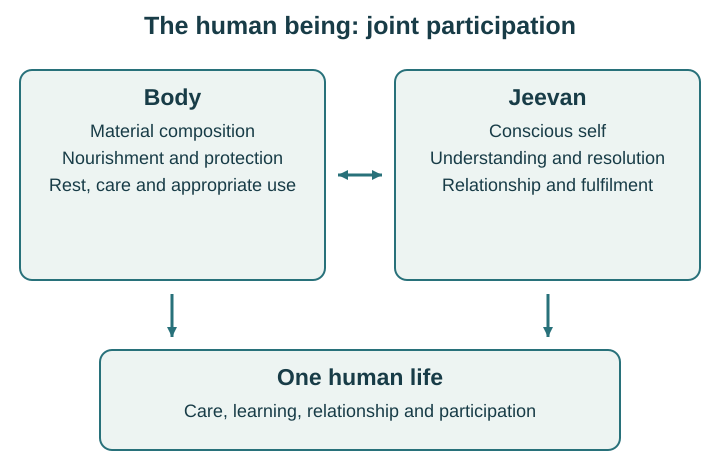
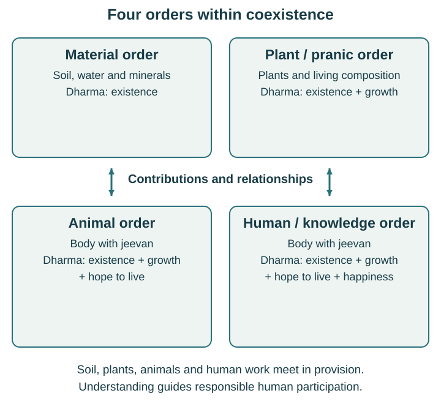
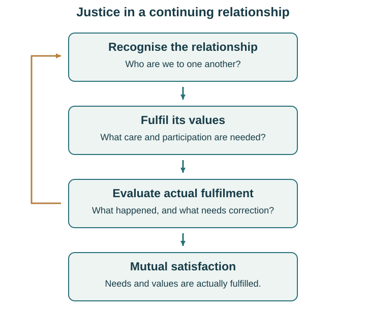
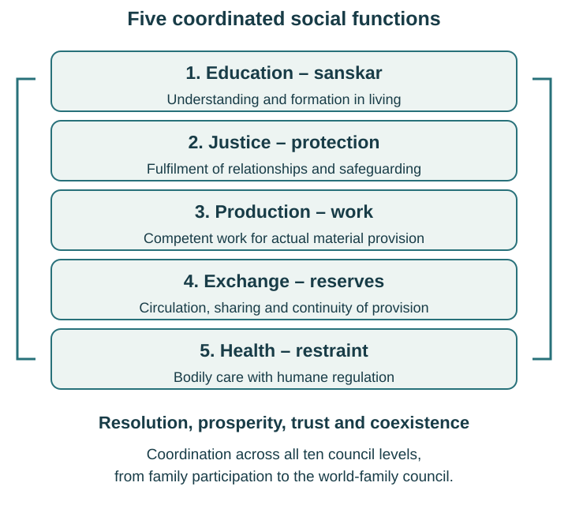

# The Human Possibility

*Understanding, Coexistence, and the Fulfilment of Life*

*An Introduction to Madhyasth Darshan*

**First manuscript draft:** October 17, 2026

## Babaji and His Wish for Humanity

**Shri A. Nagraj**

*Whom I affectionately call Babaji.*

**His wish for humanity**

> भूमि स्वर्ग हो, मानव देवता हो!
> धर्म सफल हो, नित्य शुभ हो।

> May the Earth be heaven, May humans be deities,
> May dharma prevail, May goodness be eternal.

— Shri A. Nagraj, [*Jeevan Vidya: Ek Parichay*, opening address, p. 1](https://db.madhyasth.org/books/read/107/). English translation: Rakesh Gupta, [*Jeevan Vidya: An Introduction*, p. 7](https://analyticmadhyasthdarshan.org/References/Madhyasth-Darshan/JV-Jeevan-Vidya-An-Introduction.pdf#page=8).

*Photograph: [madhyasth.org / Divya Path Sansthan](https://www.madhyasth.org/about/about-a-nagraj).*

## Preface — Understanding That Can Be Lived

We spend much of our lives learning how to earn, manage a household, care for others, and find our place in the world. Alongside these efforts, certain questions keep returning. What makes happiness dependable? What does it mean to understand another person? How much is enough? How can we live in ways that support both our own fulfilment and the lives around us?

This book introduces Madhyasth Darshan, the philosophy presented by Shri A. Nagraj, through these questions. *The Human Possibility* names the capacity to understand ourselves and the reality we belong to, fulfil our relationships, and participate consciously in humane living. What becomes possible through understanding, and what does its fulfilment require? That question connects the chapters that follow. The name Madhyasth Darshan leads into the study of mediation and orderliness in existence, and of understanding reality. Chapter 4 develops these meanings of *madhyasth* and *darshan* as part of the account itself.

Babaji wanted to see every human being live as *dev-manav*: with awakened understanding, expressed in helping others understand and in nurturing humane living together. His endeavour was to make this understanding and way of living available to everyone. The wish on the preceding page expresses this purpose. This book introduces the account of human awakening through which he proposed its fulfilment.

At its heart is the proposal that existence is coexistence. Things and beings are distinct, yet their existence is inseparable from the reality in which they are present. Human beings have the capacity to understand this and to give their participation a conscious direction. Our desire for happiness, our need for trust, and our responsibility towards nature can then be understood as parts of one life.

The pages that follow begin with familiar experiences: satisfaction in useful work, bodily needs, affection, learning, disagreement and the wish to provide for those we care about. From there, they develop a wider picture of understanding within the person, prosperity in the family, trust in society, and responsible participation with the Earth. Spiritual fulfilment belongs within this whole, finding expression in how we think, relate, work and help understanding continue. This participation also calls for practical ability, dependable conduct, material means and arrangements we sustain together.

No prior study of philosophy is assumed. Unfamiliar words are explained when they become useful. The reader is invited to consider each proposal carefully, discuss it, and examine what it would mean in living.

The hope behind this book is that a clearer understanding of life can make our everyday responsibilities more intelligible and their fulfilment more joyful. The places where this understanding matters are already before us: the people we live with, the work we undertake, and the world we share.

The family, workshop and community scenes in this book are fictional illustrations. Meera and Ravi, Ravi's mother Kamala, their college-age niece Anu, their workshop colleague Iqbal, and Iqbal's young apprentice Leela give us a connected setting in which questions can return and deepen across household, craft cooperative, study forum, and village exchange-reserve. Questions at the ends of chapters invite further observation and conversation.

This manuscript follows the approved book plan. Chapter notes identify primary sources and the page conventions used; the small glossary reconnects terms with their explanations. The book can be read continuously without memorising either. A reader who wants to examine a claim more closely can turn from its chapter to the corresponding note and then to the original work.

## Contents

**Part I — Beginning with Ourselves**

- [1. What Are We Really Looking For?](#1-what-are-we-really-looking-for)
- [2. The Body and the Conscious Self](#2-the-body-and-the-conscious-self)
- [3. Our Inner Life: Expectation, Thought, and Desire](#3-our-inner-life-expectation-thought-and-desire)

**Part II — Understanding the World We Belong To**

- [4. Existence Is Coexistence](#4-existence-is-coexistence)
- [5. Our Place in Nature](#5-our-place-in-nature)
- [6. From Assumption to Understanding](#6-from-assumption-to-understanding)

**Part III — Living Well with Other People**

- [7. What Makes Life Valuable?](#7-what-makes-life-valuable)
- [8. Trust, Respect, and Justice](#8-trust-respect-and-justice)
- [9. Family: Our First Place of Shared Living](#9-family-our-first-place-of-shared-living)
- [10. Freedom, Responsibility, and Character](#10-freedom-responsibility-and-character)

**Part IV — Bringing Understanding into Daily Life**

- [11. Caring for the Body](#11-caring-for-the-body)
- [12. Work, Wealth, and Having Enough](#12-work-wealth-and-having-enough)
- [13. Education for a Whole Life](#13-education-for-a-whole-life)
- [14. Beauty in What We Make and How We Live](#14-beauty-in-what-we-make-and-how-we-live)
- [15. Science and Technology with a Human Purpose](#15-science-and-technology-with-a-human-purpose)

**Part V — Building a Society We Can Trust**

- [16. Working Together with a Shared Purpose](#16-working-together-with-a-shared-purpose)
- [17. An Undivided Human Society](#17-an-undivided-human-society)
- [18. Living Responsibly with the Earth](#18-living-responsibly-with-the-earth)

**Part VI — The Continuity and Fulfilment of Life**

- [19. Life, Death, and What Continues](#19-life-death-and-what-continues)
- [20. Awakening in Everyday Life](#20-awakening-in-everyday-life)

- [A Small Guide to Essential Terms](#a-small-guide-to-essential-terms)
- [Sources and Further Reading by Chapter](#sources-and-further-reading-by-chapter)
- [Acknowledgements and Credits](#acknowledgements-and-credits)
- [वंदना](#vandana)

# Part I — Beginning with Ourselves

## 1. What Are We Really Looking For?

On a Saturday afternoon, Meera wipes the last coat of linseed oil across a solid wooden dining table she has spent the week building. The mortise-and-tenon joints are tight; the grain of the seasoned timber catches the afternoon light; the surface is level and smooth under her palm. Her husband Ravi helps her carry it into the courtyard room, and his mother Kamala runs a hand along the rounded edge with quiet appreciation.

Later that afternoon, Meera sits on the verandah with her college-age niece Anu, who has been living with them during her studies. For three days a tense silence has hung between them over Anu's wish to drop a commerce course that Ravi and Meera had encouraged her to take. Now, over tea, they listen to each other without hurry. Anu explains what she is actually trying to learn and why the course left her feeling hollow; Meera explains the concern for Anu's future independence that lay behind their advice. By the time they rise, the defensive knot between them has dissolved into shared clarity and mutual trust. Before evening falls, Meera and Ravi check the household pantry and workshop ledger, confirming that their grain, oil, timber stock, and repair reserves are more than sufficient for the coming season.

Looking back over the afternoon, Meera notices three distinct kinds of satisfaction. The first was physical and technical: a well-made table, a cup of warm tea, a rested body after honest labour. The second was relational and inward: clearing up a painful misunderstanding with Anu so that both of them felt understood and at peace. The third was the quiet assurance of sufficiency: knowing the household had enough useful goods for its members and for anyone who might visit or need help.

That ordinary afternoon opens the guiding question of this chapter: what kind of continuing fulfilment can human life hold? Madhyasth Darshan proposes that human beings seek happiness that does not vanish when a sensation fades, and that its basis is understanding ourselves and the reality we belong to. Understanding brings resolution, and the philosophy identifies happiness with resolution. We shall begin by examining what this connection means, and then consider how it reaches across personal clarity, family provision, social trust, and our relationship with nature.

### What do we want to continue?

The tea on the verandah is warm and fragrant, and Meera enjoys its taste. After a cup she has had enough. Drinking four more cups right away would turn pleasure into discomfort. A good meal answers hunger for a few hours; a night's sleep answers bodily fatigue. Bodily requirements are cyclical and finite: they arise, are met by appropriate material things, and return in due time.

Her wish for understanding and trust with Anu, Ravi, and Kamala has a wholly different character. Nobody says, "I would like to feel respected and at peace until four o'clock, and after that misunderstanding and resentment will be fine." We want clarity within ourselves and trust in our relationships to continue uninterrupted through ordinary days and changing circumstances.

This contrast makes the question of human happiness much more precise. We enjoy pleasant sensations and practical accomplishments, yet we also seek an unbroken basis for how we think, choose, and relate. A pleasant taste ends on the tongue, whereas the understanding gained through a resolved question remains available in the self. What we seek to continue is a resolved, fulfilling way of living across the many situations that arise.

### Happiness and resolution

Madhyasth Darshan calls happiness *sukh* and resolution *samadhan*. It identifies happiness with resolution: the settled state that arises when our questions about why and how to live are answered on the basis of reality.

It is helpful to distinguish technical know-how from existential and relational resolution. Knowing how a mortise-and-tenon joint bears weight is valuable practical science: it lets Meera build a sturdy table. Yet a person can be an expert carpenter, engineer, or physician and still feel torn by conflict at home, anxious about social status, or uncertain about the purpose of their life. Technical skill answers how to shape material things; resolution (*samadhan*) answers why we live, who we are, what our relationships call for, and how our choices fit within the larger order of existence.

Consider what changed between Meera and Anu on the verandah. As long as Meera assumed Anu was merely being impulsive, and Anu assumed her aunt cared only about conventional prestige, both felt an inner friction. Neither the newly finished table nor a plate of sweets could remove that uneasiness. When they examined their assumptions, understood each other's real concern, and agreed on a thoughtful path forward for Anu's education, the friction gave way to resolution.

When we act from unexamined assumptions, we remain vulnerable to doubt and conflict even when our material surroundings are comfortable. Understanding makes the purpose and grounds of our participation clear. We can recognise what a relationship or responsibility calls for, act toward its fulfilment, and see that fulfilment reflected in shared peace and trust. Resolution becomes evident in thought, speech, and conduct.

### Four connected aspirations

Because no human being lives in isolation, continuing fulfilment reaches beyond any one person's private mood. Our food, shelter, language, education, and work all unfold within relationships with other people and with the rest of nature. Madhyasth Darshan expresses the full reach of human fulfilment through four connected aspirations: resolution, prosperity, fearlessness, and coexistence.

**Resolution (*samadhan*)** is clarity and harmony within the person. It means understanding oneself, existence, and humane conduct so that our expectations, thoughts, and desires are free from contradiction. Resolution gives our decisions in family and work an understood direction.

**Prosperity (*samriddhi*)** is the experience of having enough—and more than enough—in the family. It joins a clear assessment of finite bodily and household needs with skilled productive work that yields more than those needs require, leaving the family with the assurance of sufficiency and the capacity to share. Food, clothing, shelter, tools, health care, and education require real material goods produced by human labour on natural resources. Chapter 12 will examine how a household assesses its needs and achieves this assurance.

**Fearlessness (*abhay*)** is living with mutual trust in society. Meera's family depends on neighbours, workshop colleagues, farmers, and countless people they will never meet. Fearlessness is not achieved merely by stronger locks or weapons; it arises when human relationships and social institutions—education, justice, production, exchange, and health care—are trustworthy, fair, and protective of everyone's development.

**Coexistence (*sah-astitva*)** is both the foundational reality of the universe and the widest horizon of human participation. Madhyasth Darshan proposes that existence itself is coexistence: distinct material and conscious units are inseparably present in an all-pervading reality. Chapter 4 develops that account. As a lived aspiration, coexistence means understanding our place among soil, water, plants, animals, and fellow human beings, receiving what sustains us, and acting in ways that preserve and replenish the natural cycles on which all life depends.

These four aspirations form a single fabric across person, family, society, and nature. Resolution in the person enables a family to recognise its real needs and work together for prosperity. Prosperous, resolved families can participate generously in building a fearless, trustworthy society. And a society guided by understanding can live in regenerating harmony with nature rather than exhausting the Earth.

### Considering a proposal

Nothing in this book asks to be accepted on authority or reverent belief. Madhyasth Darshan offers its account as a proposal for serious inquiry. At each step, the reader is invited to ask what the words mean, examine whether the distinctions hold up to rational scrutiny, and observe what happens when they are put into practice in everyday relationships and work. A familiar scene from household or workshop life can open a question and make a distinction vivid; understanding grows as we test those meanings in our own living.

### The questions ahead

Return to Meera's Saturday afternoon. The finished wooden table, the resolved conversation with Anu, and the well-stocked pantry are not competing goals; they are connected expressions of one human life. Yet they also show that a human being has requirements of two very different kinds. A table supports plates and a meal nourishes the body, while understanding and trust nourish the one who thinks, cares, and hopes. Who is the one seeking both, and how do these two kinds of need belong together in one human life? That is the question of Chapter 2.

**Questions to sit with**

1. Recall a recent moment of sensory pleasure, a moment when a misunderstanding was resolved, and a moment when you knew you had enough for a task or need. How did those three experiences differ?
2. Why does technical know-how—knowing how to build or operate something—not by itself resolve our questions about purpose and relationship?
3. In an ordinary day of your own life, how do personal clarity (*samadhan*), family sufficiency (*samriddhi*), social trust (*abhay*), and care for nature (*sah-astitva*) depend on one another?

## 2. The Body and the Conscious Self

Chapter 1 connected continuing happiness with understanding and resolution. That raises an immediate question about ourselves: who is the one fulfilled by understanding, and how does that need belong alongside the body's need for food, rest, and physical care?

On a weekday evening, Meera has a batch of glued timber frames clamping in the neighbourhood workshop that must be squared before eight o'clock. At home, her mother-in-law Kamala needs assistance with her evening walk and meal preparation. A neighbour has kindly stayed with Kamala until six, and Ravi has promised to reach home by seven to take over the rest of the evening so Meera can finish at the workshop without worry.

At a quarter past seven, Kamala calls Meera to ask whether Ravi is on his way; the neighbour has had to leave for her own family dinner. Meera tries calling Ravi, gets no answer, leaves the frames only half-finished with Iqbal, and hurries home to help Kamala. Ravi finally walks in at nine o'clock, apologetic, explaining that a colleague asked him to review a report and he lost track of time. Seeing how tired Meera is, he quickly warms the dinner and serves her a hot plate of rice, lentils, and vegetables.

Meera is genuinely hungry, and as she eats, her physical exhaustion begins to lift. Yet the knot in her chest remains untouched by the food. She had relied on Ravi's word; the neighbour had rearranged her evening around it; the workshop job was left incomplete. Why does a nourishing meal completely satisfy her hunger while leaving her concern over the broken commitment unresolved?

Madhyasth Darshan answers this question by proposing that every human being is the joint life of two distinct realities: a material body (*sharir*) and an enduring conscious self (*jeevan*). The body requires material nourishment, protection, and rest in finite quantities. The conscious self requires understanding, trust, and continuous fulfilment in living. Confusing the two leads us to offer material things where relational understanding is needed, or to neglect bodily care while talking about ideals. Understanding both in their distinctness and their cooperation lets us respond fittingly to each.

### The body and the one who understands

The body (*sharir*) is a physio-chemical, living organism composed of cells, tissues, and organs that continuously exchange matter with the surrounding environment. The conscious self (*jeevan*) is the real knower, believer, recogniser, chooser, and experiencer who animates and directs the body. When Meera asks what Ravi meant by his promise, the question, the hurt, and the search for clarity belong to *jeevan*. Speaking, hearing, cooking, and walking involve the body. Every human conversation and action is a joint participation of body and conscious self.

In Madhyasth Darshan, *jeevan* is not a poetic metaphor for brain chemistry, nor is it a person's changing social persona. Meera is simultaneously a craftswoman, a partner, an aunt, and a daughter-in-law; those roles describe relationships in which the same conscious person participates. Nor is *jeevan* merely a bundle of current opinions, for the same self can examine an old assumption, recognise its error, and come to a new understanding. Chapters 5 and 19 will examine *jeevan*'s constitution and continuity in detail; here we begin with what can be observed directly in the difference between bodily and conscious needs.

Ravi could offer Meera a second helping of lentils or buy her an expensive sweet the next day, and neither would answer the question of whether his promises can be trusted. Conversely, even the most thoughtful apology would not nourish a hungry stomach after a long day at the workbench. Each reality—body and *jeevan*—calls for its own appropriate fulfilment.

### Finite bodily capacity and the qualitative need of the self

When we compare the requirements of the body with those of *jeevan*, three clear differences emerge:

First, bodily needs are **quantitative and finite**, whereas the needs of *jeevan* are **qualitative and continuous**. As Shri A. Nagraj points out in *Karm Darshan* (*KD* p. 114), the human body and each of its sense organs have a definite, measurable capacity. A stomach holds only so much food; the skin needs clothes suited to the weather; a family needs a dwelling of a definite size. Beyond that limit, additional food causes indigestion and excess possessions become a burden to store and guard. By contrast, trust, respect, and inner resolution are not measured in kilograms or litres, and we seek their presence continuously.

Second, **sensory pleasure is transient by nature, and its transience is a signal rather than a flaw**. A delicious meal gives pleasure on the tongue while we arehungry, then naturally subsides into satiety. In *Jeevan Vidya: An Introduction* (*JV* p. 163), Nagraj observes that the temporary nature of sensory pleasure is not a defect in our bodily constitution; it is an alarm and an inspiration for awakening. It reminds the conscious self that permanent happiness cannot be extracted by forcing the sense organs to repeat pleasant sensations endlessly, and invites *jeevan* to look toward understanding and relationship where continuity is actually possible.

Third, **bodily rest and inner restfulness (*vishram*) are distinct**. After a long day of work, the body needs sleep and physical repose. Yet as *Karm Darshan* (*KD* pp. 12–13) and *Avartansheel Arthshastra* (*AA* p. 23) emphasise, people often mistake sensory indulgence, entertainment, or intoxication after work for rest, only to wake up more depleted and irritable. True restfulness (*vishram*) for the conscious self comes from family harmony, fulfilled responsibilities, and inner resolution (*samadhan*)—when the mind is no longer agitated by unexamined desires or unresolved conflicts.

### Caring for the body concretely

Recognising that *jeevan* is distinct from the body never diminishes the importance of bodily care; on the contrary, it places bodily care on a clear, rational footing. Because bodily requirements are finite and assessable, a family can understand what each person's body actually requires as capacities change over a lifetime.

A growing student like Anu, adults engaged in daily work like Meera and Ravi, and an elder like Kamala whose joints have grown stiff each have specific requirements for nourishment, rest, and physical support. Claiming that "only inner understanding matters" while leaving one family member exhausted or ignoring an elder's physical comfort would contradict the joint reality of human life. Provision for the body is therefore a shared household and social responsibility—involving time for rest, suitable tools, nourishing food, and accessible assistance.

### Sensing and acting together

Body and *jeevan* cooperate continuously in every ordinary skill. Watch Meera at her workbench paring a timber joint with a sharp chisel. Her eyes register the scribed line on the wood and her hands feel the resistance of the grain; those sensory signals travel through the bodily organs and nervous system. Yet it is *jeevan* that reads the line as a purposeful boundary, judges how much pressure to apply, notices when the blade needs honing, and cares that the table should serve the family well for decades. The body is the indispensable instrument through which *jeevan* tastes, selects, works, and communicates; *jeevan* is the conscious seer and doer that gives the body's movements meaning and direction.

When a person's bodily capacity changes—as when Kamala's grip weakens with age—the instrument requires a different tool or a helping hand, while the conscious person's dignity, wisdom, and need for respectful participation remain unchanged. Human worth is never measured by physical speed or muscular output.

*Figure 1. Distinct requirements, one joint human life. The diagram distinguishes the body and jeevan without depicting their relationship as a physical mechanism.*

### Returning to the broken promise

Once Meera has eaten and rested for a few minutes, she and Ravi sit down with Kamala to talk through what happened. Meera explains how the missed seven-o'clock handover affected the neighbour, Kamala, and the workshop job. Ravi listens without making excuses. He realises he had treated the seven-o'clock commitment as a loose intention rather than a shared dependency, assuming someone at home would cover the gap if he stayed late at the office.

Repairing the situation requires both inner understanding and a practical arrangement:
1. **Acknowledging the reality of the relationship:** Ravi recognises that Meera's work and rest, the neighbour's time, and Kamala's evening care depend on reliable follow-through.
2. **Making a realistic, communicable plan:** Because Ravi's Tuesday and Thursday reviews occasionally run past six-thirty, they agree that on those two evenings he will message by five o'clock if delayed, and Anu will be home by six to share the evening routine with Kamala.

Here bodily and conscious requirements are addressed together. The hot meal answered Meera's bodily hunger; honest acknowledgement and a realistic shared schedule answered *jeevan*'s need for trust and resolution.

This brings us directly to the next question. Before Ravi stayed late at the office, and before Meera hurried home from the workshop, an entire stream of expectations, calculations, and mental images took place inside each of them. How do expectation, thought, and desire work inside *jeevan*, why do they so often get caught in an endless loop of craving or conflict, and what can give them a coherent direction?

**Questions to sit with**

1. In your own words, what is the difference between a bodily need and a need of the conscious self (*jeevan*)? Give an example where offering a material thing fails to resolve a relational question.
2. Why does Madhyasth Darshan describe the transience of sensory pleasure as an "alarm and inspiration for awakening" rather than a flaw in the body?
3. Think of how you feel after a day of hard work when relationships at home are harmonious versus when a conflict is unresolved. How does that illustrate the difference between physical sleep and true restfulness (*vishram*)?

## 3. Our Inner Life: Expectation, Thought, and Desire

Chapter 2 distinguished the material body from the conscious self (*jeevan*) and showed how they act together. We now look inside *jeevan*'s everyday activity to see how our choices take shape—and why, without understanding, our inner life can feel endlessly restless even when our physical needs are met.

On Thursday morning, a commercial property contractor visits Meera and Iqbal's neighbourhood woodworking cooperative (`E03`). He offers a lucrative rush order for forty decorative café tables—at nearly double their usual margin—on two conditions: they must deliver within ten days by using unseasoned timber hidden under a heavy dark stain, and they must set aside the classroom benches they had promised to complete for the local primary school before term opens. That same evening at home, Anu tells Meera she wants to spend her entire three-month scholarship stipend on a branded smartphone and wardrobe upgrade so she will not feel out of place among a new group of college peers.

In both moments—in the workshop and at home—the conscious self is intensely active. Expectations are aroused, pros and cons are weighed, and different futures are pictured. Madhyasth Darshan explains this inner stream through three connected powers of *jeevan*: expectation (*asha*), thought (*vichar*), and desire (*ichha*). Understanding how these powers operate, and what directs them, reveals why human desires can either spiral into exhaustion or find a coherent, fulfilling direction.

### What we expect, consider, and imagine

Every deliberate human choice involves three inner movements working together:
- **Expectation (*asha*), expressed through the faculty of *mun*:** the activity of tasting (*aswadan*) and selecting (*chayan*) what seems pleasing or fulfilling. When the contractor names the high payout, or when Anu looks at her classmates' new phones, *mun* anticipates a taste of security, excitement, or social approval and selects an object or action to obtain it.
- **Thought (*vichar*), expressed through the faculty of *vritti*:** the activity of analysing (*vishleshan*) how to achieve a goal and deliberating or comparing (*tulan*) its worth against different criteria. Iqbal and Meera calculate timber drying times, workshop hours, and the impact on the school children; Anu weighs her book budget against the discomfort of feeling excluded.
- **Desire (*ichha*), expressed through the faculty of *chitta*:** the activity of contemplating (*chintan*) value and forming a mental image or visualisation (*chitran*) of the life or situation one wants to bring about.

Together, these flowing inner activities constitute **imagination (*kalpanasheelta*)**, and our capacity to choose and act upon them is **freedom of action (*karm-swatantrata*)**. Unlike a stone or an animal governed largely by fixed instinct, a human being can picture possibilities that do not yet exist and choose which one to enact.

### Why unawakened desires feel inexhaustible: the receding satiation point

Why, then, do human wants so often feel bottomless? In *Avartansheel Arthshastra* (*AA* pp. 17–18, 95) and *Karm Darshan* (*KD* p. 115), Shri A. Nagraj gives a precise diagnosis of what happens when *jeevan* has not yet awakened its higher faculties of comprehension (*buddhi*) and realisation (*atma*).

In its full constitution, *jeevan* possesses five faculties with ten paired activities (summarised in full in the Chapter 3 source note). When the highest two faculties—*buddhi* and *atma*—remain dormant for lack of true understanding, *jeevan* operates using only **four-and-a-half activities**: tasting and selection in *mun*, analysis and sensory-weighted comparison in *vritti*, and outward image-making (*chitran*) in *chitta*, without the contemplation of relationship and coexistence (*chintan*), comprehension of truth (*bodh*), or realisation (*anubhav*).

When those higher faculties are quiet, *jeevan* treats sensory tasting and selection (*aswadan–chayan*) as its entire business. Because *jeevan* itself is a continuous conscious unit, its thirst for happiness is continuous; but when it tries to satisfy that continuous thirst through the body's finite sense organs and status comparisons, a fundamental mismatch occurs:
1. **The inexhaustible selection–tasting loop:** Each new purchase, dish, or status display yields only a brief sensory or egoistic taste before fading. *Chitta* immediately projects a fresh image of the next object, and *mun* selects again.
2. **The receding satiation point (*tripti bindu*):** Because inner discontent in *jeevan* is misdiagnosed as a shortage of external things, a person imagines, "Once my income or possessions reach *that* level, I will finally feel content." Yet as soon as income rises to that mark, new peer comparisons and appetites push the expected **satiation point (*tripti bindu*)** further away like a mirage in the desert (*AA* p. 78; *KD* p. 115).

Anu recognises this immediately when Meera asks her what happened after her previous phone purchase a year ago. The excitement of unboxing it lasted less than a week; what Anu was actually seeking was respect and belonging among her peers—a qualitative need of *jeevan* that no gadget could secure.

### Pleasantness, Bodily Benefit, and Gain versus Justice, Dharma, and Truth

What determines how *vritti* evaluates a choice and what *chitta* desires? Madhyasth Darshan identifies two complete evaluative perspectives (*drishti*):

The first is the sensory and self-centred triad of **pleasantness, bodily benefit, and gain (*priya–hita–labha*)**:
- **Pleasantness (*priya*):** what feels immediately agreeable to the senses or flattering to personal impulse.
- **Bodily benefit (*hita*):** what preserves or comforts one's own body and narrow household convenience.
- **Gain (*labha*):** getting more in return than the labour or value one has actually contributed—profiting at another's expense.

Sensory pleasantness and bodily health have a legitimate, necessary place when kept within humane bounds. The distortion arises when *priya–hita–labha* becomes the supreme compass of life, especially when *labha*—extractive profit—governs economic and personal decisions. Judged by *labha*, the contractor's offer looks irresistible: stain the wet wood, pocket double the money, and let the café buyer discover the warped tabletops six months later when the joints split.

The second perspective is the humane triad of **justice, dharma, and truth (*nyaya–dharma–satya*)**:
- **Justice (*nyaya*) in behaviour:** recognising human relationships and fulfilling their values to mutual satisfaction.
- **Dharma in thought:** thinking and resolving in alignment with universal orderliness (*vyavastha*) and human happiness rather than sectarian or selfish advantage.
- **Truth (*satya*) in understanding and realisation:** knowing reality as coexistence—distinct units inseparably present in all-pervading *satta*.

Notice that these two triads do not convert one-to-one (pleasantness does not turn into justice, nor profit into truth). Rather, when a person awakens to **justice, dharma, and truth as a complete perspective**, that higher triad governs every decision and places sensory pleasure and bodily health in their rightful, regulated role while eliminating extractive profit (*labha*) altogether.

### Natural acceptance: the compass already within us

How can Meera, Iqbal, or Anu step back from the pull of quick money or peer pressure? Madhyasth Darshan points to **natural acceptance (*sahaj swikriti*)**: even before a person has studied philosophy or achieved complete understanding, *jeevan* innately accepts justice, dharma, and truth as what it truly wants (*AVD* p. 156).

Ask anyone calmly whether they want to be deceived by a carpenter who hides wet wood under dark varnish, or whether they want to be respected for who they are rather than the price of their phone. No one naturally accepts being cheated, nor does anyone feel genuine inner peace in cheating another. Natural acceptance is different from a passing impulse or an unexamined habit: an impulse may tempt Iqbal toward the rush payout, and peer anxiety may push Anu toward the status purchase, yet the moment they pause and ask what is genuinely acceptable to them in relationship and orderliness, their own natural acceptance points toward honesty, usefulness, and self-respect.

### Following an action into its four aspects

In Madhyasth Darshan, human action (*karma*) is examined across four connected channels: bodily action (*kayik*), speech (*vachik*), mental planning (*manasik*), and the underlying stream of expectation, thought, and desire (*asha–vichar–ichha*).

We can see all four come into alignment in the workshop. Meera and Iqbal examine the contractor's proposal together. They recognise that hiding unseasoned timber under dark stain would violate both the usefulness of the tables and their relationship with the buyer, while breaking their word to the primary school would harm thirty children waiting for benches. Speaking plainly (*vachik*), they decline the deceptive rush terms and offer an honest alternative: they will complete the school benches on schedule and can build the café tables over six weeks using properly seasoned timber at their standard, transparent remuneration for labour and materials. The contractor takes half his order elsewhere and leaves twenty tables with them on honest terms. At home, Anu decides to keep her working phone, uses a small part of her stipend for books and a workshop design notebook, and invites two classmates to study in the courtyard—discovering that real friendship grows through shared learning rather than status display.

### What gives a whole life its direction?

When we step back from a single decision to the pattern of a whole life, the governing perspective distinguishes two broad modes of human living:
- **Animal-like consciousness (*jeev-chetna*):** living governed by *priya–hita–labha* because one identifies the self with the body. Here human imagination is spent amplifying the **four bodily preoccupations (*char vishaya*)**—eating (*ahar*), sleeping (*nidra*), fear/self-defence (*bhaya*), and sexual activity (*maithun*)—into the **three obsessions (*teen unmad*)**: obsession with sexual indulgence (*kam-unmad*), obsession with sensory consumption (*bhog-unmad*), and obsession with profit and accumulation (*labha-unmad*).
- **Humane consciousness (*manav-chetna*):** living governed by *nyaya–dharma–satya* on the basis of understanding body, *jeevan*, and coexistence.

In *manav-chetna*, those obsessive pursuits are replaced by **three humane motives (*eshana*)** that direct human energy toward universal well-being:
1. **The aspiration for capable progeny and continuity (*putreshana*):** raising and educating the next generation as wise, productive participants in family and society (developed in Chapter 9).
2. **The aspiration for rightful wealth and prosperity (*vitteshana*):** producing and stewarding material resources beyond family need for right use and benevolence (developed in Chapter 12).
3. **The aspiration for public goodwill and undivided society (*lokeshana*):** contributing to social orderliness so that humane living is recognised and established for all (developed in Chapter 17, and compared across higher stages of awakening in Chapter 20).

Expectation, thought, and desire find their coherence when guided by truth, dharma, and justice. Yet truth cannot remain a mere word: what is the actual reality of the universe to which *jeevan*, the body, the timber, and other people belong? That is the subject of Part II, beginning in Chapter 4.

**Questions to sit with**

1. Trace expectation (*asha*), thought (*vichar*), and desire (*ichha*) in a choice you recently faced. How did they interact?
2. Why does Shri A. Nagraj say that when inner discontent is misread as a lack of material goods, the "satiation point" (*tripti bindu*) recedes like a mirage as income rises? Have you observed this in your own experience?
3. How does evaluating a decision through the whole triad of justice, dharma, and truth (*nyaya–dharma–satya*) differ from evaluating it through pleasantness, bodily benefit, and gain (*priya–hita–labha*)?

# Part II — Understanding the World We Belong To

## 4. Existence Is Coexistence

In Part I we saw that our inner life of expectation, thought, and desire seeks a truthful basis beyond fleeting impulse. To judge whether our thoughts accord with reality, we must ask the most foundational question of philosophy: what is reality? What is the nature of the world to which we, our families, and the things around us belong?

On a quiet Sunday morning, Anu sits in the courtyard reading corner (`E04`). On the small wooden table before her rest a smooth river stone she uses as a paperweight, a clay cup of cooling tea, and an open notebook. Beside the low wall grows a potted basil plant; a sparrow hops along the brick ledge; across the courtyard Meera and Kamala are conversing softly. Every object and living being in the courtyard has a distinct boundary, size, and activity. Yet none of them floats in isolation. What holds them together, and what is present between and within them?

Madhyasth Darshan's central proposition is that **existence is coexistence (*astitva sah-astitva hai*)**. Reality is not a chaos of colliding atoms, nor an illusion spun by consciousness, nor a world awaiting periodic interventions from outside. Existence is the eternal, self-existing harmony of two distinct realities: bounded, active **units (*ikai*)** of nature, and the unbounded, activity-free, all-pervading reality called ***satta*** (also termed pervasive space, *vyapak*), in which every unit is inseparably present.

### Distinct units and the pervasive expanse: an experiential bridge

How can a reader begin to grasp a reality that is not a bounded object? We can build an experiential bridge right from the courtyard where Anu is sitting.

Look first at the river stone, the clay cup, the basil plant, the sparrow, and Anu herself. Each of these is a **unit (*ikai*)**. Every unit has four unmistakable features:
1. It is **bounded (*seemit*)**: the stone ends at its smooth surface; the cup has a rim and base; the sparrow occupies a definite small volume.
2. It is **countable**: there is one stone, one cup, two chairs, three people.
3. It is **active (*kriyasheel*)**: the tea is cooling, the plant is transpiring, the sparrow's heart is beating, and Anu's conscious self is thinking.
4. It **interacts with and resists other units**: two stones cannot occupy the same spot on the table at the same time.

Now ask: what allows the stone, the cup, the air molecules, and the sparrow to exist where they are and to move without hitting a wall of "nothingness"? Common habit calls the interval between the stone and the cup "empty space," imagining that space exists only in the gaps where solid matter is absent, or confusing space with the invisible mixture of nitrogen and oxygen we call air.

Madhyasth Darshan invites us to look more carefully. Air is not space; air is a collection of millions of tiny material units (gas molecules) moving, warming, and cooling. And what if we look inside the solid river stone or inside the atoms that compose it? Modern physics and philosophical reflection alike recognise that an atom is not a solid marble stuffed to the brim; its constituent particles move at vast relative distances from one another. What is present *inside* the atom, *through* the dense heart of the river stone, *within* Anu's conscious self, and *between* Earth and the distant stars?

That unbroken, boundaryless, activity-free reality is ***satta*** (pervasive space, *vyapak*). Unlike units, *satta* has no boundary, cannot be cut into pieces, performs no physical or chemical activity (*kriya-shunya*), and offers zero resistance (*apratighat*) to the presence or movement of any unit. It is not pushed aside when Meera carries a table into the room; it is equally and continuously present *within*, *around*, and *between* every material particle and every conscious self.

### Submerged, surrounded, and soaked: *sampriktata*

Because *satta* is present everywhere without gaps and every unit is bounded, no unit can ever fall outside *satta* or be separated from it. Madhyasth Darshan calls this inseparable relationship **co-presence or saturation (*sampriktata*)**, and unfolds it through three vivid terms: every unit in nature is **submerged (*dooba*)**, **surrounded (*ghira*)**, and **soaked (*bheega*)** in all-pervading *satta*.

In everyday speech, we might picture a cotton cloth dipped in a bucket of water—submerged in the bucket, surrounded by water on all sides, and soaked through every thread. Water, of course, is still a bounded liquid made of molecules, whereas *satta* is the non-material, all-pervading reality. Yet the three words point to three profound ontological consequences of being inseparably in *satta* (*SB* p. 57; *MVD* pp. 32–35):
- Because every unit is **submerged (*dooba*)** in *satta*, every unit is continuously **active (*kriyasheel*)** and **energised (*urjasampanna*)**. In Madhyasth Darshan, *satta* in co-presence with nature acts as **equilibrium energy (*samya-urja*)**—without spending or transforming itself, its pervasive presence is the ground in which every unit remains effortlessly active forever, needing no external engine to wind up the universe.
- Because every unit is **surrounded (*ghira*)** by *satta* on every side, every unit is **self-regulated (*niyantrit*)** within definite boundaries and relationships, enabling lawful order rather than collision.
- Because every unit is **soaked (*bheega*)** through and through by *satta*—down to its smallest constituent particle and throughout every faculty of *jeevan*—every unit is **endowed with force and potential (*balsampanna*)** and capable of participating with others.

This gives the words "energy" and "space" a clear philosophical meaning before we compare them with laboratory measurements. Physical instruments measure relative transfers of heat, motion, or radiation between one unit and another; *satta* names the unchanging, all-pervading ground in which all those active units exist, cohere, and interact.

### Activity, law, and the human difference

Throughout nature, therefore, existence is never static. Material atoms combine into molecules and dissolve again; plants draw water and minerals into living cells; bodies grow and age; conscious selves expect, think, and desire. All of this activity unfolds within **law (*niyam*)**—the definite, uncontrived order inherent in coexistence.

Here, however, lies the decisive distinction for human beings. Every stone, plant, animal, and human being *already exists* within coexistence; no one has to invent coexistence or join it by signing a contract. A person acting selfishly or destructively is still sitting inside *satta* and breathing air produced by plants. The human question is not whether we belong to coexistence, but whether we **understand** the coexistence we belong to and align our imagination and conduct with its law. Delusion (*bhram*) is living in coexistence while assuming we are isolated competitors in a scarcity-ridden world; awakening (*jagriti*) is knowing coexistence and fulfilling our relationships within it.

### The name *Madhyasth Darshan*

We can now appreciate the full meaning of the philosophy's name. ***Darshan*** means direct vision or realistic comprehension of reality as it is—knowing why and how things exist so that doubt disappears. ***Madhyasth*** refers to the mediating, balancing reality and power through which opposing tendencies (such as formation and dissolution, or attraction and repulsion) are held in harmonious order. It does not mean splitting the difference in a diplomatic compromise between two mistaken opinions. *Madhyasth Darshan* is the realistic study and realisation of coexistence, equilibrium, and harmony across the whole of existence.

It also clarifies what the philosophy means by spirituality (*adhyatma*), to which Chapter 20 will return. Because all-pervading *satta* is present right here—within and between Anu, Meera, Kamala, the basil plant, and the river stone—realising ultimate reality never requires turning our backs on family, work, or the Earth. To understand *satta* and units together is to see why every relationship in the world matters.

What, then, are the different kinds of units that populate this world of coexistence, and how do stones, plants, animals, and human beings fit together in nature's order? Anu steps from the reading corner into the courtyard garden, where Chapter 5 takes up that question.

**Questions to sit with**

1. Using the objects around you right now, how would you explain the difference between bounded, active units (*ikai*) and all-pervading, activity-free *satta*?
2. Why is *satta* not simply "empty gaps between things" or "the air in the room"? What does it mean to say that *satta* is present *within*, *around*, and *between* every unit?
3. What do the three terms *submerged* (*dooba*), *surrounded* (*ghira*), and *soaked* (*bheega*) explain about why units in nature are continuously active, regulated, and forceful?

## 5. Our Place in Nature

In Chapter 4 we examined existence as the coexistence of bounded, active units (*ikai*) within all-pervading *satta*. When we look across the world of units, however, we immediately see that not all units act in the same way. A stone does not sprout leaves; a bean vine does not run to the gate to greet a friend; a dog does not sit down to ask whether its livelihood is just or whether its workshop uses resources sustainably. How is the rich diversity of nature organised, and what is humanity's distinctive place within it?

Later that Sunday morning, Anu steps into the courtyard garden (`E05`) while Ravi waters the vegetable beds. Around them are four unmistakable kinds of realities:
1. **Soil, stones, water, and air** along the garden bed and path.
2. **A climbing bean vine, basil bushes, and a mango tree** drawing water and minerals from the soil to grow leaves, blossoms, and fruit.
3. **A neighbourhood dog** resting in the shade, alert to sounds at the gate, seeking food and physical safety, along with **sparrows and bees** moving among the branches.
4. **Anu, Ravi, Meera, and Kamala**, who not only eat, breathe, and care for their bodies, but also ask *why* things happen, reflect on fairness, design tools, and seek continuing happiness.

Madhyasth Darshan organises the entire world of units into these **four connected orders of nature (*char avastha*)**: the material order (*padarth avastha*), the vital or plant order (*pran avastha*), the animal order (*jeev avastha*), and the human or knowledge order (*gyan avastha*). Understanding their properties, their innate tendencies, and their mutual complementarity reveals why the first three orders are already in self-regulated balance—and why human beings hold the unique responsibility of completing that balance through understanding.

### Four orders in one courtyard

Let us look closely at the four orders present in the garden:
- **The material order (*padarth avastha*)** includes soil, stones, minerals, water, air, metals, and all non-living physical and chemical formations from subatomic particles to stars and planets. Its units continuously undergo composition and decomposition (*sanghatan–vighatan*).
- **The vital or biological order (*pran avastha*)** includes all plants, trees, grasses, fungi, and cellular organisms—and also the physical, cellular bodies of animals and human beings. Built upon material elements through breath and fluid circulation (*pran-sutra*), its units grow, assimilate nourishment, reproduce, and decay back into the soil.
- **The animal order (*jeev avastha*)** consists of a living biological body (*sharir*) joined with a conscious self (*jeevan*). The dog in the courtyard and the sparrow in the tree do not merely grow like a vine; they experience sensory pleasure and pain, remember places, protect their offspring, and actively express the **will to live (*jeene ki asha*)**.
- **The human or knowledge order (*gyan avastha*)** also consists of a biological body joined with a conscious self (*jeevan*). What distinguishes the human order is that human *jeevan* seeks not merely to survive, but to **know reality (*janna*) and live in continuous happiness (*sukh*)**. Calling humanity the "knowledge order" names our defining potential and responsibility: without acquiring true understanding, a human being remains unfulfilled even when physically well fed.

### Four questions about every unit: *rupa, guna, swabhava, dharma*

Madhyasth Darshan shows that every unit in any of the four orders can be understood completely through four inseparable aspects:
1. **Form (*rupa*):** its observable shape, surface area, volume, and density (such as the colour and shape of the bean vine or the weight of the stone).
2. **Properties (*guna*):** its relative effects in interaction with other units—whether generative/augmenting (*srijanatmak*), sustaining/mediative (*madhyasth*), or degenerative/depleting (*hrasatmak*).
3. **Characteristic nature (*swabhava*):** its characteristic mode of functioning and participation in its order. The *swabhava* of the material order is composition and decomposition (*sanghatan–vighatan*); of the plant order, enhancing or worsening other living compositions (*saraka–maraka*, as nourishing grain or toxic weed); of the animal order, non-cruel or cruel behaviour (*akrurata–krurata*, as herbivore or predator); and of an awakened human being, **steadfastness in justice (*dhirata*), courage for justice (*virata*), and generosity (*udarata*)**, together with **kindness (*daya*), grace (*kripa*), and compassion (*karuna*)**—whereas in delusion human beings fall into **wretchedness (*deenta*), slyness/inferiority (*heenta*), and cruelty (*krurata*)**.
4. **Innateness (*dharma*):** that which a unit inseparably holds and cannot drop while remaining in its order—its core existential adherence.

### Cumulative innateness (*dharma*) and the human wish for happiness

Look at how innateness (*dharma*) builds cumulatively across the four orders:
- **Material order (*padarth avastha*):** its *dharma* is **existence (*astitva* / *hona*)**—it exists indestructible as matter through all changes of form.
- **Vital/plant order (*pran avastha*):** its *dharma* is **existence + growth (*pushti*)**.
- **Animal order (*jeev avastha*):** its *dharma* is **existence + growth + the will to live (*jeene ki asha*)** in *jeevan*.
- **Human order (*gyan avastha*):** its *dharma* is **existence + growth + the will to live + happiness (*sukh* through resolution, *samadhan*)**.

Notice how illuminating this cumulative map is. Here *dharma* does not mean a sectarian badge, ritual code, or caste duty; it means the intrinsic nature that no unit can renounce. Just as water cannot stop existing and a healthy seed in moist soil cannot refuse to grow, a human being cannot stop wishing for happiness (*sukh*). Even when a person makes a disastrous, self-defeating choice, they do so under the mistaken assumption that it will bring them relief or happiness. And because human *dharma* is happiness—which is fulfilled only through understanding and resolution (*samadhan*)—human beings can never settle permanently into mere animal survival (*jeene ki asha* alone).

*Figure 2. Four orders within coexistence. The innateness shown is cumulative in the source account; the arrangement is a map of distinctions and complementarity, not a timeline of species evolution.*

### Why the first three orders are in balance—and what humanity must learn

Watch how the first three orders interact in the courtyard garden. Soil, water, and air nourish the bean vine and mango tree; fallen leaves and plant roots enrich and hold the soil, while transpiration and shade cool the air and conserve moisture. Birds and insects pollinate blossoms, feed on fruit and seeds, and return organic fertility to the earth; when their bodies die, they decompose back into the material and plant orders.

In *Avartansheel Arthshastra* (*AA* pp. 41–42, 117), Shri A. Nagraj highlights a crucial contrast across the four orders:
- **The first three orders (*padarth, pran, jeev*) are already regulated by natural law (*niyam*), self-controlled (*niyantran*), and in mutual balance (*santulan*).** Each of them is naturally complementary (*purak*) both to the other orders and to human beings. Soil does not go on strike against plants; trees do not hoard carbon or poison the water table; animals take only what their bodies require and remain within ecological balance.
- **The fourth order (humanity) is the sole exception while living in delusion.** Because human beings possess expansive imagination (*kalpanasheelta*) and freedom of action (*karm-swatantrata*), our conduct is not fixed by automatic biological instinct. When human imagination is driven by profit-mania (*labhonmad*) and consumption-mania (*bhogunmad*), we strip forests, exhaust aquifers, mine fossil fuels faster than Earth can regenerate them, and exploit fellow human beings. Yet that very same freedom of imagination gives humanity the power to **understand nature's laws (*niyam*) and live in conscious self-regulation (*niyantran*) and balance (*santulan*)**.

### Material and conscious nature: development (*vikas*) and awakening (*jagriti*)

How do these four orders relate to the distinction between matter and consciousness? Madhyasth Darshan groups all units into two fundamental kinds of nature:
- **Insentient or material nature (*jada prakriti*):** atoms and molecules of the material and biological orders, whose activity is bounded by physical and chemical forces.
- **Conscious nature (*chaitanya prakriti*):** the conscious unit (*jeevan*), which animates animal and human bodies.

How does a material atom differ from a conscious *jeevan* atom? In the philosophy's ontological account (detailed in the Chapter 5 note), material atoms constantly gain or lose subatomic particles when subjected to heat, pressure, or chemical reaction. Through the long cosmic process of **development-progression (*vikas-kram*)**, an atom reaches **constitutional completeness (*vikas* / *gathan-poornata*)**: a stable, weightless, indestructible atomic structure that can never again lose or gain a particle, and in which the conscious powers of tasting, thinking, desiring, comprehending, and realising are permanently active. That constitutionally complete atom is ***jeevan***.

This distinction prevents a common confusion between biological evolution and conscious awakening. Every human *jeevan* and every animal *jeevan* is **already constitutionally complete (*gathan-poorna*)**. In the human order, what remains to be achieved is not a change in atomic structure, but **awakening-progression (*jagriti-kram*)** culminating in **awakening (*jagriti*)**—achieving **completeness of conscious activity (*kriya-poornata*)** through understanding reality, and **completeness in conduct (*acharan-poornata*)** by living with justice, resolution, and complementarity in family, society, and nature.

Thefirst three orders of nature are already fulfilling their part around us every day. For human beings to fulfil ours, we must move from unexamined assumptions to genuine knowledge. How does a person move from merely repeating a philosophical phrase or a cultural belief to actually knowing and living it? That is the question of Chapter 6.

**Questions to sit with**

1. Look at a stone, a plant, an animal, and a human being through the four aspects of form (*rupa*), relational properties (*guna*), characteristic nature (*swabhava*), and innateness (*dharma*). What does this fourfold view reveal that looking only at physical form misses?
2. Why are the first three orders of nature already in balance (*santulan*) with one another, whereas the human order achieves balance only through understanding and cultured formation (*sanskar*)?
3. What is the difference between constitutional completeness (*gathan-poornata*), completeness of conscious activity (*kriya-poornata*), and completeness in conduct (*acharan-poornata*)?

## 6. From Assumption to Understanding

Chapters 4 and 5 laid out a sweeping proposal about existence and nature: reality is coexistence, every unit is inseparably present in all-pervading *satta*, and human beings belong to the knowledge order whose *dharma* is happiness through resolution. Yet hearing or reading a grand philosophical statement does not automatically make it our own understanding. How does an idea we hear in a book or a study group move from a borrowed assumption to living knowledge?

On Sunday afternoon, Ravi and Meera host a small fortnightly study conversation in their courtyard (`E06`). Anu arrives with her notebook and brings up two statements that have been pulling her thought in opposite directions all week.

In her college economics tutorial on Friday, the lecturer had stated as an indisputable axiom: *"Every human being ultimately acts out of self-interest, and human wants are infinite while resources are scarce; society can only manage the resulting competition through prices and legal incentives."* Then, looking down at her study notes from home, Anu points to the sentence she wrote the previous weekend: *"Existence is coexistence, and human beings naturally accept justice and resolution."*

"I can repeat both sentences," Anu says honestly. "In the classroom, the competition model sounds realistic because I see people scrambling for grades and status every day. Here in the courtyard, coexistence sounds inspiring because I see how our family and Iqbal's workshop actually care for people. How do I know whether 'existence is coexistence' isn't just a comforting belief we repeat to feel good—and how does a statement in a notebook become something I genuinely *know*?"

Anu's question goes to the heart of Madhyasth Darshan's epistemology. The philosophy does not ask anyone to trade one set of memorised dogmas for another. Instead, it explains the exact relationship between **knowing, believing, recognising, and fulfilling**, defines the **three domains of complete knowledge**, and maps the step-by-step path by which a learner moves from listening (*shravan*) and rational reflection (*manan*) to direct comprehension (*bodh*) and realisation (*anubhav*) evidenced in daily living (*praman*).

### Knowing, Believing, Recognising, and Fulfilling

Every human interaction with the world involves four connected activities: **knowing (*janna*), believing or accepting (*manna*), recognising (*pahchanna*), and fulfilling (*nirvah karna*)** (*JV* pp. 72–74).

In nonhuman nature, **recognising and fulfilling** happen lawfully and automatically: water recognises soil and roots and fulfils its relation by moistening them; a seed recognises warmth and moisture and sprouts. Human beings, however, do not act by automatic chemical recognition. In human life, **how we recognise a relationship and how we fulfil it always follow what we believe (*manna*)**.

Consider Anu's two classroom and household examples:
- If a person **believes (*manna*)** without examination that "every human being acts only for selfish advantage and wants are infinite," they will **recognise (*pahchanna*)** every neighbour, colleague, and family member as a potential competitor or instrument of utility, and they will **fulfil (*nirvah karna*)** their relationships through guarded contracts, bargaining, and accumulation.
- If a person merely **believes (*manna*)** the slogan "existence is coexistence" because they admire a teacher, their conduct may look polite while things are easy, but the moment a conflict or financial pressure arises, their unexamined underlying fear will take over.
- When **believing (*manna*) is grounded in knowing (*janna*)**—in clear, verified understanding of reality—then our recognition of relationships becomes exact and our fulfilment becomes reliable across changing circumstances.

### Unexamined belief (*manyata*), delusion (*bhram*), and truth (*satya*)

Madhyasth Darshan calls an unexamined or socially inherited belief ***manyata***. A *manyata* may come from a textbook, a market ideology, a religious tradition, or a family habit. When what we accept in *manyata* differs from what actually exists in reality—such as assuming that the conscious self is just the body, that money is real wealth, or that human happiness comes from outcompeting others—that gap between assumption and reality is **delusion (*bhram*)**.

Here "delusion" is not an insult or a psychiatric label; it simply names taking something to be other than what it is (*MVD* p. 76). Let Ravi and Meera walk Anu through the college lecturer's axiom to test whether it rests on knowing (*janna*) or on an incomplete assumption (*manyata*):
1. **Why do human wants *appear* infinite in contemporary society?** Because, as we saw in Chapter 3, when the conscious self (*jeevan*) is not understood, people try to satisfy *jeevan*'s continuous need for happiness and respect through finite bodily consumption and status display (*priya–hita–labha*). The lecturer observed a real symptom of unawakened living, but mistook that symptom for universal human nature.
2. **Do people actually want conflict and exploitation?** When we check our own **natural acceptance (*sahaj swikriti*)**, even the person arguing that "everyone is selfish" feels indignant when a friend betrays them or a seller cheats them—showing that *jeevan* innately expects trust and justice, even when it does not yet know how to fulfil them.

**Truth (*satya*)** in Madhyasth Darshan is reality as it actually is: existence as coexistence—active material and conscious units inseparably saturated in all-pervading *satta*. Checking a factual detail (such as whether a ledger sum is accurate) is ordinary honesty in speech; knowing *satya* in its full philosophical sense means understanding the enduring reality of coexistence, the conscious self, and the laws of humane living.

### What is to be known? The three contents of knowledge

If believing must be grounded in knowing (*janna*), how vast is the territory a human being needs to know in order to live with complete resolution? Do we have to memorise every chemical compound and historical date in the universe?

Madhyasth Darshan answers that complete, liberating knowledge (*gyan*) consists of **three interconnected domains** (*MVD* p. 127):
1. **Knowledge of coexistence (*astitva-darshan-gyan*):** understanding existence as bounded material and conscious units inseparably submerged, surrounded, and soaked in all-pervading *satta*, along with development (*vikas*) and awakening (*jagriti*) across the four orders of nature.
2. **Knowledge of the conscious self (*jeevan-gyan*):** understanding the constitution, five faculties, and ten activities of *jeevan*, its relationship with the body, its enduring continuity, and why its innate *dharma* is continuous happiness.
3. **Knowledge of humane conduct (*manaviyata-poorna-acharan-gyan*):** understanding how an awakened human being lives in family, society, and nature through the thirty values, the three pillars of humane character (*swa-dhana, swa-nari/swa-purusha, daya*), ethics (*niti*), and the five social functions of an undivided society.

Notice how these three domains answer our deepest questions as a single whole: *What is the world I belong to? Who am I as the one experiencing and choosing? How then shall I live with others and with the Earth?*

### How a proposal becomes understanding: *shravan, manan, arth-bodh*

How does a learner like Anu move from hearing these proposals to knowing them for herself? The study process begins with three connected steps (*MVD* p. 257):
- **Listening (*shravan*):** receiving the words and definitions of the proposal attentively, making sure we understand what the speaker or text is pointing toward rather than immediately projecting our old definitions onto the words.
- **Rational reflection (*manan*):** weighing and testing the proposal logically in one's own thought (*vritti* and *mun*)—asking whether it is internally consistent, whether it holds universally across people and nature, and whether it resolves the contradictions left by our previous assumptions.
- **Grasping the meaning (*arth-bodh*):** arriving at a clear intellectual grasp of the reality to which the words refer, so that one can explain the principle in one's own words and apply it to new situations without relying on memorised slogans.

### Study, practice, direct recognition, comprehension, and realisation

Beyond initial grasping of meaning, Madhyasth Darshan outlines the complete arc of learning through three movements (*MVD* p. 88): **study (*adhyayan*)**, **experiment and practice in behaviour and work (*prayog aur abhyas*)**, and **realisation with living evidence (*anubhav aur praman*)**.

Within the conscious self (*jeevan*), this ripening of knowledge unfolds through four distinct milestones (*MVD* p. 126):
1. **Direct recognition (*sakshatkar*):** through sustained reflection and contemplation in *chitta*, the real nature, value, and purpose (*swabhava, mulya, lakshya*) of relationships and units are directly recognised, dissolving our attachment to false appearances.
2. **Comprehension (*bodh*):** in the faculty of *buddhi*, those invariant principles of reality are comprehended as settled, unshakeable understanding, awakening firm resolve (*sankalp*).
3. **Realisation (*anubhav*):** in the innermost faculty of *atma*, *jeevan* realises its own inseparable presence and harmony within all-pervading coexistence (*satta*).
4. **Evidence (*praman*):** that inward realisation expresses itself naturally and continuously in living—as resolution in thought, justice in behaviour (*vyavahar-praman*), and cyclical prosperity in work (*karya-praman*).

In Madhyasth Darshan, "seeing" truth (*darshan* and *sakshatkar*) is not a mystical hallucination of lights with closed eyes, nor is it sensory perception through the physical eyeballs; it is the lucid, wide-awake comprehension by *jeevan* of reality as it is, verified by how a person lives with others.

### Understanding that can travel

By the end of the Sunday afternoon conversation, Anu closes her notebook with a very different posture toward both her college tutorial and her home study. The next week, when her tutorial group debates a case study on local water pricing, Anu does not merely repeat a memorised slogan from either camp. She distinguishes the finite bodily need for domestic water from speculative industrial extraction, explains why pricing alone fails to protect an aquifer when profit (*labha*) is the goal, and shows how household need assessment and community stewardship change the problem. Her understanding has begun to travel on its own feet.

Once we begin to move from unexamined assumptions to understanding reality, what do we actually recognise as valuable in our lives, in our relationships, and in the things we make and use? Part III turns to living well with other people, beginning in Chapter 7 with the question: *What makes life valuable?*

**Questions to sit with**

1. Take a widely repeated belief in contemporary culture (for example, "human wants are infinite" or "money is the measure of success"). Follow how **believing (*manna*)** that assumption shapes what a person **recognises (*pahchanna*)** in others and how they **fulfil (*nirvah karna*)** relationships.
2. Why do the three contents of knowledge—coexistence (*astitva-darshan-gyan*), the conscious self (*jeevan-gyan*), and humane conduct (*manaviyata-poorna-acharan-gyan*)—belong together? What happens if one of the three is left out?
3. How does grasping the meaning of a proposal through rational reflection (*shravan–manan–arth-bodh*) differ from memorising a teacher's words?

# Part III — Living Well with Other People

## 7. What Makes Life Valuable?

On Sunday afternoon, the household gathers to celebrate Kamala's seventieth birthday. Ravi has cooked a festive meal with vegetables from the courtyard garden, Meera has arranged a low cushioned seat where Kamala can sit comfortably at the centre of the room, and Anu presents her grandmother with a large-print edition of poems she had been hoping to read, inscribed with a note thanking her for years of patient listening. Kamala asks everyone who has been serving to bring their plates and sit down together.

Later, while the others clear the dishes, Anu sits beside Kamala on the veranda and remarks how quickly a special day passes. For a week everyone plans and anticipates the celebration, yet within two hours the meal is eaten and the guests have gone home. Kamala smiles and tells her that earlier in life she often confused the excitement of an occasion with happiness itself. When an event ended, the quiet felt like an emptiness that needed another purchase or another distraction to fill it. Over time, she explains, she began to notice a very different kind of fullness—one that does not vanish when the dishes are washed: the steadiness of knowing that relationships in the home are free of resentment, that the family's work is honest and sufficient for its needs, and that her own thoughts are not at war with one another.

What makes a meal, a gift, a relationship, or a human life valuable? In ordinary speech we often use the word *valuable* for whatever commands a high market price because it is scarce. Yet air, water, a mother's care, and a trustworthy word are indispensable to life precisely because they are meant to be abundant and dependable. Madhyasth Darshan defines **value (*mulya*)** not by scarcity or price, but by **meaningful participation and definite fulfilment in relationship**: what a unit or person is able to fulfil in the larger order, and how that fulfilment is experienced and verified.

### Value as definite participation

Return for a moment to the birthday meal. At least four distinct kinds of contribution are taking place simultaneously:
1. **In useful objects:** The cooked grain and vegetables nourish the body, and the large-print book makes reading effortless for ageing eyes. Their value lies in their usefulness (*upayogita*) and the care of their form (*kala*).
2. **In expressed behaviour and established relationships:** Anu's inscription and Meera's thoughtful seating arrangement express gratitude (*kritagyata*), care (*mamata*), and respect (*samman*) between members of a family.
3. **In humane character and qualities:** The willingness of the adults to use their strength, skill, and savings to support one another's health and learning reflects steadfastness, courage, and generosity.
4. **Within the conscious self (*jeevan*):** In Kamala and in those around her, living in harmony with understood relationships yields an inward state of happiness, peace, and contentment.

Price cannot measure all four of these dimensions. Knowing what the grain cost in the market tells us nothing about whether the meal was shared with affection or eaten in tense silence. Knowing the modest price of Anu's book does not measure the gratitude it expressed. Understanding value requires seeing each level of participation in its own right—and seeing how all of them connect in a single human life.

Recall from Chapter 5 that the *dharma* (inseparable innateness) of the human order is **happiness (*sukh*)**. Because every human being innately seeks happiness through resolution (*samadhan*), our lives feel meaningful only when what we make, how we relate to people, and how we think inwardly are aligned with that fulfilment.

### Happiness, Peace, Contentment, and Bliss

What does inward fulfilment actually look like inside the conscious self (*jeevan*)? In *Avartansheel Arthshastra* (*AA* pp. 20–21, 92) and *Manav Vyavahar Darshan*, Shri A. Nagraj explains that the four **values of the conscious self (*jeevan mulya*)**—**happiness (*sukh*)**, **peace (*shanti*)**, **contentment (*santosh*)**, and **bliss (*anand*)**—are not vague poetic synonyms for a good mood. They name the four progressive harmonies that arise when the five faculties of *jeevan* (*mun, vritti, chitta, buddhi, atma*) come into alignment through understanding:

- **Happiness (*sukh*)** is the harmony between the **mind (*mun*)** and **thought/evaluation (*vritti*)**, experienced as **resolution (*samadhan*)** expressed in just behaviour and useful work. When what we select and expect (*mun*) agrees with humane evaluation (*vritti*)—free from the inner friction of acting against what we know to be fair—we experience *sukh*.
- **Peace (*shanti*)** is the harmony between **thought (*vritti*)** and **desire/imaging (*chitta*)**, experienced as **resolved, unagitated thought**. As long as a person desires a warm family life in *chitta* while calculating in *vritti* how to dominate or outmanoeuvre family members, their thoughts remain restless even in a silent room. When desire and thought align in justice and truth, inner clamour subsides into *shanti*.
- **Contentment (*santosh*)** is the harmony between **desire/imaging (*chitta*)** and **comprehension (*buddhi*)**, experienced as **freedom from the feeling of lack (*abhav-mukti*)** joined with the active readiness to produce more than one's needs through right knowledge and skill. Notice that *santosh* is neither passive resignation to poverty nor the temporary fullness of over-consumption. A household lacking food needs material provision; a household chasing endless status comparisons lacks a comprehension of sufficiency. When *chitta*'s desires are anchored in *buddhi*'s comprehension of truth and supported by family prosperity (*samriddhi*), the sense of inner scarcity disappears.
- **Bliss (*anand*)** is the harmony between **comprehension (*buddhi*)** and **realisation (*atma*)**, experienced as the continuous **celebration of awakened consciousness (*utsav*)** in the realisation of coexistence (*sah-astitva*). Because coexistence itself is eternal and unbroken, *anand* does not depend on the duration of a festival or a favourable turn of events; it is the permanent ground of an awakened self.

Seen together, *sukh, shanti, santosh,* and *anand* describe a single integrated inner life: choices agree with evaluation (*sukh*), thoughts agree with desires (*shanti*), desires agree with comprehension of truth and sufficiency (*santosh*), and comprehension rests in the direct realisation of coexistence (*anand*).

### The qualities through which understanding serves others

How does inward clarity move outward to support other human beings? On Monday morning, step into Iqbal's neighbourhood repair and fabrication workshop. Leela, a young apprentice who joined two months ago, is inspecting a farmer's irrigation pump alongside Iqbal. A cracked casing could easily be used as an excuse to sell the farmer an expensive new assembly, or patched superficially so that it holds for a week. Instead, Iqbal shows Leela how to braze and reinforce the casing properly, prices the job strictly by the labour and materials required, and spends an extra forty minutes teaching her why the impeller clearance matters so she can diagnose the next pump herself.

Madhyasth Darshan identifies six **human values (*manav mulya*)**, arranged in two complementary triads, that characterise a person whose understanding has become active in living:

The first triad—**steadfastness (*dhirata*)**, **courage (*virata*)**, and **generosity (*udarata*)**—describes how a human being stands in justice and deploys their resources:
- **Steadfastness (*dhirata*)** is unwavering firmness in **justice (*nyaya*)**. Iqbal does not bend his diagnosis of the pump when a misleading story would yield quick profit, nor does he abandon fair dealing when nobody is watching.
- **Courage (*virata*)** is the active commitment to help establish justice for others by putting one's own understanding and capability to work. Rather than merely lamenting that rural customers are often cheated in town markets, Iqbal builds a workshop where transparent pricing and durable repairs are practically available.
- **Generosity (*udarata*)** is the willing investment of one's **body, mind, and wealth (*tan–man–dhan*)** for another person's **awakening, bodily health, and prosperity**. Spending unbilled time to explain a principle to Leela, lending a tool to a neighbour, or contributing workshop surplus to a local school are not reluctant "sacrifices"; they are the natural expression of someone who experiences sufficiency rather than lack.

The second triad—**kindness (*daya*)**, **grace (*kripa*)**, and **compassion (*karuna*)**—distinguishes the precise form of help another person requires as they learn and grow:
- **Kindness (*daya*)** applies when a learner already has the **receptivity (*patrata*)** to learn, but lacks the **content or material means (*vastu*)**. Leela is eager and attentive; when Iqbal provides clear technical instruction and the right brazing torch, he practises *daya*.
- **Grace (*kripa*)** applies when the **content and means (*vastu*)** are already available around a person, but they have not yet developed the **receptivity (*patrata*)**—the confidence, attention, or trust—to receive them. When a discouraged learner assumes they are "not clever enough" to master measurement, a mentor who patiently restores their confidence and curiosity before lecturing is practising *kripa*.
- **Compassion (*karuna*)** applies when a person lacks **both the means and the receptivity**, and the helper patiently provides the conditions for both to develop together.

Distinguishing *daya, kripa,* and *karuna* keeps help intelligent and respectful. Dumping advanced explanations on someone who feels overwhelmed fails for lack of *kripa*; offering warm encouragement while withholding the actual craft knowledge that would make a learner independent fails for lack of *daya*.

### The thirty values and the chain of dedication

When we place the four *jeevan* values and the six human values alongside the values of relationship and material production, we arrive at Madhyasth Darshan's complete map of **thirty values (*tees mulya*)**:
- **4 *Jeevan* values (*jeevan mulya*):** happiness (*sukh*), peace (*shanti*), contentment (*santosh*), and bliss (*anand*).
- **6 Human values (*manav mulya*):** steadfastness (*dhirata*), courage (*virata*), generosity (*udarata*), kindness (*daya*), grace (*kripa*), and compassion (*karuna*).
- **9 Established values in relationship (*sthapit mulya*):** trust (*vishwas*), respect (*samman*), affection (*sneh*), care (*mamata*), guidance (*vatsalya*), reverence (*shraddha*), glory/emulation (*gaurav*), gratitude (*kritagyata*), and love (*prem*).
- **9 Expressed values in behaviour (*shisht mulya*):** complementariness (*saujanyata*), cordiality (*sauhardrata*), commitment (*nishtha*), generosity in care (*udarata*), spontaneity/naturalness (*sahajata*), worshipfulness (*pujyata*), simplicity (*saralata*), self-restraint/civility (*saumyata*), and unconditionality/non-alienation (*ananyata*).
- **2 Object values (*vastu mulya*):** usefulness (*upayogita*) and aesthetic value/beauty (*kala*).

In *Avartansheel Arthshastra* (*AA* pp. 20–24, 92), Shri A. Nagraj shows that these thirty values are not a disconnected checklist; they form a living **chain of dedication (*arpan-kram*)** that explains how economics and daily work fit into the whole of human life:
1. When we apply skilled labour to natural resources, we imbue material goods with the **2 object values**—usefulness (*upayogita*) and beauty (*kala*).
2. Those useful, well-made objects are **dedicated to expressing the 9 expressed values** (*shisht mulya*) in our conduct—such as serving a nourishing meal, gifting a readable book, or repairing a neighbour's pump with cooperative care.
3. The 9 expressed values in conduct serve to **fulfil the 9 established values** (*sthapit mulya*) of human relationship—building enduring trust, respect, affection, care, and gratitude between people.
4. Fulfilling the 9 established values in relationship confirms and strengthens the **6 human values** (*manav mulya*) of character and responsiveness in the person.
5. And living with those 6 human values in complete human relationship yields the continuous experience of the **4 *jeevan* values**—happiness, peace, contentment, and bliss—within the conscious self.

Notice how this single chain resolves the split between "material life" and "inner life." A wooden table, a sack of grain, or an irrigation pump is not the ultimate source of happiness, nor is it an unworthy distraction from spiritual truth. It is the first link in a purposeful chain through which human labour serves relationship, and fulfilled relationship illuminates *jeevan*. In the next chapter, we look closely at the central links of that chain: how the nine relationship values and the four steps of justice (*nyaya*) make trust and mutual satisfaction real in daily life.

**Questions to sit with**

1. Trace one concrete object or action from your week through the five levels of the thirty-value dedication chain: object values (2) to expressed values (9) to established relationship values (9) to human qualities (6) to *jeevan* values (4).
2. How does defining happiness (*sukh*), peace (*shanti*), contentment (*santosh*), and bliss (*anand*) as harmonies between specific faculties of *jeevan* help us distinguish them from fleeting sensory excitement?
3. Think of a time when you tried to help someone learn or solve a problem. Did the situation call for *daya* (supplying means/content), *kripa* (nurturing receptivity), or *karuna* (both)?

## 8. Trust, Respect, and Justice

For several years, Kamala, Ravi, Meera, and Anu had managed their household routines largely by unspoken habit. Lately, however, standing for long periods has become painful for Kamala's knees, and she needs accompaniment when visiting the clinic or the study circle across town. One Sunday evening, the four of them sit together to review how their household is working.

At first, Ravi suggests simply keeping their existing schedule and asking whoever is free at the last minute to accompany Kamala. Then Meera speaks up honestly. Over the past four months, whenever a clinic visit or household task came up, she had been the one quietly rearranging her cooperative hours, phoning Ravi to remind him of appointments, and covering the gaps when plans shifted. Kamala had received physical assistance, and nobody had intended to be unfair—yet Meera had grown exhausted and quietly resentful because the invisible work of remembering and coordinating everything had fallen entirely on her shoulders. Meanwhile, Kamala adds that while she is grateful for help with walking, she dislikes learning at the last minute who is taking her, as though she were a parcel being fitted into other people's schedules.

Affection is clearly present in this room, yet something essential remains unfulfilled. What turns mutual goodwill into an arrangement that is genuinely fair and satisfying to everyone involved?

Madhyasth Darshan defines **justice (*nyaya*)** specifically within the field of human relationships. Justice is not primarily a courtroom punishment after a crime has been committed; it is the positive, everyday activity of:
1. **Recognising the relationship (*sambandh ki pahchan*)**—seeing the other person and the mutual purpose of the bond clearly;
2. **Fulfilling its values (*mulyon ka nirvah*)**—expressing the feelings and responsibilities that belong to that relationship in actual conduct;
3. **Right evaluation (*mulyankan*)**—assessing whether those values were actually fulfilled for everyone involved; and
4. **Attaining mutual satisfaction (*ubhay-tripti*)**—the shared experience of resolution and trust on both sides.

Let us follow how these four steps unfold in the family's review, and how the nine pairs of relationship values give them definite content.

### Right evaluation (*samman*) and the foundation of trust (*vishwas*)

Why did Ravi's initial proposal—"we all care about Mother, so let us just improvise as needed"—leave both Meera and Kamala dissatisfied? Because it stopped at a vague feeling without **right evaluation (*mulyankan*)**.

In Madhyasth Darshan, **respect (*samman*)** is not mere outward politeness or deference to status; it is defined precisely as **right evaluation (*sahi mulyankan*)** of a person's innate human worth, their relationship with us, and their present capability. When we fail to evaluate rightly, we fall into one of three common errors:
- **Over-evaluation (*adhimulyan*):** attributing more capability, understanding, or availability to someone than they presently have—for instance, assuming Meera can endlessly absorb extra coordination without fatigue, or expecting a teenager like Anu to manage complex adult responsibilities without guidance.
- **Under-evaluation (*avamulyan*):** assuming someone has less understanding or agency than they actually possess—for instance, treating Kamala merely as a frail body to be transported while forgetting that she is a discerning adult who wants a voice in planning her own week.
- **Mis-evaluation (*anyatha-mulyan*):** judging a person by an irrelevant external measure—such as equating a person's human worth with their income, social rank, age, or physical speed.

Right evaluation also transforms how we respond when someone falls short. When a commitment is missed, we often judge ourselves by our **good intention** ("I meant well, I just got busy") while judging the other person harshly by the **outward result** ("You let me down"). Right evaluation separates four distinct questions that apply equally to everyone:
1. **Innate human aspiration:** Does this person, like every human being, innately wish for happiness and trust? (Always yes.)
2. **Immediate intention:** Were they trying to help on this occasion, or acting carelessly?
3. **Present competence (*yogyata*):** Have they developed the foresight, habit, and skill required to keep this kind of commitment reliably?
4. **Actual fulfilment (*nirvah*):** Was the needed task actually accomplished?

Distinguishing these four allows the family to address a lapse without either excusing the unfulfilled task or attacking the person's worth. When Ravi forgets to check his calendar before making a promise, Meera does not need to conclude that he is a selfish human being; she can recognise his goodwill while pointing out frankly that his present habit of scheduling lacks competence and leaves the commitment unfulfilled.

This brings us to **trust (*vishwas*)**, which Madhyasth Darshan identifies as the **foundational value (*aadhar mulya*)** of every human relationship. Trust is the assurance that another person wishes for our happiness and mutual fulfilment, paired with the growing dependability of our conduct as we learn to fulfil values together. Its expressed counterpart in behaviour is **complementariness (*saujanyata*)**—cooperating so that our actions genuinely support one another.

### The nine established and expressed values across three horizons

Every human relationship draws upon **nine established values (*sthapit mulya*)**—the settled feelings recognised within *jeevan*—and their **nine expressed counterparts (*shisht mulya*)**, through which those feelings become visible in conduct (*Manav Abhyas Darshan*, p. 30; *MVD* pp. 71–76). Rather than memorising them as an abstract list, we can see how they naturally unfold across three widening horizons of relationship:

#### 1. The horizon of daily dependability (present in every relationship)
- **Trust (*vishwas*) — Complementariness (*saujanyata*):** The foundational assurance of mutual goodwill, expressed in cooperative, helpful participation.
- **Respect (*samman*) — Cordiality (*sauhardrata*):** Right evaluation of the other person's worth and capability, expressed in warm, candid, and considerate communication that welcomes their voice.
- **Affection (*sneh*) — Commitment (*nishtha*):** Accepting another person as one's own without inner opposition, expressed as steady dedication to fulfilling the relationship even when tasks are inconvenient.

#### 2. The horizon of intergenerational care, growth, and gratitude
- **Care (*mamata*) — Generosity (*udarata*):** The feeling of belonging that nurtures and protects another's body, expressed by gladly investing one's body, mind, and material means for their well-being.
- **Guidance (*vatsalya*) — Spontaneity / Naturalness (*sahajata*):** Nurturing and protecting another's conscious growth toward resolution (*samadhan*), expressed through unforced authenticity where the adult's words and lived example agree.
- **Glory / Emulation (*gaurav*) — Simplicity (*saralata*):** The appreciative recognition of genuine excellence and humane effort in those who have gone ahead of us, expressed in straightforward, unpretentious conduct that learns eagerly without envy.
- **Gratitude (*kritagyata*) — Self-restraint / Civility (*saumyata*):** Heartfelt acknowledgment of those who have helped our nourishment, learning, and awakening, expressed in gracious, disciplined conduct that honours their contribution.

#### 3. The horizon of awakening and universal belonging
- **Reverence (*shraddha*) — Worshipfulness (*pujyata*):** Deep orientation toward complete awakening and authentic living—such as the family experiences toward the elder teacher who guides their monthly study circle—expressed in active effort to elevate one's own qualitative living toward that excellence.
- **Love (*prem*) — Unconditionality / Non-alienation (*ananyata*):** The complete value (*poorna mulya*), in which kindness, grace, and compassion unite in the realisation of coexistence, expressed as the experience that no human being—and no part of nature—is an outsider ("other") to oneself.

Notice why each established value needs its expressed counterpart. If Ravi says he feels deep **respect (*samman*)** and **care (*mamata*)** for Meera and Kamala, but speaks dismissively (**lacking *sauhardrata***) or leaves the practical work of care entirely to others (**lacking *udarata* and *saujanyata***), the inward feeling remains unverified. Conversely, outward politeness without genuine inward respect quickly rings hollow as mere etiquette.

### Fulfilment, evaluation, and mutual satisfaction

With these distinctions clear, the family completes its Sunday review. First, Kamala states which daily activities she enjoys doing herself and which journeys require companionship. Second, Ravi takes direct ownership of Tuesday and Friday clinic and study-circle trips—checking the times directly with Kamala and entering them in a shared wall calendar on Sunday evening so Meera no longer has to act as the household reminder service. Third, Anu takes responsibility for collecting weekly provisions from the neighbourhood store on Wednesdays, a commitment sized to fit her college study hours. Finally, they agree to review the arrangement together in a month.

*Figure 3. Justice in a continuing relationship. Evaluation can renew recognition and fulfilment; mutual satisfaction concerns actual fulfilment rather than agreement alone.*

As `Figure 3` illustrates, **evaluation (*mulyankan*)** is not a fault-finding session when things go wrong; it is the natural bridge that connects action back to understanding. And **mutual satisfaction (*ubhay-tripti*)** means that *both* the person receiving care and the people providing it experience the arrangement as fair, sustainable, and nourishing. Agreement extracted through silence or exhaustion is not *ubhay-tripti*.

Over the following weeks, when Ravi checks Tuesday's timing directly with Kamala and lets Meera know it is settled, the relief in the house is palpable. A small shift in daily responsibility has verified a major philosophical insight: trust is sustained not by assuming everything is fine, but by recognising relationships accurately, fulfilling their values in action, evaluating the result honestly, and reaching satisfaction together.

**Questions to sit with**

1. Think of a recurring responsibility in your home or workplace. If everyone involved evaluated it honestly today, would the outcome be genuine **mutual satisfaction (*ubhay-tripti*)**, or is someone quietly carrying an unrecognised load?
2. Which of the three evaluation errors—**over-evaluation (*adhimulyan*)**, **under-evaluation (*avamulyan*)**, or **mis-evaluation (*anyatha-mulyan*)**—do you notice most frequently in everyday life?
3. Why does every established feeling in a relationship (*sthapit mulya*) require a corresponding expression in behaviour (*shisht mulya*)? Give an example from one of the nine pairs.

## 9. Family: Our First Place of Shared Living

Follow a single Saturday across the household and its wider neighbourhood circle.

In the morning, a young schoolteacher named Dinesh visits Kamala on the veranda. Ten years ago Dinesh was Kamala's student; now he is struggling to reach a disruptive pupil in his own classroom and has come to ask how she used to handle similar situations without humiliating the child (**teacher and learner, *guru–shishya***). Later that morning, Ravi and Meera walk over to Iqbal's home with a basket of seasonal fruit. Two years ago, when the parents of Iqbal's apprentice Leela died in an illness, Iqbal and his wife welcomed Leela's ten-year-old brother Sameer into their own household—raising, educating, and caring for him alongside their own children (**parents and children, *mata–pita / putra–putri***).

In the afternoon, while Ravi and Meera review the week's household plans together (**husband and wife, *pati–patni***), Anu sits in the courtyard helping Sameer and her own cousin prepare for a school science exhibition (**brothers and sisters, *bhai–bahin***). Across the lane at the workshop, Iqbal and Leela test a newly repaired grain mill before delivering it (**colleagues and coworkers, *sathi–sahyogi***), and Anu's college classmate drops by to borrow lecture notes and talk through a family worry (**friends, *mitra***). As evening falls and Ravi cycles back from the market, a delivery rider skids on loose gravel ahead of him; Ravi stops immediately, helps the shaken rider bind a scraped elbow, straightens his bent brake lever, and waits until the young man can ride safely home (**participation in the wider social order, *vyavastha***).

In the span of twelve hours, we have encountered the entire web of human connectedness. Why does Madhyasth Darshan identify the **family (*parivar*)** as the foundational unit of human society, and how do these specific bonds relate to our dealings with strangers across the wider world?

### The purpose of family and the three humane motives

In a culture governed by individualism, the family is sometimes treated merely as a private shelter where people rest between hours of competitive employment, or as a legal contract for sharing expenses. In Madhyasth Darshan, the family has a far deeper evolutionary purpose: it is **the primary laboratory where human beings learn to live with resolution (*samadhan*) and prosperity (*samriddhi*), and where each generation develops the competence to participate in an undivided society (*akhand samaj*)**.

Inside a household, food, work, care for the young and the elderly, and frank conversation cannot be separated into isolated departments. Here the three humane motives (*eshana-traya*) introduced in Chapter 3 come together as a single coherent orientation:
- **The motive for progeny and generational continuity (*putreshana*):** Wishing for the next generation not merely as biological heirs or badges of family prestige, but as conscious human beings nurtured to live with understanding, skill, and justice (*MVD* p. 65).
- **The motive for rightful wealth (*vitteshana*):** Acquiring material resources through just labour and deploying them for nourishment, health, education, and hospitality.
- **The motive for humane recognition (*lokeshana*):** Earning the trust and goodwill of the community by living dependably and contributing to social orderliness.

When Ravi and Meera care for Kamala and guide Anu, they are not performing disconnected chores. Kamala's wisdom anchors the household's memory and perspective; Ravi and Meera's productive work and mutual care sustain its present life; and Anu's learning prepares the continuity of humane tradition for the future.

### Relationship (*sambandh*) and contact (*sampark*)

Consider the difference between Ravi's commitment to Anu or Kamala and his evening encounter with the injured delivery rider on the road. Both interactions are human, and both call for ethical, considerate conduct. Yet their structure is distinct. Madhyasth Darshan clarifies this by distinguishing **relationship (*sambandh*)** from **contact (*sampark*)** (*MVD* pp. 61–62, 235–236):

- **Relationship (*sambandh*)** is an enduring bond whose expectations are **definite and oriented toward completeness (*poornata*)**. Because every human *jeevan* is innately connected to every other in coexistence, relationship is not something we invent out of nothing; we recognise and fulfil it across seven definite roles. A parent's responsibility for a child's nourishment and education, or a partner's responsibility for mutual fidelity and care, continues every day whether it is convenient or not.
- **Contact (*sampark*)** is a situational or voluntary encounter—meeting a fellow passenger on a train, buying vegetables from a vendor, or stopping to help a delivery rider who has fallen on the road. In *sampark*, the specific exchange is temporary and bounded by the situation, yet it is still governed by humane values and justice. Being in a brief contact never grants permission to deceive, exploit, or ignore someone in distress; and many enduring relationships (such as friendship or apprenticeship) begin as a contact that deepens through shared purpose and accepted responsibility.

### The seven recognised relationships (*sapta sambandh*)

Madhyasth Darshan maps the entire field of enduring human connectedness across **seven recognised relationships** (*MVD* pp. 236–260). These are not seven chronological stages, nor is any one of them superior to the others; most adults participate in several of them simultaneously every day:

1. **Mother–Father and Son–Daughter (*mata–pita / putra–putri*):** Grounded in **care (*mamata*)** and **guidance (*vatsalya*)** from parents, and **gratitude (*kritagyata*)** and **emulation (*gaurav*)** from children. Notice how the philosophy defines parenthood (*MVD* pp. 244–246): while biological birth initiates the bodily lineage, the substance of parenthood is the continuing responsibility of **nourishment (*poshan*)**, **protection (*sanrakshan*)**, and **education (*shiksha–sanskar*)**. When Iqbal and his wife raise Leela's orphaned brother Sameer with full care and guidance, they fulfil the parent–child relationship in its complete meaning. And as children grow in capability, parental guidance naturally shifts from doing everything for the child to helping the young person exercise independent judgement.
2. **Husband and Wife (*pati–patni*):** Grounded in committed partnership, mutual trust, respect, affection, and marital fidelity (*swa-nari / swa-purusha*). In a humane household, partnership is not a contest over whose tasks carry more status; earning through craft or coordination and nurturing the home are recognised as complementary (*purak*) contributions to one shared life.
3. **Brother and Sister (*bhai–bahin*):** Grounded in trust, respect, affection, and mutual encouragement among siblings sharing family life (brother–brother, sister–sister, and brother–sister), as well as cousins and peers consciously accepted in a sibling bond (*MVD* pp. 344–345). Here young people first practise treating equals as allies in growth rather than rivals for attention.
4. **Teacher and Student (*guru–shishya*):** Grounded in **reverence (*shraddha*)**, **gratitude (*kritagyata*)**, and **emulation (*gaurav*)** from the student, and **guidance (*vatsalya*)**, **kindness (*daya*)**, **grace (*kripa*)**, and **compassion (*karuna*)** from the teacher. Its purpose is awakening: helping the learner move from borrowed assumptions to independent comprehension and humane conduct, as Kamala continues to do with Dinesh.
5. **Friend and Friend (*mitra*):** Grounded in trust, respect, and **affection (*sneh*)** among peers who walk alongside one another in resolution and prosperity. In Madhyasth Darshan, a true friend is not someone who flatters our mistakes or joins us in bad habits, but someone who stands by us in difficulty and speaks the truth needed for our growth.
6. **Colleague and Coworker (*sathi–sahyogi*):** Grounded in shared work and production. The **senior or guiding partner (*sathi*)** carries fuller competence and accepts accountability for guiding the work and supporting the associate's development and livelihood, while the **associate (*sahyogi*)** contributes attentive effort and skill—just as Iqbal and Leela work together at the workbench. Hierarchies of skill become relationships of **complementarity (*purakta*)** rather than domination.
7. **System Participation (*vyavastha sambandh*):** The relationship connecting each individual and family with the wider social and ecological order (*vyavastha* and *samagra-vyavastha*), through which every household contributes to and receives from education, justice, production, exchange, and health care.

### A household that opens toward the world

When we step back and look at these seven relationships together, we see why the family is neither a closed fortress nor a relic to be outgrown. A child who sees parents speak truthfully with one another (*pati–patni*), care respectfully for an ageing grandparent (*mata–pita*), welcome an orphaned child (*putra–putri*), mentor an apprentice fairly (*sathi–sahyogi*), and stop on the road to help an injured stranger (*vyavastha*) absorbs a living grammar of justice.

No household begins in perfection. People get tired, misunderstand one another, and make mistakes. What makes a family a school of humane living is its willingness to evaluate those lapses through justice and repair them without humiliation. In the next chapter, we examine how that same clarity guides personal freedom, character, livelihood, and ethical responsibility in the wider community.

**Questions to sit with**

1. Look across the seven relationships (*mata–pita/putra–putri, pati–patni, bhai–bahin, guru–shishya, mitra, sathi–sahyogi, vyavastha*). Which of these do you participate in each week, and how do their responsibilities support one another?
2. Why does Madhyasth Darshan define parenthood through the continuing responsibilities of nourishment, protection, and education rather than biological birth alone?
3. How does distinguishing **relationship (*sambandh*)** from **contact (*sampark*)** clarify both our ongoing family commitments and our ethical responsibility toward strangers we meet briefly?

## 10. Freedom, Responsibility, and Character

Two scenes in the neighbourhood bring the question of freedom and character into sharp focus.

First, at the shared lane water point, a main valve begins leaking badly. A wealthy resident who recently paid for the largest storage tank argues that his household should have priority access whenever water pressure drops, and suggests hiring an outside contractor to replace the entire valve assembly so it is done quickly. Iqbal inspects the pipe with Leela and finds that the bronze valve body is completely sound; only a worn internal seat and packing gland need machining and replacement, at a fifth of the cost. He explains this candidly to the neighbours, completes the repair with Leela, and charges solely for their labour and the brass stock used. That evening, when checking his workshop ledger, Iqbal notices that a commercial client has accidentally transferred twice the invoiced amount for an earlier job. Without hesitation, he phones the client and returns the overpayment, while paying Leela her full agreed share of the week's workshop earnings.

Second, later that same evening, Kamala tutors two neighbourhood teenagers in literature on the veranda, and Ravi reviews watershed soil-testing records for the village forum. Neither Kamala nor Ravi charges a rupee for this teaching or coordination. When Leela asks Iqbal why he charges a fair labour fee for repairing a water valve while Kamala and Ravi offer teaching and community service without any fee at all, the question opens the heart of humane ethics.

What does it mean to be genuinely free in our choices, what makes wealth and service rightful, and how do values, character, and ethics hold a human life together?

### Justice, Resolution, and Truth

In everyday conversation, freedom is often confused with doing whatever one pleases in the moment (*manmani*). Yet if an impulse creates distrust, debt, or harm that we then spend months trying to repair, we have not experienced freedom; we have been driven by an unexamined compulsion. Madhyasth Darshan explains that while every human being possesses **freedom of imagination (*kalpanasheelta*)** and **freedom of action (*karm-swatantrata*)**, that freedom becomes self-governing and fulfilling only when guided by the humane evaluative triad: **justice (*nyaya*)**, **resolution / *dharma***, and **truth (*satya*)**.

Look at how all three perspectives work together in Iqbal's decision at the water point and in the neighbours' discussion of water access:
- **Truth (*satya*)** operates at two connected levels: immediately, in accurately diagnosing and stating the physical condition of the valve rather than inventing a fictitious breakdown; and fundamentally, in recognising the reality of coexistence—that human beings and natural resources exist in mutual relationship rather than as targets for extraction.
- **Resolution (*dharma*)** here names the evaluative perspective of **orderliness and human fulfilment in thought** (*dharma–adharma*). In Chapter 5 we met *dharma* as the inseparable innateness of each order of nature, with happiness (*sukh*) as human *dharma*. Here in decision-making, thought is aligned with *dharma* when it resolves conflict and sustains everyone's participation, and falls into *adharma* when it plots to exploit a neighbour's ignorance or monopolise a shared necessity.
- **Justice (*nyaya*)** carries that resolved thought into **human relationship**—recognising the neighbours and the apprentice, fulfilling fairness and honesty, evaluating the completed repair, and reaching mutual satisfaction (*ubhay-tripti*).

Recall the sensory/material evaluative triad from Chapter 3: **pleasantness, bodily benefit, and gain (*priya–hita–labha*)**. In Madhyasth Darshan, **gain (*labha*)** has a precise technical definition: **obtaining more in exchange while giving less** (*kam dekar adhik lena*, *AA* p. 36). If Iqbal had replaced a sound valve to pocket a larger margin, or kept the client's accidental bank overpayment, he would have pursued *labha* at the cost of justice. When *priya–hita–labha* is integrated within *nyaya–dharma–satya*, a craftsperson still cares for bodily safety and earns a livelihood, but never by extracting unearned advantage from another's need.

The same clarity resolves the wealthy neighbour's claim over the shared water tank. Contributing generously toward community infrastructure deserves gratitude and respect, not a licence to deprive other households of drinking water when pressure is low. The neighbours thank him for his contribution, establish an equitable maintenance and water-sharing rule (**law, *niyam***), practise voluntary restraint during dry weeks (**self-regulation, *niyantran***), and preserve dependable access for every home (**balance, *santulan***).

### Values, Character, and Ethics

How does inner alignment with *nyaya–dharma–satya* become a recognisable, trustworthy way of life? Madhyasth Darshan describes complete humane conduct through the triad of **values (*mulya*)**, **character (*charitra*)**, and **ethics (*niti*)**:
- **Values (*mulya*)** are the thirty values we met in Chapter 7—the inward, relational, and material fulfilments we recognise and express.
- **Character (*charitra*)** is the **definite, publicly verifiable boundary and steadiness of a person's conduct** in society.
- **Ethics (*niti*)** is the **disciplined protection and right use (*sadupyog*) of one's body, mind, and wealth (*tan–man–dhan*)** for human and ecological well-being.

#### The three pillars of humane character (*charitra*)

Across cultures, people often wonder whether "good character" is merely a matter of shifting local customs. Madhyasth Darshan identifies three universal, non-negotiable pillars of **humane character (*manaviya charitra*)** whose violation anywhere in the world immediately breeds fear and distrust, and whose fulfilment establishes social confidence:

1. **Rightful wealth (*swa-dhana*):** In *Avartansheel Arthshastra* (*AA* p. 140; *AVD* p. 170), *swa-dhana* is defined through three clear sources:
   - Wealth produced by **one's own physical labour (*shrama*) on natural abundance** or received in fair exchange / remuneration (*parishramik*) for such productive work;
   - Wealth received gladly as an uncoerced **gift or offering (*bhent*)** in relationship; and
   - Wealth received as a public **award or honour (*puraskar*)** for an original contribution to society.
   Anything acquired through deception, adulteration, speculative hoarding, commission-taking without labour, or keeping an accidental overpayment is *para-dhana* (another's rightful wealth), not *swa-dhana*.
2. **Marital fidelity (*swa-nari / swa-purusha*):** Faithfulness to one's spouse in socially recognised marriage, paired with respectful, non-exploitative boundaries toward all other men and women as mothers, fathers, sisters, brothers, or children. Fidelity is not merely a negative prohibition against secret affairs; its positive substance is the lifelong trust, mutual care, and transparency that Ravi and Meera cultivate in their partnership.
3. **Kindness in conduct (*daya*):** Actively supporting other people's material and conscious development as far as one's capacity allows, and **never obstructing or exploiting another's growth** (*MVD* p. 77). When Iqbal teaches Leela the full craft rather than keeping her dependent as cheap labour, he practises *daya* as a pillar of character.

#### Why some services are remunerated and others are fee-free: the two forms of *seva*

This brings us directly to Leela's question: why does Iqbal charge a fair labour fee for repairing a pump, while Kamala teaches literature and Ravi coordinates village watershed work without charging a fee?

In *Avartansheel Arthshastra* (*AA* pp. 24, 29, 45–46, 130–140), Shri A. Nagraj explains that in a humane order, **service (*seva*)** takes two distinct, complementary forms:
- **Remuneration-primary service (*pratiphal-pradhan seva*):** When a skilled artisan, technician, or maker—like Iqbal repairing a pump, wiring a house, or crafting tools—invests physical labour to maintain or shape material goods for another household, they receive **fair remuneration (*parishramik*)** equivalent to the labour invested. That remuneration is rightful wealth (*swa-dhana*) that sustains their family's material needs.
- **Benevolence-primary service (*upkar-pradhan seva*):** Education (*shiksha–sanskar*), health care and elder care (*swasthya–sanyam*), justice and social coordination (*nyaya–suraksha*), and the sharing of wisdom are direct services from one person to another's conscious and bodily life. In *Avartansheel Arthshastra*, these are **never turned into commercial commodities sold for a fee**. Why? Because turning education, medicine, or justice into profit-seeking trades—part of what the treatise critiques as the **"seven kinds of trade (*sat prakar ke vyapar*)"** (*AA* pp. 45–46)—inevitably rationing wisdom, health, and fairness by ability to pay, corrupting the trust at the heart of the teacher–student and healer–patient relationship. Instead, practitioners of *upkar-pradhan seva* live within prosperous productive households (or are supported by the community's shared reserve) so they can offer teaching, healing, and civic coordination freely as benevolence (*upkar*).

#### Threefold moral responsibility (*krit, karit, anumodit*) and the three policies (*niti*)

In *Karm Darshan* (*KD* pp. 1–2, 117), Shri A. Nagraj adds a further precision that prevents us from outsourcing our conscience. Every human action carries **threefold moral responsibility**:
- **Done by oneself (*krit*):** performing an action directly with one's own body, speech, or mind;
- **Commissioned through another (*karit*):** hiring, instructing, or paying someone else to perform it on our behalf; and
- **Consented to or endorsed (*anumodit*):** approving, encouraging, or knowingly profiting from an action done by others.

If a workshop owner claims to be ethical while paying a middleman to use adulterated materials (*karit*), or silently applauds a deceptive billing practice because it inflates the cooperative's dividend (*anumodit*), they share moral responsibility for the act. Conversely, when we personally practise, support, and encourage honest production and care, *krit, karit,* and *anumodit* align in integrity.

Finally, **ethics (*niti*)** organises our stewardship of resources across **three integrated policies (*trividh niti*)** (*KD* p. 67; *AA* pp. 71–72):
1. **Policy of right conduct (*dharm-neeti*):** The **right use (*sadupyog*)** of one's own **body, mind, and wealth (*tan–man–dhan*)** in fulfilling family and social relationships.
2. **Economic policy (*arth-neeti*):** Investing physical labour on natural abundance to **produce more than one's family needs**, ensuring prosperity without exploitation.
3. **Policy of protection (*raj-neeti*):** **Protecting (*sanrakshan*)** human beings and the four orders of nature so that every person and ecosystem can flourish safely.

### Freedom carried through action (*karma*)

A week after the water-valve repair, Leela notices a tiny weep of moisture around the packing nut during a routine check. Instead of hiding it or waiting for a neighbour to complain, she tells Iqbal immediately. Together they tighten and reseat the gland, and explain to the lane residents what they adjusted.

In Madhyasth Darshan, **action (*karma*)** is understood as effort that implements thought, evaluated across five inseparable elements: the **doer (*karta*)**, the **objective (*lakshya*)**, the **cause (*karan*)**, the **immediate effect (*karya*)**, and the **enduring consequence (*phal*)**. In deluded living, a person exercises freedom in choosing an action (*karm karne mein swatantra*), but is bound to suffer unwanted consequences (*phal bhogne mein paratantra*) because the choice ignored reality and justice. In awakened living, because choices are grounded in *nyaya–dharma–satya* and carried out through *mulya–charitra–niti*, the person experiences freedom both in acting and in the joyful, trustworthy consequences that follow.

**Questions to sit with**

1. Review the three sources of **rightful wealth (*swa-dhana*)**—labour on natural abundance, uncoerced gift (*bhent*), and public award (*puraskar*)—alongside **marital fidelity (*swa-nari/swa-purusha*)** and **kindness (*daya*)**. Why do these three form the universal foundation of social trust?
2. Why does *Avartansheel Arthshastra* distinguish **remuneration-primary service (*pratiphal-pradhan seva*)** in material repair from **benevolence-primary service (*upkar-pradhan seva*)** in education, health care, and justice?
3. How does the principle of **doing, commissioning, and endorsing (*krit–karit–anumodit*)** challenge the habit of blaming "the system" for practices we pay for or approve?

# Part IV — Bringing Understanding into Daily Life

## 11. Caring for the Body

On Saturday morning, the household is preparing a meal for friends from the regional study circle. Kamala loves the lively kitchen conversation while vegetables are chopped and spices are roasted. Today, however, her knees ache when she stands at the counter. Instead of retreating to her room or pushing through the pain in silence, she sits down and says she would gladly prepare the vegetables if the work can be brought to the table.

Meera brings a low wooden tray and an easy-grip knife that Anu and Iqbal recently shaped for her; Ravi carries the heavy brass cooking pots and water vessels; and Kamala slices the gourds and beans comfortably while seated, pausing to rest for half an hour before the guests arrive.

Watching his mother pace her strength so naturally causes Ravi to reflect on his own habits. For years, he has swung between two extremes: during busy workweeks he skips meals, sits hunched over reports until midnight, and ignores headaches until he falls ill; then on holidays and festivals he overeats rich fried foods and sleeps late into the morning, calling it "rewarding the body." Neither extreme leaves him feeling genuinely well.

How does a conscious self care for the body without either neglecting it as a beast of burden or worshipping it as the sole purpose of life? Madhyasth Darshan answers this question through the paired concept of **health and restraint (*swasthya–sanyam*)**.

### Health (*swasthya*) and restraint (*sanyam*) in one life

In the *Paribhasha Samhita* (p. 216) and *Manav Vyavahar Darshan*, **health (*swasthya*)** and **restraint (*sanyam*)** form a single bridge between the material body (*sharir*) and the conscious self (*jeevan*):
- **Health (*swasthya*)** is the condition in which the body's organs and tissues harmoniously **assimilate the material elements they require and express their natural vitality**, making the body a fit instrument for expressing human understanding. Crucially, the definition adds that ***jeevan* is the seer (*drashta*) of the body**: the conscious self observes the body's signals, understands its material needs, and directs its care.
- **Restraint (*sanyam*)** is **regulated activity (*niyamit karyakram*)** decided by *jeevan* to maintain the body's health; and its humane expression, **self-restraint (*sanyamata*)**, is **thought, behaviour, and work guided by understanding**—specifically, integrating **pleasantness, bodily benefit, and gain (*priya–hita–labha*)** within **justice, *dharma*, and truth (*nyaya–dharma–satya*)** (*Paribhasha Samhita*, p. 207).

Look at Ravi's two extremes through this lens. When he drives himself past exhaustion during the week to finish one more file, he subordinates bodily benefit (*hita*) to anxious status or gain (*labha*). When he overeats rich food on Sunday, he lets immediate tongue-pleasure (*priya*) override what his stomach can actually assimilate (*hita*). Both extremes stem from the same root: asking the body to compensate for an restless mind.

Conversely, notice what happens in the kitchen when the family prepares for their guests with *swasthya–sanyam*. Taste (*priya*) and nourishment (*hita*) are both honoured—the meal is fresh, seasonal, and delicious—yet the menu is kept simple enough that nobody is exhausted preparing it, and Kamala can participate comfortably (**justice, *nyaya***). Restraint (*sanyam*) is not grim self-mortification or joyless fasting; it is the unforced balance of a self that knows what the body is for.

### Nourishment, protection, and right use (*poshan–sanrakshan–sadupyog*)

In daily practice, caring for the body comes down to three concrete responsibilities that apply from infancy to old age:

1. **Nourishment (*poshan*):** Providing clean, balanced food, water, air, sunlight, and timely rest suited to the person's age, season, and work. Because the body is a physio-chemical organism of the vital order (*pran avastha*), what nourishes it is a matter of objective biological law—not advertising trends or impulsive cravings.
2. **Protection (*sanrakshan*):** Safeguarding the body from extreme weather, preventable injury, toxic environments, and chronic overstrain. Clothing, shelter, clean sanitation, safe workshop guards, and ergonomic adaptations—like Kamala's seated workspace and easy-grip knife, or Ravi lifting the heavy vessels—are all practical acts of *sanrakshan*.
3. **Right use (*sadupyog*):** Employing the body's energy, hands, voice, and senses in **productive labour (*shrama*)**, **fulfilling relationships (*vyavahar*)**, and **study and service**. A body that is well-fed and sheltered (*poshan* and *sanrakshan*) but never used for productive work or helpful service stagnates physically and leaves its owner restless; a body driven into labour without nourishment and protection breaks down prematurely.

All three—*poshan, sanrakshan,* and *sadupyog*—must work together. Protecting an elder's knees does not mean banishing her from shared activities she loves; it means adapting the physical arrangement so her participation remains safe and comfortable.

### Receiving care with dignity as capacities change

Across a human lifespan, every one of us passes through seasons of physical dependence: infancy and early childhood, periods of illness or injury, pregnancy, and the gradual slowing of advanced age. In a culture that measures human worth by economic output (*anyatha-mulyan*), needing physical help often triggers shame in the receiver and impatience in the giver.

Madhyasth Darshan removes the root of that shame. Because the person is **the conscious self (*jeevan*) expressing itself through a body**, a change in physical mobility never diminishes a person's human worth or their place in the family. Kamala does not have to "pay" for her seat at the table by proving how many vegetables she can chop, nor are her stories and counsel treated as a fee exchanged for board and lodging. Where her body can contribute, the family welcomes her participation; where her body needs help or rest, caring for her is the joyful fulfilment of *mamata* and *kritagyata*. And as we saw in Chapter 8, justice requires that the caregivers' own bodily health and rest be protected with equal care.

### Health and restraint beyond the household

Finally, a single household cannot secure *swasthya–sanyam* in isolation. Clean drinking water, unpoisoned soil and food, safe working hours, accessible public pathways and doorways for elders and people with disabilities, and non-commercial community health guidance require shared social coordination. That is why, as we will see in Chapter 17, Madhyasth Darshan establishes **Health and Restraint (*swasthya–sanyam*)** as one of the five core committees of village self-governance—where families share knowledge of seasonal nutrition, household remedies, and primary care as a benevolence-primary service (*upkar-pradhan seva*), rather than turning illness into a commercial marketplace.

When the guests arrive at midday, the simpler meal is warm and plentiful, and Kamala is fresh enough to enjoy two hours of lively conversation before resting in the afternoon. Caring for the body with understanding has served the relationship for which the gathering was held. Yet every meal, tool, shelter, and medicine depends on material resources produced by human work—bringing us directly to the question of wealth and prosperity.

**Questions to sit with**

1. Look at your own weekly rhythm of work, eating, and rest. Where are **pleasantness (*priya*)** and **bodily benefit (*hita*)** aligned with **justice, *dharma*, and truth**, and where do they pull against one another?
2. How do **nourishment (*poshan*)**, **protection (*sanrakshan*)**, and **right use (*sadupyog*)** work together in caring for the body? What happens when a person focuses on the first two while neglecting *sadupyog*?
3. Why does understanding the human being as *jeevan* + *sharir* protect the dignity of children, elders, and people living with illness or disability?

## 12. Work, Wealth, and Having Enough

On the first Sunday of the season, Ravi, Meera, and Anu sit together on the veranda with two notebooks. Unlike a conventional budget that tracks only rupee income and bank balances, their seasonal review asks two concrete questions first: *What actual goods and facilities does our household need over the coming six months to nourish our bodies, care for Kamala, support Anu's education, maintain our home and tools, and welcome guests?* And second: *How much are we producing through our own physical labour in the woodworking cooperative, the courtyard garden, and our neighbourhood exchange?*

Looking at the numbers side by side, Anu notices something striking. Their rupee savings account is modest compared to those of several wealthy families near her college—yet their pantry holds six months of grain, pulses, and oil from their village exchange, their garden supplies fresh greens and fruit, their house and solar water heater are well maintained, their workshop tools are paid for, and every month they have enough surplus both to host study-circle guests and to contribute timber benches to the neighbourhood school. Meanwhile, a college classmate whose father earns five times their monetary income told Anu last week that his parents are constantly anxious about money and feel they "still do not have enough."

Why can a household with modest currency balances live with settled confidence and generosity, while a household with large financial holdings feels perpetually poor?

In *Avartansheel Arthshastra* (*AA*) and *Karm Darshan* (*KD*), Shri A. Nagraj provides a comprehensive economic framework that answers this question from the ground up. In Madhyasth Darshan, **prosperity (*samriddhi*)** is defined as **the feeling and verifiable reality of producing more than one's assessed family needs through physical labour on natural abundance, accompanied by the right use (*sadupyog*) of that surplus**. To see how prosperity works in practice, we need to understand five foundational principles from the treatise.

### 1. Resources (*artha*) and human labour (*shrama*) as the sole primary capital

In conventional economics, "wealth" or "capital" is equated with financial money, and human beings are treated as "human resources" hired by capital to generate profit. Madhyasth Darshan inverts this picture completely.

In *Jeevan Vidya* (*JV* p. 151), **resources (*artha*)** encompass all three realities available to a human being: **the body (*tan*), the mind (*man*), and material wealth (*dhan*)**. And what brings material wealth into existence? In *Avartansheel Arthshastra* (*AA* p. 73), Shri A. Nagraj states a foundational law: **nature's abundance of raw materials is perennial and free of monetary cost, and human physical labour (*shrama*) guided by understanding is the sole primary capital (*muldhan*)**. Soil, water, sunlight, timber, clay, and iron ore do not send humanity an invoice. It is human *shrama*—guided by knowledge and skill—that harvests grain, shapes timber into a bench, or forges ore into a durable tool, thereby establishing **usefulness (*upayogita*)** and **beauty (*kala*)** in natural materials.

### 2. Real wealth (*dhan*) versus symbolic currency (*prateek mudra*)

This leads to one of the most clarifying distinctions in *Avartansheel Arthshastra* (*AA* pp. 25, 45, 52, 105): the distinction between **real wealth (*dhan* or *vastu*)** and **symbolic currency (*prateek mudra*)**:
- **Real wealth (*dhan*)** consists of concrete, tangible goods produced from nature through human labour that actually nourish, shelter, clothe, or assist the body—grain, vegetables, milk, garments, houses, furniture, tools, books, and vehicles.
- **Currency (*mudra*)** is merely a **symbolic token (*prateek*)** invented to facilitate exchange when direct barter was inconvenient. You cannot eat a currency note, wear a bank balance in the rain, or repair a roof with a digital ledger entry.

Why does confusing symbolic currency with real wealth cause such havoc in human life? Look at the physical difference between the two (*AA* p. 25, 105):
- Every item of **real wealth** has a **natural satiation limit** and a **finite shelf life**. A family of four can eat only so many kilograms of wheat and vegetables in a year; if someone hoards fifty tonnes of grain in a private warehouse, insects and moisture will spoil it. If someone hoards twenty bicycles, they rust.
- **Symbolic currency**, by contrast, **never rots, rusts, or takes up pantry space**, and can be multiplied on a screen without any limit. When a person whose conscious self (*jeevan*) is starving for continuous qualitative happiness mistakes money for the source of security and respect, they project *jeevan*'s desire for infinity onto symbolic currency. Because currency has no natural ceiling, the expected **satiation point (*tripti bindu*)** keeps receding, pulling people and states into what *Avartansheel Arthshastra* calls the **three allurements (*pralobhan*) of money**: **hoarding (*sangraha*)**, **black-marketing / artificial scarcity (*kala-bazari*)**, and **tax evasion (*kar-chori*)** (*AA* p. 52).

### 3. Assessing family needs: common aspirations (*samanya akanksha*) and special aspirations (*mahatvakanksha*)

Can a family's material needs actually be known and measured? Yes—as soon as we stop measuring them in abstract currency and assess the real goods required for a healthy, participating household.

In *Avartansheel Arthshastra* (*AA* pp. 26, 93, 112), Shri A. Nagraj organises all human material requirements into two clear categories:
1. **Common aspirations (*samanya akanksha*)**—the daily household essentials required by every family:
   - **Food (*ahar*):** nourishing grain, pulses, vegetables, fruit, milk, and oils suited to the family's bodies and guests;
   - **Shelter (*avas*):** a sturdy, comfortable home with clean water, sanitation, light, and space for study and rest;
   - **Adorning and household utility articles (*alankar*):** seasonal clothing, bedding, kitchen vessels, furniture, and personal care items—along with support for health and education.
2. **Special aspirations (*mahatvakanksha*)**—the wider facilities (*suvidha*) that connect a household with society over distance:
   - **Telecommunications (*durbhash*):** telephone and connected digital communication;
   - **Broadcasting and media (*prasaran*):** access to public information, journals, and cultural/educational broadcasts; and
   - **Transport (*parivahan*):** bicycles, local vehicles, and public rail or road transport for work, study, and visiting relatives.

Notice how complete and practical this inventory is. It is neither an ascetic call to live in a cave nor a licence for status-driven luxury. For any given household of four to ten people, the annual quantities of food, clothing, shelter maintenance, tools, communication, and travel needed across both *samanya akanksha* and *mahatvakanksha* are **completely definite and calculable**.

### 4. Why a cooperative household naturally produces a surplus

Once needs are finite and known, *Karm Darshan* (*KD* p. 115) points out a simple, liberating arithmetic: **with right understanding and skill, a single capable producer can generate more than enough material goods for one person; and in a joint family where two to four adults engage in productive labour, the household easily produces substantially more than its entire family consumption**.

In Ravi and Meera's household, Meera's work in the woodworking cooperative, Ravi's seasonal contribution to food processing and orchard maintenance alongside his watershed work, and the family's kitchen garden together generate far more real value over the year than the four of them consume. Because they are not pouring their earnings into status competitions (*bhogunmad*) or speculative hoarding (*labhonmad*), they experience **prosperity (*samriddhi*)** here and now: the settled assurance that their needs are met and that their skill can reliably replenish their store tomorrow.

### 5. Benevolence (*upkar*) and the three progressive levels of deploying wealth

What does a prosperous family do with the surplus it produces beyond its own consumption? In *Avartansheel Arthshastra* (*AA* pp. 72, 94, 116) and *Karm Darshan* (*KD* pp. 115–117), the natural impulse that governs surplus in an awakened household is **benevolence (*upkar*)**—helping others stand on their own feet. Through *upkar*, material wealth moves through **three progressive levels of deployment**:

1. **Use (*upyog*):** Consuming and employing goods for the **nourishment and protection of one's own body and immediate household**.
2. **Right use (*sadupyog*):** Sharing goods, hospitality, tools, and care to **fulfil human relationships across family and community**—such as welcoming guests, supporting an apprentice, or assisting a neighbour during illness.
3. **Purposeful use (*prayojansheelta*):** Dedicating surplus resources to the **ultimate human purpose—universal education (*shiksha–sanskar*), public health, and the establishment of an undivided society (*akhand samaj*) and universal order (*sarvabhaum vyavastha*)**.

When Anu looks back at her parents' two notebooks, the whole picture clicks into place. Her classmate's wealthy family feels poor because they are trapped in an unmeasured race for symbolic currency (*mudra*), where every new acquisition only raises the bar of comparison. Her own family experiences prosperity (*samriddhi*) because they know their concrete needs (*samanya* and *mahatvakanksha*), produce more than those needs through skilled labour (*shrama*), and experience the joy of channelling their surplus through *upyog*, *sadupyog*, and *prayojansheelta*. That fulfils the motive for rightful wealth (*vitteshana*) and frees both mind and time for the next great human responsibility: education for a whole life.

**Questions to sit with**

1. Try listing your household's annual needs in terms of **real goods and facilities (*dhan*)** across **common aspirations (*ahar, avas, alankar*)** and **special aspirations (*durbhash, prasaran, parivahan*)**, rather than as an abstract currency figure. What changes when you look at sufficiency this way?
2. Why does *Avartansheel Arthshastra* emphasize that real goods have a natural satiation point and decay if hoarded, whereas symbolic currency (*prateek mudra*) has neither?
3. Trace the difference between **use (*upyog*)**, **right use (*sadupyog*)**, and **purposeful use (*prayojansheelta*)** through an example of how a household can deploy its surplus time, skill, or goods.

## 13. Education for a Whole Life

On a bright Saturday morning, the courtyard between Iqbal's workshop and Meera's cooperative is alive with activity. Twice a month, Ravi, Meera, and Iqbal host a neighbourhood learning workshop for local teenagers and young apprentices—including Anu, her twelve-year-old cousin Kabir, and Leela.

Earlier in the week, Kabir had come home from his commercial exam-coaching centre in tears. His instructor had publicly ranked the class by test scores, warned the students that anyone who fell behind was "worthless in the job market," and advised them not to share study notes with classmates because every friend was a competitor for scarce college seats. Kabir had memorised pages of textbook formulas about heat transfer and fluid pressure, yet when Ravi asked him how the solar water heater on their own roof circulated hot water without an electric pump, Kabir had no idea.

In today's courtyard workshop, the atmosphere could not be more different. First, the group sits for forty-five minutes of dialogue on why human beings learn and work at all—examining how every craft and science exists to serve human nourishment, trust, and nature's balance. Then they move to the workbenches to build a solar-heated timber-seasoning box and a charcoal-and-sand water filter for the community reading room. Anu and Leela guide Kabir through measuring the collector angles, cutting the mortise joints, and testing the water flow—explaining every step until Kabir can demonstrate the principle and build a section with his own hands.

What is education actually for? Is its goal to manufacture anxious competitors who can recite formulas for an examination while remaining strangers to themselves, to their neighbours, and to practical production? In Madhyasth Darshan, **education and the formation of humane dispositions (*shiksha–sanskar*)** is the foundational driver of human awakening: the process through which a human being comes to **understand reality in full and live with resolution, prosperity, fearlessness, and coexistence**.

### Education (*shiksha*) and humane dispositions (*sanskar*)

Madhyasth Darshan pairs **education (*shiksha*)** and **dispositions (*sanskar*)** because neither is complete without the other (*MVD* pp. 90, 94, 217–218):
- **Education (*shiksha*)** is making the understanding of reality, human purpose, and practical skill accessible through clear explanation, dialogue, and demonstration.
- **Dispositions (*sanskar*)** are the deep acceptances and tendencies established in *jeevan* as a person reflects on what they have learned and verifies it in behaviour (*vyavahar*) and work (*karya*).

Notice why the environment around a young learner is never neutral. Every family, school, and workplace is continuously cultivating either **humane dispositions (*su-sanskar*)**—tendencies toward truthfulness, cooperation, productive skill, and justice—or **inhumane dispositions (*ku-sanskar*)**—tendencies toward fear-driven competition, status vanity, contempt for physical labour, and concealment of mistakes. When Kabir's coaching centre tells him to hide his notes from classmates and equate his human worth with a rank list, it imparts technical information while actively schooling him in *ku-sanskar*. When the courtyard workshop joins rational inquiry (*shravan–manan–arth-bodh*) with cooperative making, it unites *shiksha* and *su-sanskar*.

### Knowledge, Wisdom, and Science

What must a complete education contain so that a person is neither an impractical theorist nor a directionless technician? Madhyasth Darshan integrates three inseparable dimensions of learning: **knowledge (*gyan*)**, **wisdom (*vivek*)**, and **science (*vigyan*)**.

Look at how all three operate together as the group builds the solar timber-seasoning box and water filter in the courtyard:

1. **Knowledge (*gyan*) — Knowing *what* exists and *how* it exists:**
   As we saw in Chapter 6, complete knowledge comprises three fields: **knowledge of existence as coexistence (*astitva-darshan-gyan*)**, **knowledge of the conscious self (*jeevan-gyan*)**, and **knowledge of humane conduct (*manaviyata-poorna-acharan-gyan*)**. In the courtyard workshop, *gyan* is the ground: recognising that the learners themselves are conscious selves (*jeevan*) working through bodies, that human relationships are meant for mutual fulfilment, and that timber, sunlight, air, and water are lawful units of nature's orders coexisting in pervasive *satta*.
2. **Wisdom (*vivek*) — Discerning *why* we act and the human goals (*lakshya*):**
   In Madhyasth Darshan (*Paribhasha Samhita*, p. 188; *MVD* p. 41), **wisdom (*vivek*)** is the clear discernment of the laws of living—starting with the discernment between the **immortality of *jeevan*** and the **mortality of the body**, and identifying the **four human goals**: **resolution (*samadhan*)** in every individual, **prosperity (*samriddhi*)** in every family, **fearlessness/trust (*abhay*)** in society, and **coexistence (*sah-astitva*)** with nature. In the workshop, *vivek* answers the question *Why are we building this seasoning box and filter?* Not to patent a device for monopoly profit, nor to strip local trees faster than they grow, but to season harvested timber cleanly with solar warmth and provide safe drinking water for the neighbourhood reading room.
3. **Science (*vigyan*) — Knowing *how* to accomplish the goal through time, activity, and decision:**
   In Madhyasth Darshan (*Paribhasha Samhita*, p. 182), **science (*vigyan*)** is the knowledge of **time (*kal*)**, **activity (*kriya*)**, and **decision (*nirnaya*)** through which human beings engage material laws to accomplish prosperity and serve human and *jeevan* goals. Measuring the angle of the sun, understanding thermosiphon air circulation and wood moisture equilibrium, and choosing durable joinery are all acts of *vigyan*.

See what happens when one of the three is missing:
- **Science (*vigyan*) without Knowledge (*gyan*) and Wisdom (*vivek*)** produces clever specialists who can engineer high-efficiency chain saws, addictive algorithms, or destructive weapons without ever asking whether their work destroys forests and human trust.
- **Good intentions without Science (*vigyan*)** produce well-meaning talks that cannot build a leak-free water filter or season a plank of wood without warping.
- **Knowledge (*gyan*), Wisdom (*vivek*), and Science (*vigyan*) together** form a whole education: *gyan* reveals reality, *vivek* sets the humane destination, and *vigyan* charts the reliable material pathway.

### How *jeevan* powers project into the hands and reflect inward as growth

One of the richest contributions of *Avartansheel Arthshastra* (*AA* pp. 18–19, 48–50, 131) to education is its account of what happens inside the conscious self when a person learns a real productive craft.

Modern schooling often treats work with the hands ("vocational training") as inferior to abstract desk work. Shri A. Nagraj shows that this prejudice misunderstands the structure of *jeevan* itself. When Leela or Kabir learns to plane a board square or braze a copper joint:
- First, through **outward projection (*paravartan*)**, the powers of *jeevan*—desire, thought, and expectation—flow through the nervous system into the fingers and wrists as **dexterity of the hand (*hastalaghav* or *kala-kushalata*)**, shaping the material object with precision.
- Second, through **inward reflection (*pratyavartan*)**, the feedback of that disciplined, purposeful action reflects back into *jeevan*, sharpening observation, steadying attention, and strengthening the harmony among *mun, vritti,* and *chitta*.

The treatise distinguishes **three progressive tiers of productive competence** cultivated through education (*AA* pp. 48–49):
1. **Skill (*kushalata*):** Mastering the basic physical operations of a craft so that one can produce a useful article reliably.
2. **Proficiency (*nipunata*):** Understanding the underlying material principles, maintaining tools, adapting to varied conditions, and joining usefulness with aesthetic refinement (*upayogita* + *kala*).
3. **Scholarliness / Mastery (*panditya*):** Complete comprehension of the field—uniting *gyan, vivek,* and *vigyan* so that the practitioner can innovate original methods (*maulikta*) and **teach the craft clearly to the next generation**.

Furthermore, *Avartansheel Arthshastra* (*AA* p. 131) recommends that every young person be educated to proficiency in **more than one productive occupation**—for example, combining agricultural or food-processing competence with a workshop craft such as carpentry, metalwork, or garment-making. Why? Because a person who commands both humane understanding and multiple productive skills is permanently free from occupational fear: wherever they live, they know with certainty that their hands and mind can generate prosperity for their family and useful service for their community.

### The learner returns as a teacher

By late afternoon, the solar seasoning box is assembled and its airflow tested with a curl of incense smoke. When a neighbour stops by with her ten-year-old daughter and asks how the box dries wood without electricity, Iqbal does not answer for the group. He nods toward Kabir.

Standing beside the box he helped build, Kabir explains clearly how dark metal absorbs solar warmth, why heated air rises through the stacked timber planks to draw moisture out, and why seasoning wood slowly in the sun makes furniture last for decades without splitting or wasting trees. When the younger girl asks a question about the vent flap, Kabir lets her move the slide herself and watches patiently until she sees how it works.

Look at what has happened in a single day. A boy who arrived in the morning bruised by competitive ranking has grasped a scientific principle (*vigyan*) within its human and ecological purpose (*vivek* and *gyan*), experienced the confidence of his own hands (*kushalata*), and begun passing that understanding on to a younger learner with patience (*daya*). That is the unmistakable sign of *shiksha–sanskar*: learning that has become the learner's own living capacity.

**Questions to sit with**

1. Contrast an educational setting that cultivates **humane dispositions (*su-sanskar*)** with one that unintentionally cultivates **inhumane dispositions (*ku-sanskar*)**. How does each affect a student's relationship with peers and with productive work?
2. Take any skill or field you know well and identify its **knowledge (*gyan*)**, **wisdom (*vivek*)**, and **science (*vigyan*)** components. What goes wrong when *vigyan* is taught in isolation from the other two?
3. How does learning a tangible productive craft through **skill (*kushalata*)**, **proficiency (*nipunata*)**, and **mastery (*panditya*)**—and learning more than one occupation—transform a young person's confidence about livelihood?

## 14. Beauty in What We Make and How We Live

Across the lane from the workshop, the neighbourhood has set aside a bright ground-floor room to serve as a community reading room and study hall for children, elders, and evening learners. Meera and Anu have undertaken to design and build the reading tables, benches, and wall bookshelves in the woodworking cooperative, and to prepare the room and the printed invitation for next Sunday's opening.

When Anu sketches her first design for the reading benches, she draws an elaborate carved backrest inspired by a glossy interior-design magazine. Meera looks at the drawing with appreciation for Anu's enthusiasm, then invites her to test the design against the people who will actually use the room. If Kamala or another elder sits on that bench for an hour, will the steep angle and sharp carved ridges support their lower back? Will the narrow splayed legs stay rock-steady when three schoolboys slide onto the bench at once? Can the joints be tightened easily ten years from now if the wood shrinks in dry weather? And will the intricate dust-trapping grooves make weekly cleaning a burden for the volunteers who maintain the hall?

Anu looks at her sketch with fresh eyes. She had thought of "utility" as plain and boring, and "beauty" as an ornamental layer pasted on top of an object to make it look impressive.

Madhyasth Darshan brings these two aspects together through the **two object values (*vastu mulya*)**: **usefulness (*upayogita mulya*)** and **aesthetic value or beauty (*kala mulya*)**. Understanding how they work together transforms how we make objects, arrange living spaces, and even speak and communicate with one another.

### Usefulness (*upayogita*) as the primary foundation

In Chapter 7 we saw that every material object produced by human labour participates in human life through two values: **usefulness (*upayogita*)** and **beauty (*kala*)**.
- **Usefulness (*upayogita*)** is the definite contribution an object makes to **nourishing, protecting, or assisting the human body and facilitating social participation** (*Paribhasha Samhita*, p. 46). Grain nourishes; a roof shelters; a bicycle aids transport; a reading bench supports the body comfortably during study.
- Calling usefulness *definite* means that it is grounded in the real physical properties of the material and the real requirements of the human body—not in fashion or advertising. A chair whose joints wobble under weight lacks *upayogita* no matter how famous its designer is or how much it cost in a showroom.

At the workbench, Meera helps Anu translate *upayogita* into concrete questions of material truth and human care:
- **Ergonomic fit and inclusion:** They shape the bench seat with a gentle contour and a supportive backrest angle tested by both Kamala and twelve-year-old Kabir, and leave clear knee-space at the end of the main table so a resident using a walking frame or wheelchair can pull up comfortably.
- **Durability and seasoned material:** Using timber seasoned in their solar kiln, they join the legs and stretchers with wedged mortise-and-tenon joints that will hold firm for decades.
- **Repairability:** Instead of sealing the tabletop with irreversible synthetic resins that peel and cannot be mended, they finish the wood with rubbed plant oil and beeswax so that any future scratch can be smoothed and renewed in minutes.

### How aesthetic value (*kala*) completes usefulness

Once usefulness is solidly grounded, what is the role of **aesthetic value (*kala*)**? In Madhyasth Darshan, *kala* is defined as **skilful, harmonious activity and form that presents usefulness gracefully and pleasingly, without obstructing function** (*Paribhasha Samhita*, p. 62).

Look at how Anu revises her bench design when she understands *kala* as the completion of *upayogita* rather than its rival:
- Instead of the uncomfortable carved ridges on the backrest, she gives the top rail a warm, flowing curve that delights the eye *and* offers a smooth handhold for an elder standing up from the table.
- She chamfers the edges of the legs and shelves at a clean, rhythmic bevel that prevents splinters, catches the morning light softly, and showcases the natural grain of the wood.
- She inlays a simple contrasting wooden key across a natural check in the timber—turning a structural reinforcement into a quiet visual accent.

Here **usefulness (*upayogita*)** and **beauty (*kala*)** are completely united. The bench does not ask the user to suffer discomfort for the sake of "style," nor does it settle for rough, careless workmanship in the name of "mere function." When someone enters the reading room and runs their hand along the smooth, well-proportioned timber, they immediately feel the care and respect of the makers.

Notice too how this frees a household and a culture from the waste of **cosmetic obsolescence**. In a market driven by profit-mania (*labhonmad*), manufacturers deliberately change external styling every season so that perfectly functional clothes, phones, and furniture look "outdated," pressuring consumers to discard sound goods and buy replacements. When beauty is rooted in enduring proportion, honest materials, and graceful usefulness, a well-made table, vessel, or garment grows more cherished with years of use rather than becoming visual clutter after a month.

### Beauty in shared spaces, language, and conduct

The partnership of *upayogita* and *kala* extends beyond individual objects into the arrangement of our rooms and the way we communicate:
- **In shared living spaces:** When Meera, Anu, and the volunteers arrange the reading room, they place the shelves where children and seated elders can reach books without climbing on stools, position the tables to catch natural cross-breeze and daylight, and keep the floor uncluttered so cleaning takes fifteen minutes rather than an hour. A room is genuinely beautiful when it welcomes everyone who enters and does not depend on someone's hidden exhaustion to stay tidy.
- **In language and public communication:** Anu and Ravi draft the printed notice inviting the neighbourhood to Sunday's opening. Rather than filling the page with pompous jargon to sound impressive, or scribbling a messy note that leaves out the time and purpose, they write in warm, clear sentences with legible type that elders can read at a glance. In language, **clarity of meaning is *upayogita***, and **gracious, well-ordered expression is *kala***.
- **In songs, stories, and celebrations:** When the reading room opens on Sunday afternoon, Kamala tells the children a brief story about how the neighbourhood elders first planted the shade trees outside the window, and the students sing a welcoming song. Art, music, and literature find their highest purpose not in feeding ego or distracting restless minds, but in making humane values, gratitude, and shared purpose vivid and memorable.

As Kamala sits comfortably on the new bench with a book open on the oiled table before her, Anu sees her own learning reflected in wood and space. Yet a bench and a reading room are crafted with simple hand tools and local timber. What happens when we scale up to powerful machinery, scientific research, and complex technical systems? How can science, invention, and technology be guided by this same humane purpose? That is the question of Part V, beginning in Chapter 15.

**Questions to sit with**

1. Choose an everyday object in your home that you genuinely love using. How do **usefulness (*upayogita*)** and **aesthetic refinement (*kala*)** work together in its design?
2. Why does separating "fashionable appearance" from real usefulness lead to waste and cosmetic obsolescence, whereas uniting *upayogita* and *kala* supports both contentment and ecological care?
3. How do *upayogita* and *kala* apply to the way we speak, write, or arrange a room for others?

## 15. Science and Technology with a Human Purpose

Two technical questions arrive in the same week. First, twelve neighbouring households want dependable water close enough that no one has to haul heavy containers from the lower lane, and they must choose between a high-capacity deep-bore pump with sealed electronic controls and a moderate solar-assisted pump feeding an elevated storage tank with locally repairable mechanical valves. Second, in the craft cooperative, Iqbal and Meera have finished designing a simple solar wood-seasoning chamber and precision joinery jig that cuts timber warpage and halves the time needed to fit mortise-and-tenon joints. Another workshop owner suggests they lock the design behind a patent or keep it as a trade secret so rival workshops cannot copy it.

Both choices raise the same philosophical question: what is technical capability *for*, and how should human ingenuity be governed?

Madhyasth Darshan answers by uniting three dimensions of understanding that modern life often splits apart: **knowledge (*gyan*)**, **wisdom (*vivek*)**, and **science (*vigyan*)** (*MVD* pp. 127, 170; *JV* pp. 138–139). When technical skill is detached from knowledge of reality and wisdom about human goals, machines can accelerate extraction, displace workers into dependency, or concentrate profit through artificial scarcity. When science is guided by knowledge and wisdom, tools become instruments of shared prosperity, ecological balance, and released human time.

### How Do Knowledge, Wisdom, and Science Guide a Technical Choice?

Chapter 13 introduced *gyan*, *vivek*, and *vigyan* as the three pillars of education. Here we see how they work together in concrete engineering and design decisions:

1. **Knowledge (*gyan*)** is the understanding of existence as coexistence, the conscious self (*jeevan*), and humane conduct (*manaviyata-poorna acharan*). It keeps the full reality of the situation in view. In the water project, knowledge reminds the neighbours that an aquifer is not an infinite reservoir waiting to be pumped dry; it is a living geological and hydrological system participating in the material and biological orders. Equally, the people who need water are not "consumers" defined by purchasing power; they are conscious selves living in bodies who require dignified, reliable provision.
2. **Wisdom (*vivek*)** is the recognition of the laws of living and the four universal human goals: resolution (*samadhan*), prosperity (*samriddhi*), fearlessness (*abhay*), and coexistence (*sah-astitva*). Wisdom establishes the **purpose** of the undertaking. Why install a water system or build a joinery jig? Not to boast of having the biggest machine or to corner a market, but to secure family sufficiency, reduce exhausting drudgery, strengthen neighbourly trust, and keep the local watershed intact.
3. **Science (*vigyan*)** in Madhyasth Darshan is the knowledge of **time (*kala*), activity (*karya / kriya*), and decision (*nirnaya*)** that determines the practical direction for accomplishing material prosperity along with the goals of human life and *jeevan* (*MVD* p. 170; *AA* p. 57). It includes careful measurement, material science, mechanical design, and process planning—not as value-free power over nature, but as the disciplined art of choosing the right means, at the right pace, for a humane end.

When Iqbal, Ravi, and Meera examine the two water-system proposals through *gyan*, *vivek*, and *vigyan*, the choice becomes clear. Hydrological measurement shows that the high-capacity deep-bore pump draws faster than the local aquifer recharges during dry months, and its sealed controller can only be serviced by a distant dealer. The moderate solar-assisted pump coupled to an elevated gravity tank works within the aquifer's seasonal recharge rate, keeps water available during cloudy hours without fuel costs, places accessible taps near elderly residents like Kamala, and uses standard valves and bearings that Iqbal and Leela can repair locally. Technical adequacy is judged by the whole human and natural relationship it sustains.

### Why Should Scientific Discovery Belong to an Open Commons Rather Than Patent Enclosure?

Now consider the second decision: what should Iqbal and Meera do with their wood-seasoning chamber and joinery jig?

In a profit-driven economy (*labhonmad*), an invention is treated as private property to be walled off behind patents or trade secrets so its owner can extract a scarcity rent from everyone else. In *Avartansheel Arthshastra* and *Jeevan Vidya*, Nagraj contrasts this enclosure directly with the nature of knowledge in coexistence (*AA* pp. 56–58; *JV* pp. 88–89). Every technical discovery draws upon two realities that no individual created: the invariant laws of material nature (*padarthavastha*) and the accumulated heritage of human language, tools, and learning (*manaviya parampara*).

Because the laws of nature are universal and learning is a shared human inheritance, **scientific research (*shodh*) and educational dissemination (*prasar*) are inseparable** (*AA* pp. 56–57). Nagraj compares open technical sharing to the traditional practice of farmers freely sharing viable seed across villages: when a better seed or a better method is shared, no one loses their knowledge, and every household's harvest becomes more secure (*JV* pp. 88–89). Locking a useful method behind a patent forces other workshops to waste timber and labour repeating avoidable errors.

How, then, does a humane society honour the genuine creativity of inventors like Iqbal and Meera?

Madhyasth Darshan distinguishes clearly between monopolising a method and honouring **originality (*maulikta*)**. When a person or team contributes an original scientific insight, tool, or process that improves usefulness (*upayogita*), aesthetic refinement (*kala*), or ecological care, society recognises their contribution publicly and honours them with an **award (*puraskar*)**—one of the three rightful forms of wealth (*swa-dhana*) alongside labour remuneration (*parishramik*) and affectionate gift (*upahar*, *MVD* p. 189; *AA* pp. 140, 144).

Iqbal and Meera publish the measured drawings of their seasoning chamber and joinery jig openly for the regional craft forum. The forum honours their originality with a public *puraskar* that supports their workshop's tools, and within two months three neighbouring cooperatives have built the jig. What is the economic result? Across the region, timber waste drops and the **unit labour time (*shram mulya*)** required to build durable household furniture falls for everyone (*AA* pp. 118, 145). Instead of making one workshop rich by keeping others inefficient, innovation raises the shared prosperity of the whole community and releases human hours for education, family care, and cultural life.

### When Does Automation Serve Human Beings, and When Can We Trust an Instrument?

As tools grow more capable—from workshop machines to automated sensors and digital software—two further questions arise: how much should we automate, and when is it rational to trust a machine?

In *Avartansheel Arthshastra* and *Vyavaharatmak Janvad*, Nagraj sets out a **twofold criterion for machines and automation** (*AA* pp. 107, 118; *JVD* p. 35):

1. **Machines should reduce physical drudgery and shorten required working hours**, freeing human energy for study, relationship, and social service.
2. **Productive arrangements must ensure that every capable adult remains an active producer**, uniting intellectual understanding with physical labour (*shram*).

When automation is deployed to eliminate workers for private profit, it splits society into two unhealthy groups: a small class with a "managing or ruling mindset" (*shasak vritti*) who refuse physical work, and a displaced class deprived of dignified access to the means of production (*AA* pp. 107, 118). By contrast, when a cooperative adopts a machine under shared self-governance, the saved hours are distributed across all members—so a six-hour workday becomes a four-hour workday while everyone retains productive skill, bodily health, and rightful standing.

Equally incisive is the rule in *Karm Darshan* for **when we can trust an instrument (*yantra*)** (*KD* p. 139). Whether the instrument is a pressure gauge on the neighbourhood water tank, a moisture meter in the timber kiln, or a modern computer program analysing village inventories, Nagraj observes that an instrument has no conscious self (*jeevan*) of its own. Our trust in any instrument rests strictly on **three human and material conditions**:

1. **Sound design and making:** the designer and maker have embedded definite, lawful functional parameters into the instrument.
2. **User competence:** the person operating the instrument knows how to calibrate, verify, and apply it within its appropriate domain.
3. **Physical and operational integrity:** the instrument itself is in good working order and has not drifted or been damaged.

This three-part rule prevents both technophobia and blind technocracy. When the water tank's float sensor or a digital inventory spreadsheet gives a reading, the team neither dismisses it nor treats it as infallible authority. They know that an instrument can measure, calculate, and execute within the parameters human beings have built into it—while the evaluation of **justice (*nyaya*), orderliness (*dharma*), and truth (*satya*)** remains forever the responsibility of conscious human beings.

The water system is now installed and the joinery jig is in daily use. Yet a tool is only as dependable as the human group that maintains it. What happens when a key coordinator falls ill during the busiest fortnight of the season? That question takes us from technology into the heart of human organisation.

**Questions to sit with**

1. Take a tool or software system you use every day. How do **knowledge (*gyan*)**, **wisdom (*vivek*)**, and **science (*vigyan*)** help you evaluate whether it is serving a genuinely humane purpose?
2. Why does Madhyasth Darshan treat scientific research (*shodh*) and open educational sharing (*prasar*) as inseparable, while honouring inventors through public awards (*puraskar*) rather than patent monopolies?
3. Apply the three conditions from *Karm Darshan* (*KD* p. 139) to a machine or digital tool you rely on: what must be true of its designer, its operator, and its physical state for your trust in it to be well-founded?

# Part V — Building a Society We Can Trust

## 16. Working Together with a Shared Purpose

Midway through a busy month of furniture orders and neighbourhood pump maintenance, Harish—the senior member who usually schedules jobs and tracks spare parts in Meera and Iqbal's six-person Craft and Repair Cooperative—falls ill with a fever that will keep him at home for two weeks.

By the second morning, the strain is visible. Two households are waiting for a promised repair, a timber delivery arrives before anyone has checked the workshop ledger, and Ravi and Iqbal unintentionally order the same replacement bearing twice. Meanwhile, Leela—who has been apprenticing for four months—is asked only to sweep shavings and carry tools because everyone feels "too rushed" to explain the scheduling board to her. Everyone in the cooperative means well, yet their good intentions are colliding in frustration.

Why does shared work so often swing between chaotic improvisation and rigid bossiness?

Madhyasth Darshan answers that human cooperation becomes both joyful and resilient when it is organised around **complementarity (*purakta*)**, **justice (*nyaya*)**, and **shared responsibility** rather than hierarchy or competition. A workplace or community team has two inseparable tasks: to accomplish useful material work (*utpadan–karya*) and to fulfil the human relationships among those who work and those they serve.

### How Does Complementarity Differ from Merely Dividing Up Tasks?

In an ordinary division of labour, a manager slices a job into narrow fragments and tells each worker to repeat their fragment for a wage. If one person is absent or a situation changes, no one understands the whole, and responsibility evaporates into "that isn't my department."

**Complementarity (*purakta*)** begins from a shared comprehension of the whole purpose. Different members bring distinct levels of **skill (*kushalata*)**, **proficiency (*nipunata*)**, and **scholarly or organizational insight (*panditya*)** (*MVD* p. 251; *AA* pp. 66, 76), and their roles are arranged so that each person's contribution enables the others to succeed and grow.

In Chapter 9 we met the sixth of the seven human relationships: the **colleague–coworker relationship (*sathi–sahyogi sambandh*)** (*MVD* pp. 251–252). In a cooperative undertaking:

- **Colleagues (*sathi*)** carry the coordinating responsibility for understanding the whole project, ensuring that materials, tools, and guidance are ready, and answering for the outcome.
- **Coworkers (*sahyogi*)** accept definite operational duties within their competence and carry them out reliably, while steadily learning the wider craft.

Crucially, this difference in role is a difference in **present competence and responsibility**, never a difference in human worth or dignity. A coordinator who hoards knowledge to stay indispensable violates the relationship; a coworker who conceals a mistake or refuses to learn leaves their duty unfulfilled. Both sides are bound by mutual respect (*samman*), trust (*vishwas*), affection (*sneh*), and transparent material reciprocation.

### How Do the Four Steps of Justice Transform an Organisation?

On the third evening of Harish's absence, Meera, Iqbal, Ravi, Leela, and the other two members sit down for an hour to evaluate what is going wrong. Instead of blaming one another, they apply the four steps of **justice (*nyaya*)** from Chapter 8 directly to their cooperative:

1. **Recognising the relationships and responsibilities:** They map out every responsibility Harish was quietly carrying in his head—supplier logs, household repair calls, tool maintenance, and apprentice mentoring—alongside their responsibilities to Harish's family during his illness and to the households awaiting service.
2. **Fulfilling the values in practice:** They realise that leaving Meera to handle all household communications after hours, and treating Leela as an errand-runner rather than a learner, fell short of generosity (*udarata*) and guidance (*vatsalya*). They reorganise the work so that every role has a primary lead, a trained second, and the authority and funds needed to act.
3. **Right evaluation (*mulyankan*):** At the end of each week, they review both the physical output (repairs completed, timber seasoned, accounts balanced) and the relational outcome (Was anyone overloaded? Did every household receive timely truth about schedules? Did Leela advance in her skill?).
4. **Mutual satisfaction (*ubhay-tripti*):** Because burdens are visible and shared justly, the members finish the week without hidden resentment, and the households they serve experience the cooperative as trustworthy.

### Why Is Mentoring Newcomers Essential to Resilient Work?

The most important change happens at the workbench and the scheduling ledger. Iqbal and Meera recognise that an organisation that relies on one or two indispensable veterans is always one illness away from crisis. **Education and disposition-building (*shiksha–sanskar*)** must happen inside daily work.

Iqbal spends forty minutes each morning teaching Leela how to inspect pump seals, read the timber moisture chart, and update the shared workshop logbook. He does not merely tell her which box to tick; he explains *why* a seal fails when sediment rises and *how* to tell a routine wear-and-tear replacement from an alignment fault that needs a senior repairer.

When Leela misrecords a timber batch on Thursday, Iqbal shows her how the missing dimension would cause the next carpenter to cut the wrong plank, and lets her correct the entry herself. Her dignity stays intact, and her care sharpens. By the second week of Harish's convalescence, Leela is independently handling routine pump inspections and logging incoming parts, accompanied by another member who is learning the ledger in turn. Teaching has not slowed the cooperative down; it has multiplied its competence and turned fragility into strength.

### What Does Self-Governance (*Swa-Shasan*) Look Like in Daily Work?

As understanding spreads across the team, their meetings change character. No one needs to issue threats or watch over shoulders, because each person governs their own participation from an understood purpose. Madhyasth Darshan calls this **self-governance (*swa-shasan*)**: orderliness that arises internally from comprehension of relationships and duties rather than externally from fear or surveillance.

Disagreements still arise—for instance, over whether to replace a worn lathe chuck now or after the current order—but the cooperative now has a clear way to resolve them. Questions about physical durability are settled by measurement and craft inspection; questions about workload and scheduling are settled by evaluating fairness across members; questions about priority for an urgent household repair are settled by humane need.

When Harish returns in the third week, he finds not a backlog of crises, but a clearer logbook, a more capable apprentice, and a cooperative that no longer depends on his private memory to function. Soon afterwards, delegates from three neighbouring villages visit the workshop with a larger proposal: if six people can coordinate work, learning, and shared reserves this transparently, how can ten villages coordinate their food, crafts, tools, and ecological care together?

**Questions to sit with**

1. Think of a team or workplace you have belonged to when a key person was suddenly absent. What revealed whether the group was organised around **complementarity (*purakta*)** or around isolated task fragments?
2. How does the **colleague–coworker (*sathi–sahyogi*)** relationship combine clear accountability and differing levels of skill with complete equality of human respect?
3. Why is teaching newcomers during ordinary work one of the clearest tests of whether an organisation is building humane capability rather than exploiting short-term labour?

## 17. An Undivided Human Society

On a Sunday after the harvest, Ravi, Meera, and Iqbal travel to a neighbouring settlement for a **village-group (*Gram-Samuh*) forum** bringing together representatives from ten nearby villages. Each settlement has strengths and gaps. Two hillside villages produce surplus millet, pulses, oilseeds, and dairy, and maintain rich timber groves, but lack a machine-repair shop and high-school science teachers. Ravi and Meera's settlement has skilled carpenters, mechanics, weavers, and teachers, yet imports half its grain and cooking oil—losing nearly a third of its labour's value each year to wholesale middlemen and price swings in the distant town market.

The forum has gathered to take two practical steps described in *Avartansheel Arthshastra* and *Vyavaharatmak Janvad*: conducting a shared **village survey (*gram sarvekshan*)** of every family's annual needs and productive capacities (*AA* pp. 122–125), and establishing a cooperative **exchange-reserve (*vinimay kosh*)** so the villages can exchange goods and services directly on the basis of equal **value of labour (*shram mulya*)** (*AA* pp. 136–138; *JVD* pp. 187–188).

Behind these practical steps lies a far-reaching question: where do the boundaries of human belonging actually lie, and how can an entire society organise itself without coercion, exploitation, or war?

Madhyasth Darshan proposes that human fulfilment points naturally toward two connected realities: an **undivided human society (*akhand samaj*)** grounded in our shared humanity, and **universal orderliness (*sarvabhaum vyavastha*)** extending from the family to the world-family (*MVD* pp. 244, 253, 260–261; *JVD* pp. 133–134).

### Why Does Shared Humanity Call for an Undivided Society?

Every boundary that divides human beings into permanent "insiders" and "outsiders"—sect, caste, race, class, or armed nation-state—rests on a partial identification. When we understand the human being as it actually is—a conscious self (*jeevan*) living through a body, sharing the same innate dharma of happiness (*sukh*) and the same four life aspirations—every human being on Earth is recognised as a member of one human family.

**Undivided society (*akhand samaj*)** does not mean erasing local languages, culinary traditions, architectural styles, or crafts. Cultural variety in how we cook, sing, build, and celebrate is natural and welcome whenever it honours human values. Undividedness means that no human group treats another as an enemy or a resource for exploitation, and that our social arrangements are built to secure resolution, prosperity, and fearlessness for every family alike.

**Universal orderliness (*sarvabhaum vyavastha*)** is the practical architecture through which this shared belonging is lived. It rests on two structural pillars:

1. **Five paired social functions (*panch-sutriya vyavastha*)** that define *what* work society coordinates at every level.
2. **Ten nested council tiers (*dash-sopaniya vyavastha*)** that define *how far* participation reaches, from the individual household to the world-family council.

### What Are the Five Paired Social Functions and the Nine Branches of Village Production?

Across every community, human goals require five connected kinds of collective work (*MVD* pp. 260–261; *JVD* pp. 133–134; *AA* pp. 126–138). Notice that each function is stated as an inseparable pair—because separating the first term from the second loses its humane purpose:

1. **Education and the formation of humane dispositions (*shiksha–sanskar*):** ensuring that every child and adult has the opportunity to understand reality, develop character and productive competence, and make that understanding evident in living.
2. **Justice and protection (*nyaya–suraksha*):** recognising and fulfilling human relationships towards mutual satisfaction, while protecting human beings and the wealth of body, mind, and material resources from harm or misuse.
3. **Production and service work (*utpadan–karya*):** transforming natural abundance through skilled physical labour into food, clothing, housing, tools, and infrastructural care beyond assessed family needs, using cyclical methods that enrich the Earth.
4. **Exchange and reserves (*vinimay–kosh*):** coordinating the direct, profit-free exchange of goods and maintaining buffer reserves so every household has timely access to what it needs across seasons and life circumstances.
5. **Health and understanding-guided restraint (*swasthya–sanyam*):** supporting mental regulation (*sanyam*) alongside clean water, nourishing food, daily movement, household remedies, and compassionate care for the ill and elderly.

*Figure 4. Five coordinated social functions in source order. They recur across the ten council levels; functions name kinds of work, while levels name the reach of participation.*

To make the third function (**production and work**, *utpadan–karya*) concrete at the village and village-group level, *Avartansheel Arthshastra* outlines **nine practical branches of village industry (*gramodhyog*)** through which a cluster of settlements becomes largely self-reliant (*AA* pp. 133–136):

- **Agriculture and horticulture (*krishi*)** for grains, pulses, vegetables, and orchard fruits;
- **Animal husbandry and dairy (*pashupalan / gou-palan*)** for milk, manure, and biogas inputs;
- **Forestry and medicinal flora (*vaniki / aushadhi*)** for timber, soil conservation, and herbal care;
- **Clothing and textiles (*vastra*)** from spinning and weaving to tailoring;
- **Housing and construction (*bhavan nirman*)** using durable local stone, earth, lime, and seasoned wood;
- **Household vessels and implements (*patra*)** in ceramic, wood, and metal;
- **Food processing and preservation (*khadya prasanskaran*)** for oils, flours, jaggery, and seasonal preserves;
- **Energy and mechanical repair (*urja evam yantra rakhrakhav*)** for solar, hydro, biogas, and workshop tools; and
- **Local transport and communications support (*parivahan evam sanchar*)** connecting households and neighbouring councils.

### How Do Need-Based Sharing and Equal Labour-Value Exchange Work Together?

At the *Gram-Samuh* forum, the delegates review the completed **village survey (*gram sarvekshan*)** (*AA* pp. 122–125). Every household has listed its members, its assessed annual needs for grain, pulses, oil, cloth, housing repair, and tools, and the productive labour its adult members contribute.

How do goods move from producers to users without profiteering middlemen? *Avartansheel Arthshastra* joins two complementary rules of distribution (*AA* pp. 119, 136–138, 145):

- **Inside the family (*parivar*), sharing is governed by assessed need (*avashyakta*) and relationship:** Kamala, Anu, Meera, and Ravi do not charge one another for meals or care; every member contributes according to capacity and receives according to genuine need.
- **Between families and villages, exchange (*vinimay*) is governed by equal value of labour (*shram mulya*):** when a farming family brings grain and oilseeds to the village **exchange-reserve (*vinimay kosh*)** and draws woven cloth, seasoned furniture, or pump repairs in return, the exchange is measured not by speculative scarcity or hoarding, but by the **human labour invested** in producing each item.

How do the villages compare an hour of farming, an hour of weaving, and an hour of precision joinery? In *Avartansheel Arthshastra* (*AA* pp. 66, 76, 119, 145), **labour value (*shram mulya*)** is evaluated openly by the producers' committees across five concrete factors: the **skill (*kushalata*)** and **proficiency (*nipunata*)** required, the **pace and intensity of work (*karya-gati*)**, the **time invested**, and the **tools and materials consumed**.

Because the **exchange-reserve (*vinimay kosh*)** records credits and debits in transparent symbolic accounting units (*prateek mudra*) backed directly by real goods in the storehouse, **exploitative profit (*labha*)**—taking more value than the labour contributed—disappears (*AA* pp. 136–138). Both the hillside grain-growers and Ravi and Meera's craft cooperative receive full value for their labour, while a shared community buffer covers families facing temporary illness, disability, or crop loss.

### How Do Ten Council Levels Connect the Household to the World-Family?

Some needs—like daily cooking, primary schooling, and seasonal grain storage—belong naturally to the family and village. Others—like watershed management, regional hospitals, metallurgy, railway transport, and global ecological treaties—require wider coordination. *Vyavaharatmak Janvad* proposes **ten nested council tiers** through which self-governance scales from the household to the entire planet (*JVD* pp. 175–225):

| Level | Council | Reach of participation |
|---|---|---|
| 1 | *Parivar / parivar sabha* | Family |
| 2 | *Parivar-samuh sabha* | Family group |
| 3 | *Gram/mohalla-parivar sabha* | Village or neighbourhood |
| 4 | *Gram-samuh sabha* | Group of villages or neighbourhoods |
| 5 | *Kshetra-parivar sabha* | Area joining village groups |
| 6 | *Mandal-parivar sabha* | Wider grouping of area councils |
| 7 | *Mandal-samuh-parivar sabha* | Group of mandal councils |
| 8 | *Mukhya-rajya sabha* | Wider council represented through mandal groups |
| 9 | *Pradhan-rajya sabha* | Wider council represented through mukhya-rajya councils |
| 10 | *Vishva-parivar-rajya sabha* | World-family council |

Two features keep this ten-tier architecture grounded and non-bureaucratic:

First, **the five social functions recur at every tier, with scale matched to the task** (*AA* pp. 29–30, 115; *JVD* pp. 189–225). Households, villages, and village-groups handle agriculture, dairy, textiles, housing, and everyday craft repairs directly, so no family is dependent on a distant corporation for daily necessities. Wider regional and national councils (*Kshetra* through *Pradhan-rajya*) coordinate higher education, specialist healthcare, clean energy grids, public transport, and telecommunications, while the **World-Family Council (*Vishva-parivar-rajya sabha*)** stewards planetary ecological balance and universal human solidarity.

Second, **representation is bottom-up and rooted in lived conduct** (*JVD* pp. 179–182, 223–225). Each family chooses one member to represent it in a ten-family group (*Parivar-samuh*); each council selects trusted members—recognised for their understanding, family harmony, and productive contribution—to serve on the five functional committees and the next wider council. Representatives are not career politicians campaigning for power; they remain rooted in productive community life, and decisions flow in both directions between local realities and wider coordination.

### How Can Communities Transition Step by Step—and How Do Digital Tools Help?

A reader may naturally ask: how can a community living inside today's price-and-wage economy begin moving toward *shram mulya* exchange without waiting for the whole world to change first?

In *Avartansheel Arthshastra* (*AA* pp. 142–143), Nagraj outlines a practical **three-stage transition** for cooperative communities:

1. **Stage 1 — Eliminating speculative markups via wholesale-benchmark accounting:** Cooperatives and village groups begin exchanging their goods directly through a shared *vinimay kosh*, pricing items initially at transparent baseline wholesale rates (*thok mulya*) stripped of retail hoarding, advertising costs, and middleman commissions, while keeping an accurate parallel record of actual labour hours (*shram*).
2. **Stage 2 — Internal labour-value parity across allied village groups:** Once the participating families and cooperatives produce most of their own food, cloth, housing materials, and repair services, they shift internal exchange among members to agreed **labour-value (*shram mulya*)** norms, using external market currency only for items still purchased from outside.
3. **Stage 3 — Full cyclical exchange across regional and wider councils:** As wider networks of villages and regional workshops join the commons, symbolic currency (*prateek mudra*) functions purely as an accounting measure of real goods and labour across the ten tiers.

Managing household surveys, dual ledgers (market currency alongside labour-value credits), and surplus-deficit balances across ten villages used to require heavy clerical labour. Here the *Karm Darshan* rule for instruments from Chapter 15 meets *Avartansheel Arthshastra*'s explicit provision for **connected computers and information systems** (*AA* pp. 132, 138).

At the *Gram-Samuh* exchange-reserve, Leela and the village clerks use a connected ledger and an **intelligent software assistant** to aggregate the ten villages' seasonal surveys, calculate Stage-1 wholesale and Stage-2 labour-value equivalents, and flag where one village's surplus millet or timber matches another settlement's shortfall. Because the software handles the arithmetic and inventory matching in seconds, the committee members—who are working farmers, weavers, and mechanics rather than full-time bureaucrats—can complete the month's coordination in a single afternoon. And in keeping with *Karm Darshan* (*KD* p. 139), the software never decides what is just: the human council verifies the physical stocks, sets the labour-value norms, and decides how community reserves will support a household in need.

When neighbouring settlements visit to learn how the ten villages organised their *vinimay kosh*, the recognition the forum receives is an expression of humane **desire for social recognition (*lokeshana*)**—reputation that spreads confidence in humane orderliness rather than personal vanity (*MVD* p. 65, 321). Yet even the fairest human exchange depends on the living Earth that supplies every grain, timber beam, and drop of water. How do we ensure that our production enriches the planet rather than exhausting it? That is the subject of Chapter 18.

**Questions to sit with**

1. How do **undivided society (*akhand samaj*)** and **universal orderliness (*sarvabhaum vyavastha*)** belong together, and why do the five social functions need both local village participation and wider council coordination?
2. Why does Madhyasth Darshan pair **need-based sharing inside the family** with **equal value-of-labour (*shram mulya*) exchange between families and villages** through the *vinimay kosh*?
3. How does the **three-stage transition** (*AA* pp. 142–143)—supported by transparent digital ledgers under human oversight—allow a group of families and workshops to begin practising non-exploitative exchange right now?

## 18. Living Responsibly with the Earth

As part of the *Gram-Samuh* survey, Ravi and Meera spend a Saturday visiting a neighbouring mixed farm and craft unit stewarded by a farmer named Devendra and his family. The contrast with the chemically exhausted monoculture fields along the highway is striking.

On Devendra's land, multi-crop grain and pulse plots are bordered by nitrogen-fixing trees and deep-rooted orchard rows that hold the monsoon rain in the soil. Crop residues feed the household's cattle; the cattle's dung passes through a biogas digester that provides clean cooking gas and workshop heat before returning to the fields as rich fermented slurry. Timber for Ravi and Meera's furniture cooperative is harvested selectively from mature plantation groves where two saplings are established for every tree felled, and a small run-of-river micro-hydro wheel and rooftop solar array power the oil-press and grain mill.

Standing beside the biogas unit, Ravi remembers the coal-fired brick kilns on the edge of town—where scarred pits of stripped topsoil fill with stagnant water and plumes of black smoke hang over the workers' huts. Both activities transform material nature to meet human requests. What makes one a participation in coexistence and the other an act of ecological destruction?

Madhyasth Darshan answers through the principle of **cyclicality in nature and economics (*avartansheelta*)**—and through a sharp primary-source distinction between **cyclical production (*utpadan*)** and **non-cyclical extraction (*dohana*)** (*AA* pp. 26, 30–32, 77–78, 106, 142, 146; *KD* p. 7).

### What Are the Two Connected Meanings of Cyclicality (*Avartansheelta*)?

In the primary texts, **cyclicality (*avartansheelta*)** unites two connected loops into one living system:

1. **The human provision cycle (*JV* p. 154; *AA* pp. 26, 106):** Human beings invest skilled physical labour (*shram*) in natural abundance to produce useful goods; those goods are shared through just exchange (*vinimay*) and put to right use (*sadupyog*) to nourish and protect the body; and the nourished human being in turn reproduces both the next generation of capable people and the next cycle of productive work.
2. **The natural regeneration cycle (*AA* pp. 142, 146; *KD* p. 7):** Every material input drawn from soil, water, forests, and atmosphere is used **strictly in proportion to Earth's natural cycles of regeneration**, and every by-product is returned in a form that the material and biological orders (*padarthavastha* and *pranavastha*) can assimilate and renew.

When both loops remain intact, human prosperity and ecological vitality reinforce each other season after season. When human industry breaks the second loop—taking faster than nature regenerates or dumping wastes that soil and water cannot assimilate—even the largest short-term output is a disguised debt against future generations.

### How Does Cyclical Production (*Utpadan*) Differ from Non-Cyclical Extraction (*Dohana*)?

To make this boundary unmistakable, *Avartansheel Arthshastra* contrasts **cyclical production (*utpadan*)** with **exploitative extraction (*dohana* / *shoshan*)** (*AA* pp. 30–31, 77–78).

Why does Nagraj warn so strongly against basing human civilisation on the large-scale extraction of subterranean coal, mineral oil (*khanij tel*), and deep mineral strata? In *Samadhanatmak Bhautikvad* and *Avartansheel Arthshastra*, Earth is understood not as a dead ball of rock, but as a self-regulating planetary organism in which subterranean mineral strata, coal seams, and hydrocarbon deposits perform definite structural and energetic functions—moderating internal heat, filtering groundwater, and maintaining radiative and compositional balance across the crust (*AA* pp. 30–31, 77–78).

When industrial economies strip out in a single century subterranean reserves that took ages of geological activity to form, and burn them into the atmosphere, they commit a double disruption: they hollow out the stabilizers inside the Earth's crust and overload the atmosphere and oceans with heat and unassimilated compounds. That is **extraction (*dohana*)**—consuming the capital of the planet rather than living on its renewable yield.

### What Is the Source Blueprint for Cyclical Energy, Farming, and Materials?

Living within Earth's regenerative cycles does not mean returning to scarcity or exhausting manual drudgery. In *Avartansheel Arthshastra* (*AA* pp. 31–32, 70–71, 134–135), Nagraj sets out a concrete, positive blueprint for **cyclical energy (*avartansheel urja*)** and **integrated land stewardship**:

1. **Flowing-water hydroelectricity (*pravahit jal-vidyut*):** tapping the kinetic energy of rivers and canals through run-of-river turbines without drowning valleys behind ecologically destructive mega-dams (*AA* p. 31).
2. **Solar and wind power (*saur evam pavan urja*):** capturing radiant and atmospheric flows directly for household, workshop, and community use (*AA* pp. 31–32).
3. **Biogas and organic fertility (*gobar / jaivik gas*):** generating clean fuel from livestock and agricultural residues while upgrading manure into rich fermented compost (*AA* pp. 31–32, 70–71).
4. **Closed-loop plant and seed oils (*vanaspati tel*):** meeting liquid-fuel and lubrication needs from seasonal oilseed crops whose carbon cycle remains balanced (*AA* p. 32).
5. **Integrated agriculture, forestry, and animal husbandry (*krishi, vaniki, pashupalan*):** designing farms, orchards, watersheds, and livestock care as one mutually nourishing whole (*AA* pp. 70–71, 134–135).
6. **Durable, repairable, and recoverable crafts:** shaping timber, stone, clay, natural fibres, and recycled surface metals into implements built to last for generations and return cleanly to the earth or the forge.

### How Do Law, Regulation, and Balance Guide Everyday Choices?

In Chapters 4 and 5 we met the ontological triad of **law (*niyam*)**, **regulation (*niyantran*)**, and **balance (*santulan*)** (*MVD* pp. 34, 174). On Devendra's farm and in the village cooperative, these three terms lose all abstraction:

- **Law (*niyam*)** is the invariant constitution of each natural order—how soil microbes build humus, how water moves through a watershed, how timber seasons. Human wishes cannot repeal a natural law; we can only understand it and work in harmony with it.
- **Regulation (*niyantran*)** is our conscious self-restraint in aligning human extraction, crafting, and consumption with those laws—for instance, limiting timber felling to the verified annual growth of the village groves and sizing the neighbourhood water pump to the aquifer's dry-season recharge.
- **Balance (*santulan*)** is the resulting state in which human families enjoy abundance while the soil grows deeper, the water table stays clear, and surrounding plant and animal species thrive.

Back at home that evening, Ravi, Meera, Kamala, and Anu look at their own kitchen and workshop with fresh eyes. They do not need to wait for a global treaty to begin: they already separate kitchen organics for the neighbourhood compost and biogas loop, choose repairable vessels and solar-seasoned timber over disposable plastics, and link their workshop's procurement to Devendra's regenerative groves through the village *vinimay kosh*.

As they sit under the courtyard mango tree that Ravi's late father planted thirty years ago, Anu notices how the tree still fruits every summer while the wooden workbench her grandfather built still supports Meera's hands in the shop. Nature renews itself through cycles of composition; crafts and wisdom pass from one generation to the next. What, then, happens to the conscious person himself when a human life ends? That question leads us to Part VI.

**Questions to sit with**

1. Explain the two connected meanings of **cyclicality (*avartansheelta*)**: the human provision cycle and the natural regeneration cycle. Why does prosperity fail if either loop is broken?
2. How does *Avartansheel Arthshastra* distinguish **cyclical production (*utpadan*)** from **non-cyclical extraction (*dohana*)**, and why does it favour flowing-water, solar, wind, and biogas energy over fossil fuels?
3. Trace one item you used today—a meal, a garment, or a tool—from its natural source through its use and return. What changes at the household, workshop, and council levels would make its cycle genuinely regenerative?

# Part VI — The Continuity and Fulfilment of Life

## 19. Life, Death, and What Continues

It is the anniversary of the passing of Ravi's father, Master Keshav, who died five years ago after forty years as a village carpenter and teacher. In the morning, the family gathers in the courtyard under the mango tree he planted as a young man. In the workshop stands his heavy teak workbench, its surface worn smooth by his hands and now used daily by Meera and Iqbal. On the veranda, Kamala and Anu open his cloth-bound notebook of joinery sketches and reflections on living—and in the afternoon, a middle-aged craftsman from a neighbouring village arrives to tell Anu how Keshav patiently taught him a trade when his own family was in distress.

Sitting together that evening, Anu asks the question that every human family eventually faces: *"Grandfather's body returned to the earth five years ago, yet his tree feeds us, his workbench holds our tools, and his understanding lives in the people he taught. Does anything of Grandfather himself—the conscious person who loved and understood—continue beyond death?"*

To answer Anu honestly, without either sentimental vagueness or materialist dismissal, Madhyasth Darshan distinguishes **three completely different kinds of continuity** (*JV* pp. 19, 48–50, 53–54; *MVD* pp. 90, 94, 179, 217–218; *SB* PDF pp. 236–237; *AVD* PDF pp. 260–262):

1. **The material continuity of bodily composition and biological lineage (*rachana / vansh parampara*);**
2. **The social and educational continuity of humane tradition (*manaviya parampara*) transmitted between distinct people;** and
3. **The ontological continuity of the individual conscious self (*jeevan*), its established dispositions (*sanskar*), and its awakened attainment across bodily death.**

Keeping these three continuities distinct—while seeing how they meet in a human life—illuminates how we understand ageing, grief, legacy, and the ultimate fulfilment of *jeevan*.

### First Continuity: What Happens to the Body and Material Composition?

The human body (*sharir*) belongs to the biological order (*pranavastha*). From conception through childhood, maturity, and old age, it is a marvellous, continuously changing composition of material atoms and cells. When death occurs, the joint association of *jeevan* and *sharir* ends, and the body's material constituents return cleanly to the soil, water, and air of the material and biological orders to participate in new compositions—just as the fallen leaves of Master Keshav's mango tree nourish the soil around its roots.

Through biological reproduction, parents also contribute to the lineage of new human bodies (*vansh*). Yet a child's body is a new biological composition, and the conscious self (*jeevan*) who associates with that body is a distinct conscious individual. Recognising that the body is a temporary, precious instrument rather than the conscious person himself changes how we care for one another in old age: as Kamala's physical stamina slows, her human worth and conscious dignity remain undiminished, calling for affectionate care (*mamata*) and gratitude (*kritagyata*).

### Second Continuity: How Does Understanding Live On in Humane Tradition?

What about the joinery methods in Master Keshav's notebook, the way Meera planes a board, or the way Anu now explains a household principle to her younger cousin?

That is the **continuity of humane tradition (*manaviya parampara*)**. When one person understands a truth, lives it with integrity, and teaches it to another, the learner does not inherit the teacher's conscious self; rather, the teacher's explanation and example help a **second conscious self** awaken to that same reality in their own right (*JV* pp. 48–49).

Books, notebooks, tools, and institutions are the helpful carriers of this tradition, but the tradition stays alive only when each new generation studies, verifies, and practises the understanding for itself. When Keshav's former apprentice tells Anu how Keshav taught him both carpentry and honesty, Anu sees that a human life does not vanish into nothingness even in this visible world: every act of justice, every skill taught with kindness, and every tree or institution cared for becomes part of the living environment in which future human beings learn and thrive.

### Third Continuity: What Continues in the Individual Conscious Self (*Jeevan*)?

Beyond material recycling and social tradition, Madhyasth Darshan makes a clear ontological affirmation about the **individual conscious self (*jeevan*)** itself (*JV* pp. 19, 53–54; *MVD* pp. 75–76, 90, 179; *SB* PDF p. 55):

1. ***Jeevan* is a constitutionally complete, indestructible conscious unit (*gathan-poorna chaitanya ikai*):** Unlike the body, which is a molecular composition that forms and dissolves, *jeevan* is a single conscious atom whose constitution never gains or loses sub-particles (*amrita*—immortal in constitution). The death of the body cannot destroy *jeevan*.
2. **What *jeevan* carries forward is its *sanskar*—the qualitative dispositions and understanding established through its living (*MVD* pp. 90, 94, 179, 217–218):** Every expectation, thought, desire, and action leaves an impression in the self. Unexamined assumptions and deluded attachments (*ku-sanskar*) keep *jeevan* bound in restlessness; true understanding and humane conduct (*su-sanskar*) advance its awakening. Notice the precision here: the primary texts do **not** claim that every ordinary autobiographical detail, bodily habit, or workshop muscle-memory transfers intact into a next life; what belongs to *jeevan* is its conscious formation (*sanskar*) and realised understanding.
3. **Re-embodiment and the qualification of completed awakening (*kaivalya*):** So long as a *jeevan*'s awakening remains incomplete, it associates with another new human body after death to continue its journey of learning and living (*JV* pp. 53–54). What happens when a *jeevan* completes its awakening in full realisation of coexistence—a state the sources call **completed awakening (*kaivalya*)**? First, *Paribhasha Samhita* (p. 37, under *amushmik*) affirms that awakened attainment is permanently retained beyond bodily death. Second, *Anubhavatmak Adhyatmvad* (PDF pp. 260–262) adds an explicit qualification: for a *jeevan* established in *kaivalya*, **further bodily journeys are no longer necessary**, while its awakened conscious activity and beneficent presence in existence continue undiminished.

### How Does This Understanding Help Us Meet Loss and Live the Present Day?

Understanding these three continuities together brings a quiet steadiness to grief and to daily life.

When we lose someone we love, our sorrow at the ending of their shared bodily companionship—their voice at the table, their hand on our shoulder—is natural and deserves unhurried compassion rather than stiff philosophical slogans. At the same time, knowing that the conscious self (*jeevan*) is indestructible frees bereavement from the terror of annihilation, and knowing that humane tradition lives through our own conduct gives grief a constructive direction.

The best way to honour Master Keshav—and to cherish Kamala while she is right here beside us—is neither to cling in helplessness nor to postpone our own inquiry. This present bodily life is our working opportunity to move from assumption to understanding, to fulfil our relationships while we are together, and to pass on a clearer, kinder world to those who follow. How all the threads of this book come together in a single awakened human life is the theme of our final chapter.

**Questions to sit with**

1. Using the remembrance of Master Keshav (or someone in your own life), distinguish the **three continuities**: bodily composition and lineage, humane tradition shared between people, and the individual conscious self (*jeevan*).
2. What is *sanskar* in Madhyasth Darshan, and how does the account of retained awakening and **completed awakening (*kaivalya*, *AVD* PDF pp. 260–262)** relate to further bodily journeys?
3. How does recognising that the body is a temporary instrument for an enduring conscious self change the way you value the people around you and the time you have today?

## 20. Awakening in Everyday Life

Morning returns to the household. Kamala wakes rested; Ravi and Meera share the morning care and check the household storehouse before Ravi heads to the village-group *vinimay kosh* meeting and Meera opens the craft cooperative with Iqbal and Leela. At the study table, Anu reviews her notes before a neighbourhood learning circle.

Nothing about the outward setting is theatrical or supernatural. No one has retreated to a mountain cave to escape family duties, workshop labour, or social participation. Yet everything in how the day is lived—how a question is heard, how a meal is shared, how a craft joint is cut, how labour is exchanged, and how the Earth's trees and water are stewarded—is now connected by a single, coherent understanding.

Madhyasth Darshan calls the full flowering of this understanding **awakening (*jagriti*)**: realised knowledge of existence as coexistence, of the conscious self (*jeevan*), and of humane conduct, expressed continuously throughout inner activity and outward living (*MVD* pp. 76–81, 87–89, 127). To bring our whole journey together, let us see how awakening unites the ten inner activities of the self, transforms the motives behind our choices, frees us from delusion, and fulfils Babaji's wish for humanity.

### How Does Awakening Harmonise All Ten Inner Activities of the Self?

In Chapter 3 we saw that when a human being lives under sensory and ego-driven assumptions (*jeev-chetna*), only **four-and-a-half of the ten activities** of *jeevan* are active: tasting and selecting in *mun*, analysing and half-deliberating (through pleasantness, bodily benefit, and gain) in *vritti*, and visualising in *chitta*. Because the higher faculties of comprehension (*bodh* in *buddhi*) and realisation (*anubhav* in *atma*) remain dormant, imagination runs without an anchor in truth.

What happens when study (*adhyayan*), practice (*abhyas*), and realisation (*anubhav*) awaken all **ten activities** across the five faculties?

In *Avartansheel Arthshastra* (*AA* p. 95) and *Manav Vyavahar Darshan* (*MVD* pp. 76–81), Nagraj describes the resulting harmony as an unbroken **inner chain of self-regulation**:

- **Realisation (*anubhav*)** in *atma* is saturated in the truth of all-pervading **coexistence (*sah-astitva*)**;
- **Comprehension (*bodh*)** in *buddhi* is governed by **realisation**;
- **Contemplation (*chintan*)** in *chitta* is governed by **comprehension**;
- **Deliberation (*tulan*)** in *vritti*—weighing every situation through justice (*nyaya*), orderliness (*dharma*), and truth (*satya*)—is governed by **contemplation**; and
- **Tasting and selection (*asvadan–chayan*)** in *mun* are governed by **deliberation**.

Notice what this chain accomplishes. The senses, the body, and daily choices are not suppressed; instead, every selection in the kitchen, workshop, or village council flows from a self whose deepest centre is anchored in reality.

This brings together the **three completions** introduced in Chapter 5 (*MVD* pp. 76–81, 87–89):

1. **Constitutional completeness (*gathan-poornata*):** the enduring structure of *jeevan* as a conscious unit, which every human being already possesses;
2. **Activity completeness (*kriya-poornata*):** the awakening of all ten conscious activities in harmonious self-regulation through realisation; and
3. **Conduct completeness (*acharan-poornata*):** the dependable expression of that inner harmony in relationships, work, character (*charitra*), ethics (*niti*), and participation in undivided society.

### What Gives Our Motives Their Direction?

Throughout this book we have seen that the same outward skill—building a house, managing a reserve, or teaching a student—can be driven by fundamentally different inner orientations. Madhyasth Darshan maps this transformation across **four consciousness orientations** (*jeev-chetna*, *manav-chetna*, *dev-chetna*, and *divya-chetna*) and **five categories of human living**, distinguished by their evaluative perspective, their governing propensity, and how they direct the **three humane motives (*putreshana*, *vitteshana*, and *lokeshana*)** (*MVD* pp. 58–60, 65, 85–89, 147, 304, 321; *AA* pp. 23–24, 101–102):

1. **Living governed by sensory and bodily preoccupations (*jeev-chetna* — *pashu-manav* and *rakshas-manav*):** Here evaluation is **sensory-preference-driven (*ruchimulak*)**, restricted to pleasantness, bodily comfort, and acquisitive gain (*priya–hita–labha*) around the four bodily preoccupations (*ahar, nidra, bhaya, maithun*) and the three obsessions (lust, overconsumption, and profit-mania). In the technical classification, *pashu-manav* is marked by helplessness and dependency (*deenta* predominant), and *rakshas-manav* by coercive exploitation (*kroorta* predominant), alongside betrayal of trust (*heenta*). As we noted in Chapter 3, these are diagnostic descriptions of deluded orientation, never labels for a person's poverty, illness, or inherent worth.
2. **Humane consciousness (*manav-chetna* — humane *manav*):** With awakening, evaluation shifts from sensory whim to **value-guided and goal-guided living (*mulyamulak / lakshyamulak*)** grounded in **justice, dharma, and truth (*nyaya–dharma–satya*)** (*AA* pp. 23–24). The three humane motives (*eshana-traya*) now organise family and social life constructively: **progeny and capable continuity (*putreshana*)** in raising and preparing the next generation for understanding and productive responsibility; **rightfully acquired prosperity (*vitteshana*)** in securing material resources through productive labour and justice for right use (*sadupyog*); and **recognition serving social order (*lokeshana*)** in earning trust through dependable participation in undivided society. In the technical account (*MVD* p. 304), a humane *manav* possesses the understanding of comprehensive resolution, while their daily implementation is concentrated primarily in family and local community stewardship (*putreshana* and *vitteshana*) with steadfastness (*dhirata*), courage for justice (*virata*), and generosity (*udarata*).
3. **Godly humane consciousness (*dev-chetna* — *dev-manav*):** In *dev-manav*, **dharma (resolution and universal orderliness)** takes prominence alongside justice and truth, and **desire for universal human welfare and recognition of awakening (*lokeshana*)** becomes the primary governing motive (*MVD* pp. 86, 321; *AA* pp. 101–102). Here a person directs their family's vitality and material resources toward nurturing and extending the humane tradition across society—so that others are inspired to study, emulate, and realise awakening for themselves. **Beneficence (*upkar-pravritti*)** shines through **kindness (*daya*)** alongside grace (*kripa*), compassion (*karuna*), and the earlier humane qualities.
4. **Divine humane consciousness (*divya-chetna* — *divya-manav*):** In *divya-manav*, **ultimate truth as coexistence (*satya / sah-astitva*)** is the continuous governing perspective, and the person attains **freedom from the three motives (*eshana-mukti*)** (*MVD* pp. 86, 147). Does *eshana-mukti* mean that the person stops thinking, caring, or acting? Not at all: expectation, thought, and desire remain fully active, but they are no longer driven even by the wish for lineage, resources, or reputation. Every action flows spontaneously as **pure beneficence (*upkar*)** for universal well-being (*sarva-shubh*), with unconditional **compassion (*karuna*)** prominent toward every learner regardless of their starting condition.

### What Is Freedom from Delusion (*Bhram-Mukti*) and Spiritual Reality (*Adhyatma*)?

We can now see what **liberation (*mukti* or *bhram-mukti*)** means in Madhyasth Darshan. It is not an escape from existence or a flight from the physical world—because existence itself is already harmonious coexistence, and there is nowhere "outside" existence to go. Liberation is **freedom from delusion (*bhram-mukti*)**: the permanent ending of the mistaken assumptions (*manyata*) that separated us from ourselves, from one another, and from nature (*MVD* pp. 80–81, 96–97).

Similarly, **spirituality (*adhyatma*)** is not a separate compartment of life reserved for rituals or esoteric trances. Recall Chapter 4: every material and conscious unit is soaked, surrounded, and submerged in **all-pervading reality (*satta*)**. *Adhyatma* is that very all-pervading reality understood as the foundation of conscious selves (*MVD* pp. 65–66). When a human being realises their inseparable presence in coexistence and expresses that truth in morning care for an elder, honest craft in a workshop, fair labour exchange in a village reserve, and regenerative care for the soil, **daily living and spiritual fulfilment become one and the same**.

### Babaji's Wish and the Open Invitation Before Us

At the threshold of this book stood the portrait of Shri A. Nagraj—affectionately called Babaji—and the four lines of his wish for humanity:

> *May the Earth be heaven, May humans be deities,*
> *May dharma prevail, May goodness be eternal.*

Every word of that wish now has a clear, lived meaning:

- **For the Earth to be heaven (*bhumi swarg ho*)** is not a geographic transfer to another sky; it is this living planet restored to ecological balance (*santulan*) and blessed with undivided human society and universal orderliness (*akhand samaj* and *sarvabhaum vyavastha*).
- **For humans to be deities (*manav devata ho*)** is for human beings to awaken from sensory delusion into *dev-manav*—living with resolved understanding, family prosperity, and generous beneficence (*upkar*) that helps others awaken in turn.
- **For dharma to prevail (*dharma saphal ho*)** is for happiness, resolution, and justice to become the normal, everyday evidence of human living in every home, workshop, school, and council.
- **For goodness to be eternal (*nitya shubh ho*)** is for this awakened humane tradition (*manaviya parampara*) to continue unbroken from generation to generation.

Nothing in this book asks to be accepted on blind faith. Every concept we have explored—from the difference between the body and *jeevan* to the thirty human values, the four steps of justice, cyclical production, and the ten-tier council order—is offered as a **proposal (*prastav*)** for your own attentive study (*shravan*), reflection (*manan*), and verification in living (*abhyas aur praman*).

The places where that inquiry begins are already around you today: the next conversation in your home, the next decision in your work, the next learner who asks *why*, and the living Earth beneath your feet. In understanding reality and fulfilling our relationships together, the human possibility becomes our shared life.

**Questions to sit with**

1. Trace the **inner chain of self-regulation** (*AA* p. 95) from realisation (*anubhav*) and comprehension (*bodh*) down to daily deliberation (*tulan*) and selection (*chayan*). How does this unite the **three completions** (*gathan-poornata*, *kriya-poornata*, and *acharan-poornata*)?
2. Compare how the **three humane motives (*putreshana*, *vitteshana*, and *lokeshana*)** operate in **humane *manav***, ***dev-manav***, and ***divya-manav*** (*eshana-mukti*). How does each express **beneficence (*upkar*)**?
3. Looking back across the four human aspirations—**resolution (*samadhan*)** in the self, **prosperity (*samriddhi*)** in the family, **fearlessness (*abhay*)** in society, and **coexistence (*sah-astitva*)** with nature—what is one concrete step of study or practice you want to begin in your own life this week?

## A Small Guide to Essential Terms

These entries return you to explanations in the chapters. Read a term together with its related group: expectation belongs with thought and desire; justice belongs with resolution and truth; provision belongs with relationships and participation. The brief English glosses are aids to reading, not replacements for the source definitions.

### The human being and fulfilment

**Jeevan.** The conscious self in Madhyasth Darshan: the enduring, constitutionally complete conscious unit that knows, understands, and participates with the body. The word here does not simply mean biological life, personality, or an individual memory. See Chapters 2, 5, 19, and 20; *sharir*, *three completions*.

**Sharir.** The body, whose material composition changes and whose nourishment, protection, and right use require actual material provision. Body and *jeevan* participate together in human living while having distinct requirements. See Chapters 2 and 11.

**Sukh, shanti, santosh, anand.** Happiness, peace, contentment, and bliss: the four *jeevan* values. They concern fulfilled conscious living, with the faculty relations explained in Chapter 7 and its note. See Chapters 7 and 20.

**Samadhan.** Resolution: understanding through which the *why* and *how* of living become clear and participation becomes coherent. See Chapters 1, 6, 7, and 20.

**Samriddhi.** Prosperity: the experience and reality of having more material goods than assessed family needs through skilled productive labour and cyclical methods, joined with the readiness for right use. See Chapters 1 and 12; *tripti bindu; vishram*.

**Abhay.** Fearlessness and trust in human society, grounded in active justice (*nyaya*) and dependable social arrangements. See Chapters 1, 8, and 17.

**Four aspirations.** *Samadhan, samriddhi, abhay, sah-astitva*: resolution within the person, prosperity in the family, fearlessness and trust in society, and coexistence with nature. Coexistence also names the fundamental nature of existence itself. See Chapters 1, 4, and 20.

### Existence and nature

**Sah-astitva.** Coexistence: distinct active units (*ikai*) inseparably present in all-pervading reality (*satta*). Cooperation between people and regenerative participation in nature express human understanding of this ontological reality. See Chapters 4, 5, and 18.

**Ikai; satta.** *Ikai* means a bounded, active unit of nature. *Satta* names the boundless, all-pervading, unchanging reality in which all units are inseparably present. *Satta* is not another bounded object, a supply of air, or a measurable physical force. See Chapter 4.

**Sampriktata.** The inseparable presence of units in *satta*. Being surrounded (*ghira*) gives every unit self-regulation; being submerged (*dooba*) gives continuous activeness; being soaked (*bheega*) gives energetic forcefulness. See Chapter 4 and its note.

**Jada; chaitanya.** Material and conscious. Material units undergo changes of composition; *jeevan* is the constitutionally complete conscious unit. Animal and human living involve a material body and *jeevan* acting together. See Chapters 2 and 5.

**Rupa, guna, swabhava, dharma.** The four aspects of every unit: form (*rupa*), relational properties or effects (*guna*), characteristic functioning (*swabhava*), and inseparable innateness (*dharma*). See Chapter 5.

**Dharma.** Inseparable innateness—that from which a unit cannot be separated. Across the four orders, innateness is stated cumulatively: existence (*astitva*), growth (*pushti*), the hope to live (*jeene ki asha*), and happiness (*sukh*). In *nyaya–dharma–satya*, dharma also names thought aligned with resolution and universal orderliness. See Chapters 5, 7, and 10.

**Four orders.** *Padarthavastha* (material order), *pranavastha* (plant/bio-cellular order), *jeevavastha* (animal order), and *gyanavastha* (human or knowledge order). They distinguish kinds of activity, innateness, and complementary participation within nature. See Chapter 5 and Figure 2.

**Purakta.** Complementarity: mutual fulfilment contributed through relationships across the orders of nature and among human beings in family, cooperative work, and society. See Chapters 5, 7, 16, and 18.

**Niyam, niyantran, santulan.** Law (the basis regulating activity and conduct), regulation, and balance. Together they explain how orderliness operates in nature and how human beings participate responsibly in it. See Chapters 4, 5, 10, and 18.

**Madhyasth; darshan.** *Madhyasth* refers to mediative power and reality—harmonising generative and degenerative forces without bias or coercion—rather than compromise between opinions. *Darshan* means direct understanding and realisation of reality. See Chapter 4.

### Inner activity and understanding

**Asha, vichar, ichha.** Expectation (selection and tasting), thought (deliberation and analysis), and desire (contemplation and visualisation), understood together across the faculties of *jeevan*. See Chapter 3; *five faculties*.

**Kalpanasheelta; karm-swatantrata.** The power of imagination (*kalpanasheelta*) and freedom of action (*karm-swatantrata*), the two distinctive endowments of human beings (*AVD* PDF pp. 70, 79; *KD* p. 62). See Chapters 3 and 10.

**Five faculties.** *Mun, vritti, chitta, buddhi, atma*, with their corresponding powers *asha, vichar, ichha, ritambhara, praman* and ten paired reflection–projection activities. In *jeev-chetna* only four-and-a-half activities operate; awakening activates all ten in an unbroken chain of self-regulation (*AA* p. 95). See Chapters 3, 6, and 20.

**Priya, hita, labha.** Sensory pleasantness, bodily benefit, and acquisitive gain: the sensory-preference (*ruchimulak*) evaluative triad. In awakened living, pleasantness and bodily health are integrated within *nyaya–dharma–satya*, while exploitative gain (*labha*) is left behind. See Chapters 3, 10, and 12.

**Nyaya, dharma, satya.** Justice in behaviour, resolution and universal orderliness in thought, and truth as coexistence in realisation: the humane (*mulyamulak / lakshyamulak*) evaluative triad. See Chapters 3, 6, 10, and 20.

**Prastav; sahaj swikriti.** A philosophical proposal, and natural acceptance. Justice, dharma, and truth are naturally acceptable to every *jeevan*, while study and practice are needed to comprehend and live them reliably. See Chapters 1, 3, and 6.

**Manyata; bhram.** An accepted belief or assumption, and delusion (mistaking something for less, more, or other than what it is). See Chapters 3, 6, and 20.

**Knowing, believing, recognising, fulfilling.** *Janna, manna, pehchanna, nirvah karna*: understanding reality, accepting it on a verified basis, recognising relationships and their values, and fulfilling them in conduct. See Chapter 6.

**Shravan, manan, arth-bodh.** Attentive listening, reflective examination, and grasping the actual reality to which words point in the learner's study (*MVD* p. 257). See Chapters 6 and 13.

**Sakshatkar, bodh, anubhav, praman.** Direct recognition of values and orderliness (*sakshatkar* in *chitta*), comprehension (*bodh* in *buddhi*), realisation in coexistence (*anubhav* in *atma*), and lived evidence (*praman*). See Chapters 6 and 20.

**Three contents of knowledge.** Understanding existence as coexistence (*astitva-darshan-gyan*), understanding the conscious self (*jeevan-gyan*), and understanding humane conduct (*manaviyata-poorna-acharan-gyan*). See Chapters 6, 13, 15, and 20.

### Relationships and humane conduct

**Mulya.** Value: the meaningful contribution and fulfilment of a unit in coexistence. Madhyasth Darshan identifies thirty human values across five families: four *jeevan* values, six humane qualities, nine established relationship values, nine expressed relationship values, and two object values. See Chapters 7, 8, and 14.

**Dhirata, virata, udarata.** Steadfastness in justice, active courage to help others reach justice, and generosity with body, mind, and wealth. See Chapters 7 and 10.

**Daya, kripa, karuna.** Kindness (providing means where receptivity is present), grace (awakening receptivity where means are already present), and compassion (providing both means and receptivity where both are lacking). See Chapters 7, 10, 13, and 20.

**Established and expressed relationship values.** The nine recognised feelings in the self (*vishwas, samman, sneh, mamata, vatsalya, shraddha, gaurav, kritagyata, prem*) and their nine active expressions in conduct (*saujanyata, sauhardrata, nishtha, udarata, sahajata, pujyata, saralata, saumyata, ananyata*). See Chapter 8 and its note.

**Vishwas; samman.** Trust (the foundational value of every relationship, distinguishing universal aspiration from current competence) and respect (right evaluation of a human being's worth and capability). See Chapter 8.

**Sneh, mamata, vatsalya.** Affection (accepting another as one's own without animosity), care (bodily nourishment and protection), and guidance (nurturing understanding and responsible capability). See Chapters 8, 9, and 13.

**Shraddha, gaurav, kritagyata, prem.** Reverence toward lived excellence, willing emulation of those who have gone ahead, gratitude for help received, and love as the complete value (*purna mulya*) of undivided relatedness. See Chapter 8.

**Nyaya; mulyankan.** Justice and right evaluation. Justice operates through four steps: recognising the relationship, fulfilling its values, right evaluation (*mulyankan*—free from over-, under-, or mis-evaluation), and mutual satisfaction (*ubhay-tripti*). See Chapters 8 and 16, and Figure 3.

**Sambandh; sampark.** Relationship (*sambandh*, carrying definite responsibilities toward mutual fulfilment across the seven human relationships) and contact (*sampark*, wider encounters governed by the same humane values). See Chapter 9.

**Upkar; pratiphal-pradhan and upkar-pradhan seva.** Beneficence (*upkar*—helping another's physical sustenance and conscious awakening). In *Avartansheel Arthshastra* (*AA* pp. 23, 66–67, 129), **return-oriented service (*pratiphal-pradhan seva*)** exchanges service for a material fee or wage, whereas **beneficence-oriented service (*upkar-pradhan seva*)** arises naturally inside relationships of care, education, and mutual aid. See Chapters 9, 17, and 20.

**Parivar.** The family: the foundational unit of shared understanding, generational care, material prosperity, and social representation. See Chapters 9, 12, and 17.

**Charitra; niti.** Humane character (*charitra*: rightful wealth, marital fidelity, and kindness in behaviour) and ethics (*niti*: *dharm-niti* as right use and *rajya-niti* as protection of body, mind, and wealth). See Chapter 10.

**Swa-dhana; swa-nari/swa-purusha.** Rightfully acquired wealth (through productive labour remuneration *parishramik*, affectionate gift *upahar*, or public award for originality *puraskar*), and committed marital fidelity. See Chapters 9, 10, 12, and 15.

**Karma; krit, karit, anumodit.** Action implementing thought (*karma*), and the three modes of responsibility in *Karm Darshan* (*KD* p. 62) and *Manav Vyavahar Darshan* (*MVD* p. 118): actions **done directly by oneself (*krit*)**, actions **directed or commissioned through others (*karit*)**, and actions **endorsed or consented to (*anumodit*)**. See Chapter 10.

### Provision, learning and society

**Swasthya; sanyam.** Bodily health (harmonious assimilation and expression of the elements of the body) and mental restraint or self-regulation (*sanyam* in thought, behaviour, and work). See Chapters 11 and 17.

**Poshan, sanrakshan, sadupyog.** Nourishment, protection, and right use (*sadupyog*) of the wealth of body, mind, and material means, extending into purposeful use (*prayojansheelata*) for universal orderliness. See Chapters 10, 11, and 12.

**Artha; dhan; prateek mudra.** In *Avartansheel Arthshastra* (*AA* pp. 20–21, 136–138), **real wealth (*artha / dhan*)** consists of tangible, life-nourishing goods from nature shaped by human labour, whereas **symbolic currency (*prateek mudra*)** is solely an accounting token representing labour and goods for convenient exchange. See Chapters 12 and 17.

**Tripti bindu; vishram.** The **point of satisfaction (*tripti bindu*)** where bounded material needs are met through *utpadan + sadupyog*, bringing **mental rest (*vishram*)** from financial anxiety (*AA* pp. 95, 116). See Chapter 12.

**Shram; utpadan; dohana; avartansheel.** Skilled physical labour (*shram*); **cyclical production (*utpadan*)** that enriches Earth's regenerative cycles; **non-cyclical extraction (*dohana*)** that depletes subterranean coal, oil, and mineral strata; and **cyclicality (*avartansheelta*)** in both human provision and natural regeneration (*AA* pp. 26, 30–32, 77–78, 106, 142, 146; *KD* p. 7). See Chapters 12, 17, and 18.

**Shram mulya; vinimay kosh.** **Value of labour (*shram mulya*)**—evaluated across skill, proficiency, pace, time, and means—and the cooperative **exchange-reserve (*vinimay kosh*)** through which families and villages exchange goods directly without exploitative profit (*labha*, *AA* pp. 66, 76, 119, 136–138, 145). See Chapters 12 and 17.

**Kushalata, nipunata, panditya.** **Skill (*kushalata*)** in reliably producing a useful object, **proficiency (*nipunata*)** in uniting usefulness with aesthetic refinement and teachability, and **scholarly comprehension (*panditya*)** of the whole system of knowledge and orderliness (*AA* pp. 66, 76; *MVD* p. 251). See Chapters 13, 14, 16, and 17.

**Maulikta; puraskar.** **Originality (*maulikta*)** in scientific or technical discovery, honoured publicly with an **award (*puraskar*)** while the discovery itself is shared openly in the educational commons rather than locked behind patents (*AA* pp. 56–58, 140, 144). See Chapter 15.

**Putreshana, vitteshana, lokeshana.** The three humane motives: raising capable progeny and continuing humane tradition (*putreshana*), acquiring resources justly for right use (*vitteshana*), and earning recognition that strengthens undivided society (*lokeshana*). See Chapters 3, 9, 12, 17, and 20.

**Shiksha; sanskar.** Education (*shiksha*) and the qualitative dispositions (*sanskar*) established in *jeevan* through study, behaviour, and work (*su-sanskar* supporting awakening; *ku-sanskar* obstructing it). See Chapters 13 and 19.

**Gyan, vivek, vigyan.** Knowledge of coexistence, *jeevan*, and humane conduct (*gyan*); wisdom recognising the laws of living and the four human goals (*vivek*); and science (*vigyan*—knowledge of time, activity, and decision) determining the practical direction to accomplish material prosperity and human fulfilment. See Chapters 13 and 15.

**Upayogita; kala.** **Usefulness (*upayogita*)** and **artistic or aesthetic refinement (*kala*)**—the two object values (*vastu mulya*) embedded in natural materials through skilled human labour. See Chapters 7 and 14.

**Akhand samaj; sarvabhaum vyavastha.** **Undivided human society (*akhand samaj*)** and **universal orderliness (*sarvabhaum vyavastha*)** coordinated across the five paired social functions and ten nested council levels. See Chapters 16, 17, and 18.

**Five social functions.** Education–sanskar (*shiksha–sanskar*), justice–protection (*nyaya–suraksha*), production–work (*utpadan–karya*), exchange–reserves (*vinimay–kosh*), and health–restraint (*swasthya–sanyam*), in source order. They recur across all ten council tiers. See Chapter 17 and Figure 4.

### Development, continuity and awakening

**Vikas-kram, vikas, jagriti-kram, jagriti.** Progression toward constitutional development (*vikas-kram*), constitutional completeness of *jeevan* (*vikas*), progression toward awakening (*jagriti-kram*), and completed awakening (*jagriti*). See Chapters 5, 19, and 20.

**Three completions.** Constitutional completeness (*gathan-poornata*), activity completeness (*kriya-poornata*), and conduct completeness (*acharan-poornata*). See Chapters 5 and 20.

**Jeev-chetna; manav-chetna.** Deluded consciousness governed by sensory and bodily preoccupations (*jeev-chetna*, encompassing *pashu-manav* and *rakshas-manav*), and awakened humane consciousness (*manav-chetna*) governed by *nyaya–dharma–satya*. See Chapters 3 and 20.

**Dev-manav; divya-manav.** Higher expressions of awakened consciousness: *dev-manav* (where *lokeshana* and kindness *daya* extend the humane tradition across society) and *divya-manav* (where *eshana-mukti* and unconditional compassion *karuna* serve universal well-being from realised coexistence). See Chapter 20.

**Eshana-mukti.** Freedom from the three *eshanas* as governing motives in *divya-manav*, while expectation, thought, desire, and beneficent action continue undiminished. See Chapter 20.

**Mukti; bhram-mukti; adhyatma.** Liberation as freedom from delusion (*bhram-mukti*), and **spiritual reality (*adhyatma*)** as all-pervading *satta* understood in relation to conscious selves. See Chapters 4 and 20.

**Kaivalya.** Completed, self-fulfilled awakening in coexistence. In *Anubhavatmak Adhyatmvad* (PDF pp. 260–262), *kaivalya* includes the qualification that further bodily journeys are no longer necessary while awakened conscious activity continues. See Chapter 19.

**Three continuities.** (1) Material bodily composition and biological lineage, (2) humane tradition (*manaviya parampara*) transmitted between distinct people through education and example, and (3) the enduring individual conscious self (*jeevan*), its *sanskar*, and its retained awakening. See Chapters 13, 19, and 20.

## Sources and Further Reading by Chapter

This book introduces A. Nagraj's Madhyasth Darshan through a connected explanation of human living. The chapters paraphrase the primary concepts; the household, workshop, cooperative, and village scenes (`E01`–`E20`) are original narrative illustrations developed for this book.

The following primary works underlie the chapter notes. Hindi sources govern decisive terminology; English working translations make the account accessible alongside the Hindi originals.

| Short name | Primary work and consulted form | Page convention |
|---|---|---|
| MVD | A. Nagraj, [*Manav Vyavahar Darshan*, English working translation](https://analyticmadhyasthdarshan.org/References/Madhyasth-Darshan/MVD-Madhyasth-Darshan-Coexistentialism.pdf), with accompanying Hindi | Page labels and PDF positions coincide in the passages used here. |
| SB | A. Nagraj, [*Samadhanatmak Bhautikvad*, English working translation](https://analyticmadhyasthdarshan.org/References/Madhyasth-Darshan/SB-Samadhanatmak-Bhautikvad.pdf), with accompanying Hindi | One-based PDF positions. |
| AVD | A. Nagraj, [*Anubhavatmak Adhyatmvad*, English working translation](https://analyticmadhyasthdarshan.org/References/Madhyasth-Darshan/AVD-Adhyatmvad.docx.pdf), with accompanying Hindi | One-based PDF positions. |
| JV | A. Nagraj, [*Jeevan Vidya: An Introduction*](https://analyticmadhyasthdarshan.org/References/Madhyasth-Darshan/JV-Jeevan-Vidya-An-Introduction.pdf), translated by Rakesh Gupta, dated 14 January 2023; compare the [Hindi reader](https://db.madhyasth.org/books/read/107/) | Printed pages; add one for the PDF position in the passages cited. |
| PS | A. Nagraj, *Paribhasha Samhita*, Hindi, third edition 2012, printing dated 14 January 2016, Jeevan Vidya Prakashan / Divya Path Sansthan; [official source collection](https://originals.madhyasth.org/granth/published) | Printed pages; add eight for the PDF position in the consulted 234-page scan (`15_paribhasha_sanhita_2015_ocr.pdf`). |
| MAD | A. Nagraj, [*Manav Abhyas Darshan*, Hindi online reader](https://db.madhyasth.org/books/read/144/?page=30) | Displayed reader page; p. 30 supplies the paired relationship values. |
| JVD | A. Nagraj, [*Vyavaharatmak Janvad*, bilingual working translation](https://analyticmadhyasthdarshan.org/References/Madhyasth-Darshan/JVD-Janvad.pdf), dated 21 October 2026, from the January 2017 source | One-based PDF positions in that translation. |
| AA | A. Nagraj, *Avartansheel Arthshastra*, Hindi, third edition 2010, Jeevan Vidya Prakashan / Divya Path Sansthan; [official source collection](https://originals.madhyasth.org/granth/published) | Printed pages in the Hindi edition, cross-referenced in [*Prosperity, Economics, and Right Use in Madhyasth Darshan*](https://analyticmadhyasthdarshan.org/Studies/Prosperity-Economics-and-Right-Use/Prosperity-Economics-and-Right-Use.html). |
| KD | A. Nagraj, *Karm Darshan*, Hindi, third edition 2011, Jeevan Vidya Prakashan / Divya Path Sansthan; [official source collection](https://originals.madhyasth.org/granth/published) | Printed pages in the Hindi edition, cross-referenced in [*Prosperity, Economics, and Right Use in Madhyasth Darshan*](https://analyticmadhyasthdarshan.org/Studies/Prosperity-Economics-and-Right-Use/Prosperity-Economics-and-Right-Use.html). |

The [official published Hindi collection](https://originals.madhyasth.org/granth/published) provides the complete primary corpus, and the project's [Studies collection](https://analyticmadhyasthdarshan.org/Studies/) offers detailed analytical monographs. In particular, the economic, craft, cooperative, and ecological discussions in Chapters 3, 7, 9, 10, 12, 13, 14, 15, 16, 17, 18, and 20 draw directly on the primary-source synthesis in [*Prosperity, Economics, and Right Use in Madhyasth Darshan*](https://analyticmadhyasthdarshan.org/Studies/Prosperity-Economics-and-Right-Use/Prosperity-Economics-and-Right-Use.html).

The notes preserve key distinctions across the chapters: *dharma* has connected meanings as inseparable innateness and as thought aligned with resolution and universal orderliness; the natural acceptance (*sahaj swikriti*) of justice, dharma, and truth is distinct from already comprehending how to fulfil them; the continuity of an individual *jeevan* is distinct from the educational transmission of humane tradition between people; and the philosophy's ontological account of the conscious atom (*gathan-poorna paramanu*) is a philosophical model of *jeevan* rather than a laboratory particle-physics claim.

### Chapter 1 — What Are We Really Looking For?

The connection between understanding, resolution (*samadhan*), and happiness (*sukh*) is explicit in *Jeevan Vidya: An Introduction* (`JV`), printed p. 45 (PDF p. 46). The four human goals—resolution (*samadhan*), prosperity (*samriddhi*), fearlessness (*abhay*), and coexistence (*sah-astitva*)—are developed on printed pp. 45, 51, 60, and 68 (PDF pp. 46, 52, 61, and 69). Page 51 relates their expression to justice, production beyond family needs, trust in society, and complementarity with nature; p. 60 connects happiness directly with resolution.

*Manav Vyavahar Darshan* (`MVD`), p. 346, defines happiness (*sukh*) as resolution (*samadhan*). Pages 34 and 65 explain resolution through answering *why* and *how* (*kyon aur kaise*); p. 43 connects it with understanding the law (*niyam*) of an activity; and pp. 96–97 ground comprehensive resolution in realisation in coexistence (*sah-astitva mein anubhav*).

`MVD` pp. 53–54 and 64–66 contrast temporary sensory relief with the continuing restfulness of intellectual resolution and realisation. For the introductory outline of prosperity (*samriddhi*), see `JV` printed pp. 127–128 (PDF pp. 128–129) and *Avartansheel Arthshastra* (`AA`), pp. 95, 106, and 142. Ravi's salary-raise and phone-upgrade scene (`E01`) illustrates the difference between a sensory/financial bump and the four connected dimensions of human fulfilment.

### Chapter 2 — The Body and the Conscious Self

For the human being as the joint expression of a material body (*sharir*) and a conscious self (*jeevan*), see `MVD` pp. 75–76 and *Samadhanatmak Bhautikvad* (`SB`), PDF p. 63. For enduring *jeevan* and changing bodily composition, see `JV` printed pp. 19 and 48–49 (PDF pp. 20 and 49–50) and *Anubhavatmak Adhyatmvad* (`AVD`), PDF pp. 70 and 79.

In *Avartansheel Arthshastra* (`AA` pp. 25, 103), Nagraj highlights the diagnostic contrast between bounded bodily requirements (measurable in weights, calories, and temperatures) and the qualitative, continuous requirements of *jeevan* (trust, respect, affection, and resolution)—and exposes the error of trying to buy infinite conscious respect through bounded material display. The evening scene with Kamala's knee care and Anu's college setback (`E02`) brings this body–*jeevan* distinction into everyday family life, and Figure 1 summarises their distinct inputs and joint participation.

### Chapter 3 — Our Inner Life: Expectation, Thought, and Desire

`MVD` p. 76 defines *asha* as expectation on a basis, *vichar* as deliberation and analysis directed toward resolution, and *ichha* as receiving and forming images of purpose and possibility. The full map of five faculties, five powers, and ten paired reflection–projection activities follows `SB` PDF p. 63 and `JV` printed pp. 72–74 (PDF pp. 73–75):

| Faculty | Power | Reflection and projection activities |
|---|---|---|
| *Mun* | *Asha* | Tasting (*asvadan*) and selection (*chayan*). |
| *Vritti* | *Vichar* | Deliberation or evaluation (*tulan*) and analysis (*vishleshan*). |
| *Chitta* | *Ichha* | Contemplation (*chintan*) and visualisation (*chitran*). |
| *Buddhi* | *Ritambhara* | Comprehension (*bodh*) and resolve (*sankalp*). |
| *Atma* | *Praman* | Realisation (*anubhav*) and authenticity (*pramanikta*). |

The four-and-a-half activity account (`JV` printed pp. 72–74; `AA` p. 95) explains how unawakened living (*jeev-chetna*) operates through selection, tasting, analysis, visualisation, and half-deliberation restricted to *priya–hita–labha*. Awakening activates all ten activities in a continuous chain of self-regulation (developed in Chapter 20).

The two evaluative triads—sensory-preference-driven (*ruchimulak*: *priya–hita–labha* / *apriya–ahita–alabha*) and value-and-goal-guided (*mulyamulak*: *nyaya–dharma–satya* / *anyaya–adharma–asatya*)—follow `MVD` pp. 58, 67, 102, and 126, and `AA` pp. 23–24. Notice that *labha* is defined technically as taking more value in exchange than the labour contributed (`MVD` p. 102; `AA` p. 136), distinct from rightful remuneration (*parishramik*).

For natural acceptance (*sahaj swikriti*) of justice, dharma, and truth, see `AVD` PDF pp. 70, 79, and 156. For the four bodily preoccupations (*ahar, nidra, bhaya, maithun*) and the three obsessions (*kamunmad, bhogunmad, labhonmad*), see `MVD` pp. 58–60, `PS` printed pp. 48, 140, and 163 (PDF pp. 56, 148, and 171), `JV` printed pp. 15 and 94, and `AA` pp. 30–31. For the four consciousness orientations, five human categories, and three humane motives (*putreshana, vitteshana, lokeshana*), see `MVD` pp. 65, 85–89, and `SB` PDF pp. 93–94. Meera and Iqbal's timber-defect dilemma (`E03`) illustrates how `MVD` p. 118's account of action (*karma*) and the two evaluative triads work in a real decision.

### Chapter 4 — Existence Is Coexistence

The core definitions of all-pervading reality (*satta*), bounded units (*ikai*), their inseparable presence (*sampriktata*), and coexistence (*sah-astitva*) follow `MVD` pp. 32–35 and 40. `SB` PDF p. 57 provides the three aspects of *sampriktata*: surrounded (*ghira*) with self-regulation (*niyantran*), submerged (*dooba*) with continuous activeness (*kriyashilta*), and soaked (*bheega*) with energetic forcefulness (*urjashilta*).

For the conversational room-and-objects entrance, see `JV` printed p. 30 (PDF p. 31); for the meaning of *Madhyasth Darshan* and mediative power (*madhyasth shakti* and *madhyasth bal*), see `JV` printed p. 28 (PDF p. 29) and `MVD` pp. 33, 50–51. For *adhyatma* in relation to *satta*, see `MVD` p. 65. Anu's veranda study conversation with Ravi (`E04`) introduces these ontological distinctions step by step.

### Chapter 5 — Our Place in Nature

The four orders of nature and the four aspects of every unit follow `MVD` pp. 50–51, `SB` PDF pp. 55–58, and `JV` printed pp. 68–69 (PDF pp. 69–70):

| Aspect | Meaning across the orders |
|---|---|
| *Rupa* — form | Shape, volume and density. This includes material, living plant, animal bodily and human bodily forms. The conscious unit is treated distinctly in the body–jeevan account. |
| *Guna* — properties | Effects in the coming together of units: generative (*sam*), degenerative (*visham*) and mediative (*madhyasth*). Formation, dissolution and sustainment effects concern every order; human participation includes understanding and responsibility for effects. |
| *Swabhava* — characteristic nature | Characteristic functioning and participation, specified by order below. |
| *Dharma* — innateness | What is inseparable from the unit in its order, presented cumulatively below. |

| Order | Characteristic nature | Cumulative dharma |
|---|---|---|
| Material | Integration–disintegration and disintegration–integration. | Existence. |
| Plant/biological | Nourishing/depleting activity: *sarak*, *marak* and their conjunction. | Existence and growth/nourishment. |
| Animal | *Krur–akrur*, rendered in working English as cruel/non-cruel: characteristic animal conduct, without human moral blame. | Existence, growth and hope to live. |
| Human/knowledge | *Dhirata–virata–udarata* and *daya–kripa–karuna*: the six humane qualities developed in Chapter 7. | Existence, growth, hope to live and happiness. |

In *Avartansheel Arthshastra* (`AA` pp. 26, 70–71, 146) and *Karm Darshan* (`KD` p. 7), Nagraj emphasises that the first three orders are already established in mutual complementarity, whereas the human order (*gyanavastha*) fulfills its complementary role only through knowledge and education. The developmental quartet (*vikas-kram, vikas, jagriti-kram, jagriti*) and the constitutional completeness of *jeevan* (*gathan-poorna paramanu*) follow `MVD` pp. 75–76, 87–88 and `SB` PDF p. 55, introducing the three completions (*gathan-poornata, kriya-poornata, acharan-poornata*) developed in Chapter 20. The courtyard garden and Sunday meal scene (`E05`) and Figure 2 illustrate the four orders in practice.

### Chapter 6 — From Assumption to Understanding

The four dimensions of human living—knowing (*janna*), believing (*manna*), recognising (*pehchanna*), and fulfilling (*nirvah karna*)—follow `JV` printed pp. 68–69 and 72–74 (PDF pp. 69–70 and 73–75). In *Avartansheel Arthshastra* (`AA` pp. 95–96), Nagraj shows how recognising and fulfilling with clothes, tools, and money without **knowing (*janna*)** leaves even well-intentioned people vulnerable to exploitation and conflict.

Three complementary source contexts describe the path of learning:

| Context | Connected terms | What the passage establishes |
|---|---|---|
| Learner study | *Shravan–manan–arth-bodh* | Listening, reflection and grasping meaning in the teacher–learner relationship: *Manav Vyavahar Darshan*, p. 257. |
| Stated learning direction | *Adhyayan*; *prayog aur abhyas*; *anubhav aur praman* | Study first, experiment/practice second, realisation/evidence third: p. 88. |
| Faculty correspondence in study | *Manan–mun*; *tulan–vritti*; *sakshatkar–chitta*; *bodh–buddhi* | Acceptance/reflection, qualitative evaluation, direct recognition and comprehension in their faculties: p. 126. This mapping alone does not establish a compulsory four-step chronology. |

The three contents of knowledge (*astitva-darshan-gyan, jeevan-gyan, manaviyata-poorna-acharan-gyan*) follow `MVD` p. 127; the relation of natural acceptance, study, and evidence in living follows `AVD` PDF pp. 70, 79, and 156, and `SB` PDF p. 58. Ravi and Meera's evening study forum and their discovery of why Ravi's unspoken assumption about Kamala's medicine backfired (`E06`) illustrate the movement from *manyata* to *janna*.

### Chapter 7 — What Makes Life Valuable?

The account of value (*mulya*) is grounded in `MVD` pp. 52–53, 60–62, 208, 254, and 327–340, and *Avartansheel Arthshastra* (`AA` pp. 66, 76, 119). The complete thirty-value enumeration appears in *Paribhasha Samhita* (`PS`), printed pp. 151 and 154 (PDF pp. 159 and 162):

| Value family | Count | Complete inventory |
|---|---|---|
| Jeevan values | 4 | Happiness, *sukh*; peace, *shanti*; contentment, *santosh*; bliss, *anand*. |
| Humane qualities | 6 | Steadfastness, *dhirata*; courage, *virata*; generosity, *udarata*; kindness, *daya*; grace, *kripa*; compassion, *karuna*. |
| Established relationship values | 9 | Gratitude, *kritagyata*; willing emulation of excellence, *gaurav*; reverence, *shraddha*; love, *prem*; trust, *vishwas*; guidance, *vatsalya*; care, *mamata*; respect, *samman*; affection, *sneh*. |
| Corresponding expressed values | 9 | Willing restraint and civility, *saumyata*; simplicity, *saralata*; active dedication to awakening, *pujyata*; non-otherness, *ananyata*; cooperation and complementarity, *saujanyata*; natural coherence, *sahajata*; generosity, *udarata*; cordiality, *sauhardrata*; dedication, *nishtha*. |
| Object values | 2 | Usefulness, *upayogita*; aesthetic refinement, *kala*. |

The faculty harmonies of the four *jeevan* values follow `MVD` pp. 208, 327–328, 331, 333, and 346. The six humane qualities (*swabhava* of *gyanavastha*) follow `MVD` pp. 52–53, 60–61, 333–334, and 338–340. In `AA` pp. 66, 76, and 119, Nagraj explains how human labour embeds the two object values (*upayogita* and *kala*) into natural materials while human relationships are fulfilled through the eighteen relationship values—demonstrating why market price (*daam*) can never substitute for human value (*manav mulya*). The birthday meal and Iqbal's handcrafted bookrest for Kamala (`E07`) bring all five value families together in a single scene.

### Chapter 8 — Trust, Respect, and Justice

The four components of justice (*nyaya*: recognition of relationship, fulfilment of values, right evaluation *mulyankan*, and mutual satisfaction *ubhay-tripti*) follow `MVD` pp. 311 and 336, illustrated in Figure 3. The nine established values (*sthapit mulya*) and their nine expressed counterparts (*shisht mulya*) follow *Manav Abhyas Darshan* (`MAD`), Hindi reader p. 30, and `MVD` pp. 331–340:

| Established value and meaning | Expressed counterpart and meaning |
|---|---|
| *Kritagyata*: acknowledgement of help received towards development and awakening. | *Saumyata*: willing self-restraint and established civility. |
| *Gaurav*: willingly embracing emulation of excellence. | *Saralata*: conduct free of entanglement and tension. |
| *Shraddha*: continuing movement towards awakening, authenticity and complete conduct. | *Pujyata*: activeness for qualitative development and awakening. |
| *Prem*: realisation of completeness, expressed jointly through kindness, grace and compassion. | *Ananyata*: complementary participation among people and with nature, continuing in authenticity and resolution. |
| *Vishwas*: fulfilment of values in mutuality, understanding orderliness, and communicating resolution. | *Saujanyata*: cooperation, participation and complementarity. |
| *Vatsalya*: continuing nurturing and protection towards comprehensive resolution. | *Sahajata*: clarity and authenticity, with coherence among behaviour, practice, thought and realisation. |
| *Mamata*: nurturing and protection with affinity and belonging. | *Udarata*: willing contribution of body, mind and wealth for another's awakening, health and prosperity. |
| *Samman*: acceptance and balanced expression of personality and talent. | *Sauhardrata*: faithful, cordial presentation of what is understood and accepted. |
| *Sneh*: absence of opposition in just behaviour and continuity of willingly meeting in satisfaction. | *Nishtha*: continuing endeavour to attain and evidence the understood goal of awakening. |

In `AA` pp. 25 and 103, Nagraj connects right evaluation (*samman*) with freedom from both superiority and inferiority complexes, and shows why attempting to extract respect through conspicuous consumption fails both relationally and ecologically. The household misunderstanding when Ravi misses his promised turn with Kamala and over-evaluates Anu's mistake (`E08`) traces how distinguishing intention from competence and practising the four steps of justice restores trust.

### Chapter 9 — Family: Our First Place of Shared Living

`MVD` pp. 61–62, 235–236, and 244–254 present the distinction between relationship (*sambandh*) and contact (*sampark*) and the seven human relationships:

| Relationship | Purpose and complementary responsibilities |
|---|---|
| *Mata–pita/putra–putri*: parents and children | Birth and lineage together with nourishment, protection, education–sanskar, preparation for production and awakening; the developing child's acceptance of care, gratitude and responsible participation. |
| *Pati–patni*: husband and wife | Complementary participation in marriage and humane family continuity, with fidelity, care, trust and shared fulfilment. |
| *Guru–shishya*: teacher and learner | The shared aim of understanding and awakening: authentic explanation and guidance; listening, reflection, grasping meaning and corresponding practice. |
| *Bhai–bahin*: siblings | Trust, respect, affection and mutually supportive development; includes same-sex siblings and accepted sibling-like relationships. |
| *Sathi–sahyogi*: responsible participant and associate | Complementarity through the responsible participant's accountability and the associate's fulfilment of duties, with recognised competence, clear roles and material reciprocation. |
| Participation in *vyavastha* and *samagra-vyavastha* | Participation in particular and wider orderliness, from family towards world-family, through the fulfilment of resolution, prosperity, fearlessness and coexistence. |
| *Mitra*: friends | Participation in resolution and prosperity; absence of animosity, dependable help in adversity, and continuity through just behaviour. |

In *Avartansheel Arthshastra* (`AA` pp. 23, 66–67, 129, 133), the family (*parivar*) is identified as the foundational unit of both human relationship and economic orderliness, and Nagraj distinguishes **beneficence-oriented service (*upkar-pradhan seva*)**—which flows naturally in family care, education, and mutual aid—from **return-oriented service (*pratiphal-pradhan seva*)** exchanged for a fee. For the three humane motives (*putreshana, vitteshana, lokeshana*), see `MVD` p. 65. The weekend gathering of all seven relationships across the household and workshop (`E09`) brings this relational architecture to life.

### Chapter 10 — Freedom, Responsibility, and Character

The two complete evaluative groups follow `MVD` pp. 58, 67, 102, 126, and 137, `JV` printed pp. 138–139, and `AA` pp. 23–24:

| Group | All three paired alternatives |
|---|---|
| Sensory and material perspectives | *Priya–apriya*: pleasant–unpleasant; *hita–ahita*: bodily benefit–harm; *labha–alabha*: gain–loss, with labha defined through obtaining more in exchange for less. |
| Humane perspectives | *Nyaya–anyaya*: justice–injustice; *dharma–adharma*: fulfilment and orderliness–their absence or opposition; *satya–asatya*: truth–untruth. |

For humane character (*charitra*: rightful wealth *swa-dhana*, marital fidelity *swa-nari/swa-purusha*, and kindness *daya*), see `MVD` pp. 189–190 and `AA` pp. 140, 144 (which detail the three rightful sources of *swa-dhana*: labour remuneration *parishramik*, affectionate gift *upahar*, and public award for originality *puraskar*). For humane ethics (*niti*: *dharm-niti* as right use and *rajya-niti* as protection of the three wealths of body *tan*, mind *man*, and material resources *dhan*), see `PS` printed p. 151 (PDF p. 159), `MVD` pp. 235–236 and 265–267, and `AA` pp. 90, 96, and 139.

For action (*karma*) and the three modes of responsibility—actions **done directly (*krit*)**, **commissioned through others (*karit*)**, and **endorsed or consented to (*anumodit*)**—see *Karm Darshan* (`KD`), p. 62, and `MVD` pp. 69, 118. Ravi's invoice overpayment and supplier kickback test (`E10`) illustrates how *krit–karit–anumodit*, *charitra*, and *niti* operate in an everyday ethical choice.

### Chapter 11 — Caring for the Body

The definitions of bodily health (*swasthya*) and mental restraint or self-regulation (*sanyam*, *sanyamata*, *sanyat*) follow *Paribhasha Samhita* (`PS`), printed pp. 207 and 216 (PDF pp. 215 and 224), and `MVD` pp. 260–261, 337, and 342. Nourishment (*poshan*), protection (*sanrakshan*), and right use (*sadupyog*) of the body follow `MVD` pp. 265–267 and *Avartansheel Arthshastra* (`AA`), pp. 129–130 (which link mental composure *sanyam* with balanced diet, seasonal routines, physical work, household remedies, and compassionate care). Ravi's spell of overwork and Kamala's changing mobility (`E11`) illustrate how *swasthya* and *sanyam* support one another across generations without reducing a person's worth to physical vigour.

### Chapter 12 — Work, Wealth, and Having Enough

This chapter integrates the core economic principles of *Avartansheel Arthshastra* (`AA`), *Karm Darshan* (`KD`), *Manav Vyavahar Darshan* (`MVD`), *Jeevan Vidya: An Introduction* (`JV`), *Paribhasha Samhita* (`PS`), and *Vyavaharatmak Janvad* (`JVD`), as synthesised in [*Prosperity, Economics, and Right Use in Madhyasth Darshan*](https://analyticmadhyasthdarshan.org/Studies/Prosperity-Economics-and-Right-Use/Prosperity-Economics-and-Right-Use.html):

- **Definition of prosperity (*samriddhi*) and the point of satisfaction (*tripti bindu*):** `JV` printed pp. 127–128 (PDF pp. 128–129); `MVD` pp. 265–267, 342; `PS` printed pp. 38–39, 191, 222–223 (PDF pp. 46–47, 199, 230–231); and `AA` pp. 95, 106, 116, and 142 (establishing that bounded material needs can be assessed and met with surplus through *utpadan + sadupyog*, bringing mental rest *vishram* at the *tripti bindu*).
- **Real wealth (*artha / dhan*) vs. symbolic currency (*prateek mudra*):** `AA` pp. 20–21, 136–138; `JVD` PDF pp. 187–188.
- **Why nature is abundant (*samriddha*) and scarcity is man-made:** `AA` pp. 26, 29–30, 146; `KD` p. 7 (tracing scarcity to weapons, hoarding, waste, and speculative middlemen rather than Earth's insufficiency).
- **The four-stage lifecycle of material goods (*utpadan, vinimay, sadupyog, avartansheel punar-viniyog*) and fivefold right use (*ahar, aushadhi, avas, alankaran, durlabhata-mukti*):** `AA` pp. 57, 106, 133–138; `MVD` pp. 56–57, 171.
- **Consumption mania (*bhogunmad*), profit mania (*labhonmad*), and multifaceted deprivation (*daridrata*):** `PS` printed pp. 48, 140, 163; `JVD` PDF pp. 139–140; `AA` pp. 30–31.

Ravi and Meera's annual household needs-and-reserves inventory (`E12`) shows how a family moves from unexamined financial anxiety to the clarity of assessed sufficiency.

### Chapter 13 — Education for a Whole Life

`MVD` p. 257 supplies the three steps of study (*shravan, manan, arth-bodh*); p. 88 connects study (*adhyayan*), experiment and practice (*prayog aur abhyas*), and realisation with evidence (*anubhav aur praman*). Pages 127 and 170 define the triad of **knowledge (*gyan*)**, **wisdom (*vivek*)**, and **science (*vigyan*)**; pp. 90, 94, 179, and 217–218 explain *sanskar* (*su-sanskar* and *ku-sanskar*).

In *Avartansheel Arthshastra* (`AA` pp. 55–58, 66, 76) and `JV` printed pp. 138–139 (PDF pp. 139–140), Nagraj emphasises that humane education (*shiksha–sanskar*) must unite **understanding of values (*mulya-shiksha*)** with **productive vocational competence (*kushalata* and *nipunata*)**, accompanied by **scholarly comprehension (*panditya*)**—so that no graduate leaves school with an entitled "ruling mindset" (*shasak vritti*) that looks down on physical labour (*AA` p. 107). For the three teaching helps (*daya, kripa, karuna*), see `MVD` pp. 60–61, 333–334. Iqbal and Meera's joint mentoring of Leela and Anu (`E13`) illustrates this integrated pedagogy.

### Chapter 14 — Beauty in What We Make and How We Live

The two object values—**usefulness (*upayogita*)** and **artistic or aesthetic refinement (*kala*)**—complete the thirty-value inventory (`PS` printed pp. 151, 154; `JV` printed pp. 136–137 [PDF pp. 137–138]; `MVD` pp. 56–57, 66, 324, 330).

In *Avartansheel Arthshastra* (`AA` pp. 66, 76, 119), Nagraj shows how **skill (*kushalata*)** establishes usefulness (*upayogita*) in natural materials, while **proficiency (*nipunata*)** unites usefulness with **aesthetic refinement (*kala*)**—and contrasts durable, repairable craft with the ecological and human waste of cosmetic obsolescence driven by profit mania (*labhonmad*). Designing and making Kamala's ergonomic ceramic cup, wooden dining chair, and clear community notice (`E14` / `E15`) illustrates how *upayogita* and *kala* meet in objects and in daily conduct.

### Chapter 15 — Science and Technology with a Human Purpose

The triad of **knowledge (*gyan*)**, **wisdom (*vivek*)**, and **science (*vigyan*)** follows `MVD` pp. 127 and 170, `JV` printed pp. 137–139, and *Avartansheel Arthshastra* (`AA`), p. 57 (which connects *vigyan* with the knowledge of time *kala*, activity *kriya*, and decision *nirnaya* directed toward material prosperity and human fulfilment).

Three major primary-source principles from *Avartansheel Arthshastra* and *Karm Darshan* complete the chapter's account of technology:

1. **Open knowledge commons vs. patent enclosure:** `AA` pp. 56–58 and `JV` printed pp. 88–89 (PDF pp. 89–90) establish that scientific research (*shodh*) and educational dissemination (*prasar*) are inseparable, comparing open technical sharing to farmers sharing viable seed across villages rather than locking discoveries behind patents.
2. **Honouring originality (*maulikta*) with public awards (*puraskar*) and reducing unit labour time (*shram mulya*):** `AA` pp. 118, 140, 144, and 145, alongside `MVD` p. 189, explain how original inventions are honoured publicly through *puraskar* (as a rightful form of *swa-dhana*) while open adoption reduces the unit labour time required across society.
3. **Twofold criterion for machines/automation and the *Karm Darshan* rule for trusting instruments (*yantra*):** `AA` pp. 107, 118 and `JVD` PDF p. 35 require machines to reduce drudgery and working hours while keeping every adult an active producer. *Karm Darshan* (`KD`), p. 139, establishes that rational trust in any instrument (*yantra*) rests on three conditions: (i) the designer/maker has embedded definite lawful parameters, (ii) the user knows how to calibrate, verify, and operate it, and (iii) the instrument's physical/operational state remains sound. See also [*Prosperity, Economics, and Right Use in Madhyasth Darshan*](https://analyticmadhyasthdarshan.org/Studies/Prosperity-Economics-and-Right-Use/Prosperity-Economics-and-Right-Use.html), §4 and §8.

The neighbourhood solar-assisted water installation and Iqbal and Meera's openly shared wood-seasoning and joinery jig (`E16`) illustrate these principles in practice.

### Chapter 16 — Working Together with a Shared Purpose

`MVD` pp. 244–254 and 331–341 ground the chapter's account of cooperative organisation in **complementarity (*purakta*)**, the **colleague–coworker relationship (*sathi–sahyogi sambandh*, pp. 251–252)**, and the four steps of **justice (*nyaya*, pp. 311, 336)**. Pages 260–261 connect education, justice, production, exchange, and health within shared work, and *Avartansheel Arthshastra* (`AA`), pp. 66, 76, and 107, connects differing levels of skill (*kushalata*), proficiency (*nipunata*), and insight (*panditya*) with shared productive responsibility and **self-governance (*swa-shasan*)**.

The two-week illness of the senior coordinator Harish in the six-person Craft and Repair Cooperative and the structured mentoring of Leela (`E17`) illustrate how a team moves from fragile dependency on one person's memory to resilient, self-governed complementarity.

### Chapter 17 — An Undivided Human Society

The institutional and economic architecture of **undivided society (*akhand samaj*)** and **universal orderliness (*sarvabhaum vyavastha*)** draws jointly on *Vyavaharatmak Janvad* (`JVD`), *Manav Vyavahar Darshan* (`MVD`), and *Avartansheel Arthshastra* (`AA`):

- **The five paired social functions (*panch-sutriya vyavastha*):** *shiksha–sanskar* (education and humane dispositions), *nyaya–suraksha* (justice and protection), *utpadan–karya* (production and work), *vinimay–kosh* (exchange and reserves), and *swasthya–sanyam* (health and restraint), in source order (`JVD` PDF pp. 133–134; `MVD` pp. 260–261; `AA` pp. 126–138; Figure 4).
- **The nine practical branches of village industry (*gramodhyog*):** agriculture, dairy/animal husbandry, forestry/medicinal flora, textiles, housing construction, household vessels, food processing, energy/mechanical repair, and local transport/communications (`AA` pp. 133–136).
- **Village surveys (*gram sarvekshan*), need-based family sharing, and equal labour-value (*shram mulya*) exchange via the *vinimay kosh*:** `AA` pp. 66, 76, 119, 122–125, 136–138, and 145, and `JVD` PDF pp. 187–188, establish how need-based sharing inside the household pairs with profit-free *shram mulya* exchange between families and villages (evaluated across skill, proficiency, pace, time, and means).
- **The ten council levels (*dash-sopaniya vyavastha*) and industrial scale across tiers:** `AA` pp. 29–30, 115, and `JVD` PDF pp. 175–225:

| Council level | Janvad PDF pages |
|---|---|
| Family | 175, 179 |
| Family group | 179–181 |
| Village or neighbourhood | 180–182, 189 |
| Village group | 189–190 |
| Kshetra | 193–195 |
| Mandal | 195–199 |
| Mandal group | 199–211 |
| Mukhya-rajya | 211–217 |
| Pradhan-rajya | 217–223 |
| World-family | 223–225 |

- **Representative qualifications and flexibility:** `JVD` PDF pp. 179–182, 189, 223–225, and 238–239 describe the ten-person council pattern, locally determined functional committee sizes, and bidirectional communication between local and world-family levels.
- **The three-stage transition to *shram mulya* and digital/intelligent coordination instruments:** `AA` pp. 142–143 sets out the three-stage transition (from wholesale-benchmark accounting stripped of speculative markups, to internal labour-value parity across allied village groups, to full cyclical exchange). `AA` pp. 132 and 138 explicitly provide for connected computers and information systems to aggregate surveys and exchange ledgers across councils; read with `KD` p. 139 (and [*Prosperity, Economics, and Right Use in Madhyasth Darshan*](https://analyticmadhyasthdarshan.org/Studies/Prosperity-Economics-and-Right-Use/Prosperity-Economics-and-Right-Use.html), §7–§8), digital and intelligent assistants serve as bounded calculation and matching instruments while all normative judgements remain in human hands. For humane *lokeshana*, see `MVD` pp. 65 and 321.

The ten-village *Gram-Samuh* survey and *vinimay kosh* forum (`E18`) illustrates these arrangements in action.

### Chapter 18 — Living Responsibly with the Earth

This chapter unites the ecological and economic teachings of `MVD` (pp. 34, 56–57, 174, 265–267), `JV` (printed pp. 136, 154 [PDF pp. 137, 155]), *Avartansheel Arthshastra* (`AA`), and *Karm Darshan* (`KD`):

- **The two connected meanings of cyclicality (*avartansheelta*):** (1) the human provision cycle (`JV` printed p. 154; `AA` pp. 26, 106) and (2) using natural resources strictly in proportion to Earth's natural cycles of regeneration (`AA` pp. 142, 146; `KD` p. 7).
- **Cyclical production (*utpadan*) vs. non-cyclical extraction (*dohana* / *shoshan*):** `AA` pp. 30–31 and 77–78 warn directly against stripping subterranean coal, mineral oil (*khanij tel*), and deep mineral strata, explaining that these geological layers perform essential heat-moderating, radiative, and structural functions inside the living Earth.
- **The source blueprint for cyclical energy (*avartansheel urja*) and integrated land stewardship:** `AA` pp. 31–32 recommends flowing-water hydroelectricity (*pravahit jal-vidyut*), solar (*saur urja*), wind (*pavan urja*), livestock/organic biogas (*gobar gas*), and closed-loop plant oils (*vanaspati tel*); `AA` pp. 70–71 and 134–135 detail integrated agriculture, orchard forestry, watershed conservation, and animal husbandry.
- **Law, regulation, and balance (*niyam, niyantran, santulan*):** `MVD` pp. 34 and 174 connect natural law and balance with human justice and dharma. Ravi and Meera's visit to Devendra's mixed farm, biogas unit, and selective timber groves (`E19`) illustrates these principles concretely.

### Chapter 19 — Life, Death, and What Continues

The distinction among the **three continuities**—(1) changing bodily composition and biological lineage (*rachana / vansh*), (2) humane tradition (*manaviya parampara*) transmitted between distinct people through education and example, and (3) the enduring individual conscious self (*jeevan*), its *sanskar*, and its retained awakening—follows `JV` printed pp. 19, 48–50, and 53–54 (PDF pp. 20, 49–51, and 54–55), `MVD` pp. 90, 94, 134, 179, 187, 217–218, and 289–291, and `SB` PDF pp. 55, 236–237.

*Paribhasha Samhita* (`PS`), printed p. 37 (PDF p. 45), under *amushmik*, explicitly affirms that awakened attainment is permanently retained by *jeevan* beyond bodily death. *Anubhavatmak Adhyatmvad* (`AVD`), PDF pp. 260–262, develops **completed awakening (*kaivalya*)** through comprehensive resolution, realised understanding, and active beneficence, and states at PDF p. 261 that for a *jeevan* established in *kaivalya* further bodily journeys are no longer necessary while awakened conscious activity continues. Time as the duration of activity is defined in `MVD` p. 34. The family's annual remembrance of Ravi's late father, Master Keshav (`E20`), brings all three continuities into clear, compassionate focus.

### Chapter 20 — Awakening in Everyday Life

`MVD` pp. 76–81, 87–89, and 127 ground the synthesis of **awakening (*jagriti*)**, the three contents of knowledge, and the **three completions** (*gathan-poornata, kriya-poornata, acharan-poornata*). *Avartansheel Arthshastra* (`AA`), p. 95, states the **inner chain of self-regulation** across the awakened faculties: tasting (*asvadan*) regulated by deliberation (*tulan*), deliberation by contemplation (*chintan*), contemplation by comprehension (*bodh*), comprehension by realisation (*anubhav*), and realisation saturated in coexistence (*sah-astitva*).

The five human categories across the four consciousness orientations follow `MVD` pp. 58–60, 65, 85–89, 147, 304, and 321, `SB` PDF pp. 93–94, `PS` printed pp. 2 and 54 (PDF pp. 10 and 62), and `AA` pp. 23–24, 101–102 (which contrast sensory-preference-driven *ruchimulak* living with value-and-goal-guided *mulyamulak / lakshyamulak* living and beneficence *upkar-pravritti*):

| Category | Perspective and governing propensity | Characteristic conduct in the source classification |
|---|---|---|
| *Pashu-manav* within jeev-chetna | Priya–hita–labha; the four bodily preoccupations | Deenta predominates, with heenta and kroorta |
| *Rakshas-manav* within jeev-chetna | Priya–hita–labha; the four bodily preoccupations | Kroorta predominates, with deenta and heenta |
| Humane *manav* | Nyaya–dharma–satya; putreshana–vitteshana–lokeshana | Dhirata, virata and udarata |
| *Dev-manav* | Dharma prominent with justice and truth; lokeshana directed towards the humane tradition | Daya prominent with kripa and karuna, alongside dhirata, virata and udarata |
| *Divya-manav* | Ultimate truth as coexistence; eshana-free beneficence | Karuna prominent with daya and kripa, with the humane qualities retained |

In this technical usage, *deenta* (helpless dependency), *heenta* (betrayal of trust), and *kroorta* (coercive exploitation) describe deluded conduct patterns rather than poverty or social status. `MVD` p. 304 explains humane *manav*; p. 321 explains *dev-manav*; p. 147 explains *eshana-mukti* in *divya-manav*; and pp. 80–81 and 198 explain *bhraantabhraant*, *sabij*, and *nirbij*.

For *adhyatma* as all-pervading *satta* in relation to conscious selves, see `MVD` pp. 32–35, 65–66, and 89, and `AVD` PDF pp. 260–262. Babaji's wish that all human beings live as *dev-manav* is cited from [*Jeevan Vidya: Ek Parichay*, opening address](https://db.madhyasth.org/books/read/107/), p. 1, and Rakesh Gupta's translation, [*Jeevan Vidya: An Introduction*](https://analyticmadhyasthdarshan.org/References/Madhyasth-Darshan/JV-Jeevan-Vidya-An-Introduction.pdf), printed p. 7 (PDF p. 8), with the related discussion on Hindi pp. 7 and 12 (English printed pp. 18 and 26).

## Acknowledgements and Credits

This primer is offered in gratitude to Shri A. Nagraj, affectionately called Babaji in these pages, for making Madhyasth Darshan available for study and examination in living. His wish that human beings awaken and live as dev-manav gives the book its direction. The opening wish comes from *Jeevan Vidya: Ek Parichay*, opening address, Hindi reader p. 1. His connection between this wish and sharing his discovery can be followed in the same reader at pp. 7 and 12. Rakesh Gupta's English translation, *Jeevan Vidya: An Introduction*, dated 14 January 2023, supplies the opening English wording on printed p. 7, with the related discussion on printed pp. 18 and 26.

The opening portrait is reproduced unchanged from [madhyasth.org / Divya Path Sansthan's biography of A. Nagraj](https://www.madhyasth.org/about/about-a-nagraj). It retains the supplied photograph's aspect ratio. The [site's content terms](https://www.madhyasth.org/site-responsibility) identify Creative Commons Attribution–NonCommercial–NoDerivatives 4.0 for its content; this credit applies specifically to the reproduced photograph. No claim is made that the primer's original diagrams or text are photographs from that source.

The closing Hindi Vandana is the version supplied by the primer's author, who notes that it is sung in gratitude to Babaji in Madhyasth Darshan gatherings. The supplied text identifies no lyricist or composer. Its words, repetitions, punctuation and three stanzas have been retained; the two standalone dots separating stanzas in the supplied version are represented by blank space. No English adaptation replaces the Hindi song.

The four explanatory diagrams were prepared for this primer. They arrange concepts for learning and do not add mechanisms, developmental timelines or institutional guarantees to the source account. The fictional people and situations were developed for this manuscript; resemblance to particular individuals is not intended.

This first draft grew from the approved plan, *The Human Possibility*, in the Analytic Madhyasth Darshan project. It is a separate introductory book, with its own manuscript and PDF. Its source notes acknowledge both the primary works and consequential translation choices so that readers can continue the inquiry for themselves.

## वंदना

> वंदना उनकी करें, जिनसे सुशोभित है धरा।
> जिनसे है मानव का पथ, प्रकाश ज्योति से भरा ।।
> जिनसे दिशा हमको मिली, नित मानवीय मार्ग की।
> पथ मिला निश्चित हमें, थी कामना जिस मार्ग की।।
> कृतज्ञता से सौम्यता की, नित्य आईं निरंतरा।
> जिनसे है मानव का पथ प्रकाश ज्योति से भरा।।

> जिनका है चिंतन शुभ यही, कैसे हो मानव सुखमयी?
> प्रेरणा से जिनकी है, मानव का जीवन सुखमयी।।
> श्रद्धा समर्पित जिनसे आए, मानवीय परंपरा।
> जिनसे है मानव का पथ प्रकाश ज्योति से भरा।।

> सबके सुख की कामना ले, रहती है जिनकी प्रेरणा।
> निकली जिनसे मानवीय पथ, हेतु निश्चित योजना।।
> पूज्यता उन हेतु जिनसे, हो सुसज्जित हो वसुंधरा।
> जिनसे है मानव का पथ प्रकाश ज्योति से भरा।।
