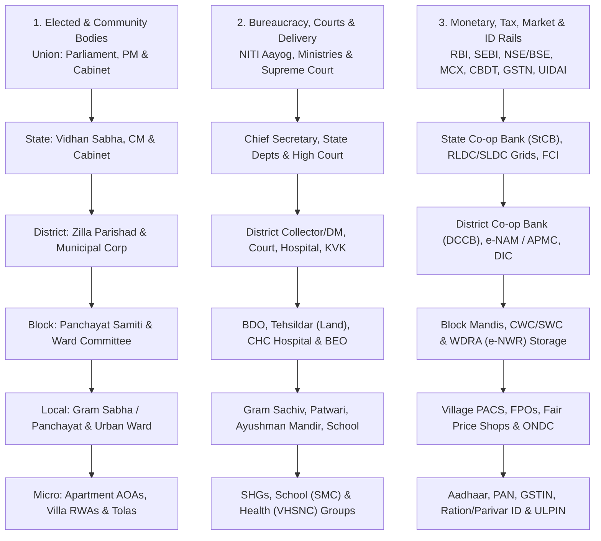
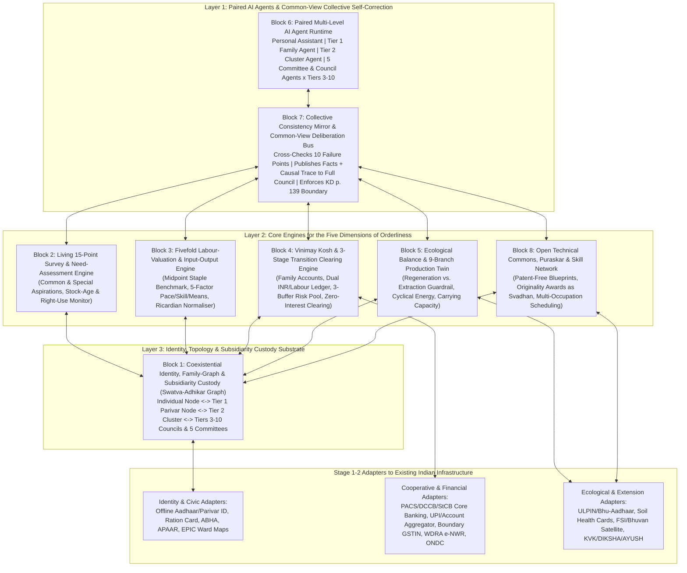
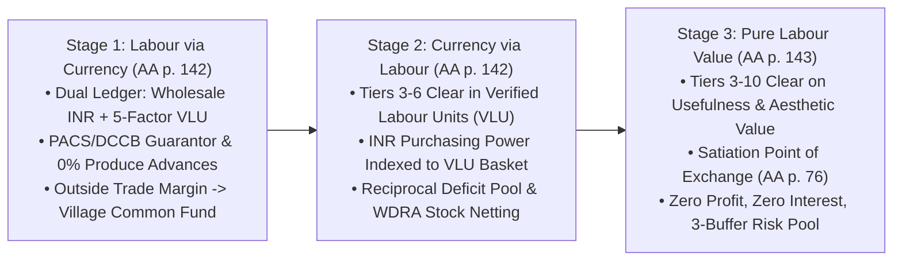
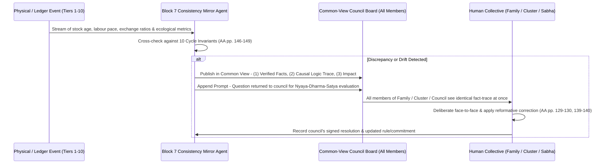
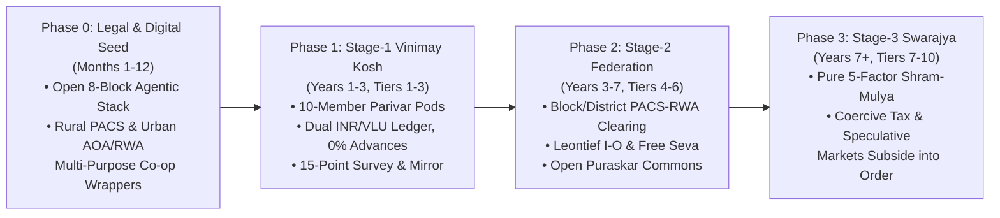

# Ten-Tier Agentic Infrastructure for Cyclical Economics and Undivided Society: Indian Institutional Mapping, System Architecture, Use Cases, and Transition Blueprint

**Author:** [AnalyticMadhyasthDarshan.org](https://github.com/raghavamohan/AnalyticMadhyasthDarshan) — a group of people studying Madhyasth Darshan philosophy. Source repository: [raghavamohan/AnalyticMadhyasthDarshan](https://github.com/raghavamohan/AnalyticMadhyasthDarshan).

**Edited on:** October 22, 2026, 3:58 AM IST

Working technical note for the study [*Prosperity Economics and Right Use*](Prosperity-Economics-And-Right-Use.pdf), extending [*How Undivided Society Is Established*](../How-Undivided-Society-Is-Established/How-Undivided-Society-Is-Established.pdf) and [*The Personal AI Assistant in Coexistential Perspective*](../Artificial-Intelligence-And-Coexistence/Technical-Note-The-Personal-AI-Assistant.pdf).

How can a society move from an accumulation-driven, currency-mediated, state-administered order to the ten-tier family-rooted self-governing order (*parivar-mulak swarajya vyavastha*) and cyclical economy (*avartansheel arthvyavastha*) set out by Shri A. Nagraj—without waiting for every individual on Earth to reach complete awakening first, and without creating a coercive state bureaucracy? The parent study [*Prosperity Economics and Right Use*](Prosperity-Economics-And-Right-Use.pdf) (§§1–8) established two foundational premises. First, existing economic models fail to close the economic cycle because they model the human actor without *jeevan* and without realisation (*anubhav*) in the coexistence of all-pervasive omnipresence (*satta*, *vyapak*) and nature as a whole at once (AA, pp. 16–20, 47–51, 58–60; MVD, p. 203). Second, while humanity is in the process of realisation (*anubhav-gami*), operating a non-price, profit-free economy across an Earth-spanning ten-tier order requires a **federated multi-level AI agentic backbone** paired with individuals, ten-member families, five functional committees, and ten nested council tiers. By placing verified facts, material balances, and checkable causal logic in common view before the responsible collective simultaneously, this agentic backbone enables communities to notice individual errors and self-correct collectively while keeping all normative judgements of justice, *dharma*, and truth in human hands (AA, pp. 128–130, 138–140, 146–149; KD, p. 139).

To build and deploy this infrastructure in the real world, however, an abstract specification of ten tiers is not enough. Any transition must start inside an existing society that already has constitutional tiers of government, line ministries, revenue and tax authorities, central and commercial banks, stock and commodity exchanges, public hospitals and schools, rural panchayats, urban municipal corporations, apartment and villa associations, and digital identity and payment rails. Taking **India** as the primary reference environment, this technical note performs four tasks:

1. **Establishes the two foundational architectural shifts (§1):** why moving toward *Akhand Samaj* and *Sarvabhaum Vyavastha* requires replacing (a) atomised individual and corporate surveillance IDs with a **subsidiarity-governed relational identity graph (*Swatva–Adhikar Graph*)** anchored in the ten-member family (*parivar*), and (b) imperishable symbolic currency (*prateek mudra*) with a **federated Exchange-Reserve (*Vinimay Kosh*) and fivefold labour-value clearing system**.
2. **Maps India's existing governance, departmental, financial, market, and identity architecture in full (§2):** from apartment blocks, villa committees, Self-Help Groups (SHGs), Primary Agricultural Credit Societies (PACS), Gram Panchayats, Zilla Parishads, and Municipal Corporations to State departments, Union ministries, the Reserve Bank of India (RBI), the banking and UPI / Account Aggregator stack, SEBI / NSE / BSE, MCX / NCDEX / e-NAM / APMC mandis, Income Tax / GSTN, Land Records (ULPIN), and identity registries (Aadhaar, PAN, TAN, GSTIN, EPIC, Passport, Ration Card, Parivar IDs, ABHA, Udyam), showing how each maps onto—or diverges from—the ten-tier order and its five committees.
3. **Specifies the eight core architectural blocks of the Ten-Tier Agentic Infrastructure (§3):** defining the data custody boundaries, ledger equations, multi-tier input–output labour valuation engines, ecological digital twins, paired AI agents, and the Common-View Consistency Mirror.
4. **Catalogs eighteen end-to-end operational use cases (§4) and lays out a four-phase transition blueprint for India (§5):** showing how existing Indian cooperative law, digital public infrastructure (DPI), local bodies, and community institutions can be leveraged immediately in Stage 1 and evolved step by step into the full ten-tier *Swarajya* architecture.

---

## 1. Foundational premises: authority, relational identity, and exchange without money

### 1.1 The triad of authority, identity, and independence (*adhikar, swatva, swatantrata*)

In *Avartansheel Arthshastra*, institutional order is not founded on coercive state sovereignty (*rajyapith*), religious authority (*dharmapith*), or market purchasing power (*vyaparpith*) (AA, pp. 3–6, 82–84, 90–91). Instead, it is grounded in the progression from the autonomous human (*swayatt manav*) to the family human (*parivar manav*) and the orderliness human (*vyavastha manav*) through three inseparable qualities (AA, pp. 104–105):

- **Authority (*adhikar*):** the strength of understanding and realisation (*anubhav*) in coexistence, expressed as competence in living with resolution (*samadhan*) and prosperity (*samriddhi*).
- **Identity or ownness (*swatva*):** evidencing that strength in one's own conduct, relationships, and complementary participation—where a person's standing is recognised by capacity, receptivity, and ability in production and service rather than accumulated currency (MVD, p. 265; AA, pp. 45, 104).
- **Independence or self-organization (*swatantrata*):** unconstrained participation in the ten-member family and the ten-tier universal orderliness, free of fear, inducement, and exploitation (AA, pp. 82, 104–105).

When we translate *adhikar*, *swatva*, and *swatantrata* into system architecture, two foundational primitives immediately distinguish a coexistential infrastructure from contemporary state and market platforms.

### 1.2 Primitive 1: Why relational family-and-tier identity replaces atomised individual IDs

Modern digital identity and tax systems—such as Aadhaar, PAN, Voter ID, and credit bureau profiles—model society as a flat collection of **isolated individuals** (`1 human = 1 atomised economic and legal unit`) alongside **profit-maximising corporate entities** (`CIN`, `GSTIN`, `TAN`). Every wage payment, tax assessment, loan, welfare transfer, and vote is attached either to a single individual or to a commercial firm.

In Madhyasth Darshan, by contrast, **the ten-member family (*parivar*, reckoned in the treatise as at least ten members), not the isolated individual, is the primary unit of society, need assessment, prosperity, and economic accounting** (AA, pp. 9, 14, 26, 65, 119–120; JV, p. 153):

1. **Inside the family, there is no individual labour accounting or exchange:** Because every member is *jeevan*, endowed with the ability to realise (*anubhav*) in the coexistence of all-pervasive omnipresence (*satta*, *vyapak*) and nature as a whole at once (AA, pp. 47, 51, 60; MVD, p. 203), the household of at least ten autonomous people lives in relationship balance. Goods are shared unconditionally according to need, without weighing whether one member produced more on a given day and another less (AA, pp. 1, 14, 119–120).
2. **Between families, villages, and regions, accounts belong to households and nested councils:** Every family chooses its representative (*mukhiya*), holds an account in the village's autonomous cooperative Exchange-Reserve (*vinimay kosh*, AA, pp. 129, 137–138), and declares its assessed seasonal needs and surplus production as a household unit (AA, pp. 9, 26, 130).
3. **Governance is nested across ten tiers (*soopan*) and five committees (*samitis*):** A single family of at least ten members forms the Family Council (*parivar sabha*, Tier 1); ten families form a Family-Cluster Council (*parivar samuh sabha*, Tier 2, ~100 people); ten clusters form a Village Family Council (*gram parivar sabha*, Tier 3, 100 families / ~1,000 people); and ten-fold nesting continues through Tier 4 (*gram samuh sabha*, 10 villages / 1,000 families), Tier 5 (*gram kshetra sabha*, 100 villages / 10,000 families), Tier 6 (*mandal sabha*, 1,000 villages / 100,000 families), Tier 7 (*mandal samuh sabha*, 10,000 villages / 1,000,000 families), and Tier 8 (*mukhya rajya sabha*, 100,000 villages / 10,000,000 families), linking across continents in Tier 9 (*pradhan rajya sabha*, Continent Council) to Tier 10, the World Family Council (*vishva parivar sabha*) (AA, pp. 27–30, 125–127). At every tier from the village (Tier 3) upward, the council nominates five functional committees:

    - **Education–Sanskar Committee (*Shiksha-Sanskar Samiti*)**
    - **Health–Restraint Committee (*Swasthya-Sanyam Samiti*)**
    - **Justice–Security Committee (*Nyaya-Suraksha Samiti*)**
    - **Production–Work Committee (*Utpadan-Karya Samiti*)**
    - **Exchange–Reserve Committee (*Vinimay-Kosh Samiti*)**

Consequently, the identity management system of this infrastructure cannot be a centralised biometric surveillance registry of atomised individuals. It must be a **Federated Relational Identity and Subsidiarity Graph** that links:

- **Self-sovereign Individual nodes** (paired with a Personal AI Assistant, holding multi-occupation skill credentials and private reflective logs; AA, p. 131);
- **Tier 1 10-Member Family nodes (*Parivar Sabha*)** (paired with a Family AI Agent, acting as the primary economic account holder in the *Vinimay Kosh* and preserving internal household privacy; AA, pp. 119–120, 130, 137–138); and
- **Consensus-selected Council and Committee role credentials across Tiers 1–10** (selected by consensus from the tier below with zero election expenditure and held on a part-time producer basis, with the five committees nominated from Tier 3 upward; AA, pp. 110, 125–127).

### 1.3 Primitive 2: Why the *Vinimay Kosh* and fivefold labour value replace symbolic money

Modern economies use **symbolic currency (*prateek mudra*)**—fiat money created predominantly through interest-bearing commercial bank loans (BoE 2014)—as the universal unit of account, medium of exchange, and store of value. As the parent study showed ([*Prosperity Economics and Right Use*](Prosperity-Economics-And-Right-Use.pdf) §§2.4, 3.6, 4.6), symbolic currency breaks the economic cycle in three ways:

- Real produced goods (*dhan*) have definite physical properties and decay over time (grain rots, iron rusts), whereas symbolic currency does not decay and can be accumulated without limit in a pocket, vault, or digital ledger (AA, pp. 5–6, 45, 52; JV, pp. 151–152).
- Because currency holders can withhold imperishable money from perishable goods, currency commands interest, rent, and speculative price margins, enabling artificial scarcity and siphoning value away from actual producers (AA, pp. 5–7, 52, 75, 106; Gesell, *Natural Economic Order*).
- Pricing everything in currency reduces human capacities to commercial trades (*vyapar* in strength, learning, knowledge, office, and beauty; AA, pp. 45–46) and masks ecological extraction (*paddat-prapti*) as monetary income (AA, p. 78).

To replace money without reverting to primitive bilateral barter, the treatise establishes the **Exchange-Reserve (*Vinimay Kosh*)** and the **Fivefold Valuation of Labour (*Shram Mulya*)** across a **Three-Stage Transition** (AA, pp. 66, 76, 119, 136–138, 142–145):

1. **Unit of valuation (*Shram-Mulya*):** Wealth (*dhan*) is exclusively the produced object carrying objective **usefulness value (*upyogita mulya*)** and **aesthetic value (*kala mulya*)** (AA, pp. 25, 49, 105). A unit of human labour is calibrated from a local staple benchmark (such as the midpoint of wheat yields across village plots; AA, p. 66) and evaluated across five dimensions: **skill (*kushalata*), proficiency (*nipunata*), speed/pace of work (*karya-gati*), time, and means** (AA, pp. 119, 145).
2. **Clearing mechanism (*Vinimay Kosh*):** Every family holds an account in the village's autonomous cooperative Exchange-Reserve (AA, pp. 137–138). Families deposit what they produce in excess of household need and draw what they require at equal labour value, reaching the **satiation point of exchange (*vinimay ka tripti bindu*, AA, p. 76)**—where remuneration after exchange equals what was produced, with zero profit, zero loss, and zero interest.
3. **Three-stage transition bridge (AA, pp. 142–143):**

    - **Stage 1 (Labour evaluated through currency):** The Exchange-Reserve operates inside the prevailing rupee economy. Goods are booked at nearby wholesale rates less transport cost; families without initial capital receive interest-free advances repaid in produce; a cooperative bank stands as guarantor; and any incidental surplus from outside trade goes to village common facilities (AA, pp. 136–138, 142). Simultaneously, the reserve's AI agent records fivefold labour values in parallel.
    - **Stage 2 (Currency evaluated on the basis of labour):** As inter-village production covers common aspirations, the purchasing power of currency inside the federated network is indexed directly to verified units of human labour (AA, p. 142).
    - **Stage 3 (Pure labour-value clearing):** Objects are valued and cleared across all ten tiers solely on fivefold labour value through usefulness and aesthetic value, free of profit, loss, interest, and accumulation (AA, p. 143).

---

## 2. Mapping India's existing governance, economic, financial, and identity structures

Before designing the transition architecture, we must map India's existing institutional landscape across four dimensions: (1) the constitutional and administrative hierarchy from residential communities to the Union government; (2) the revenue, tax, monetary, banking, and capital/commodity market machinery; (3) the social delivery systems for education, health, food security, and justice; and (4) the digital and statutory identity registries.

### 2.1 Constitutional, administrative, and residential hierarchy in India ("As-Is")

India's existing governance combines a formal three-tier constitutional structure (Union, State, and Panchayati Raj / Urban Local Bodies under the 73rd and 74th Constitutional Amendments) with informal or statutory micro-community bodies at the neighbourhood level.

#### Detailed layer-by-layer breakdown of existing Indian structures

| Layer | Rural structures | Urban structures | Parallel bureaucracy, agencies & cooperatives |
|---|---|---|---|
| **Layer 0: Household & Micro-Cluster** | Nuclear or joint family household; *Tola* / *Majra* / *Pada* / *Habitation* (10–30 neighbouring homes); Women's Self-Help Groups (SHGs, 10–20 members under DAY-NRLM). | Nuclear household; Apartment block / Tower committee; **Apartment Owners' Association (AOA)** / **Cooperative Housing Society (CHS)**; **Villa / Gated-Community / Layout Resident Welfare Association (RWA)**. | SHG federations (Village Organisations, Cluster Level Federations); Resident consumer clubs; informal neighbourhood childcare and tool-sharing groups. |
| **Layer 1: Village / Urban Ward** | **Gram Sabha** (all adult voters) & **Gram Panchayat** (Sarpanch / Pradhan + Ward Panchs; ~1,000–5,000 population). | **Municipal Ward** & **Area Sabha / Mohalla Sabha** (Ward Councillor / Corporator; 10,000–50,000 population in cities). | **Gram Sachiv** (Secretary), **Patwari / Lekhpal / Talathi / VAO** (revenue & land), **PACS** (Primary Agricultural Credit Society), **FPO** (Farmer Producer Organisation), **Fair Price Shop** (PDS ration), **Anganwadi**, **Ayushman Arogya Mandir / Sub-Centre** (ASHA, ANM), Government Primary School & School Management Committee (SMC), Village Water & Sanitation Committee, Biodiversity Management Committee, Joint Forest Management Committee (JFMC / Van Panchayat). |
| **Layer 2: Block / Tehsil / Municipal Zone** | **Panchayat Samiti / Block / Mandal / Taluka Parishad** (Elected Pramukh; ~50–100 villages). | **Ward Committee / Municipal Zone** (in larger corporations) or **Nagar Panchayat / Municipal Council (*Nagar Palika*)** in smaller towns. | **Block Development Officer (BDO)**, **Tehsildar / Mamlatdar / Naib Tehsildar** (revenue & land registry), **Block Education Officer (BEO)**, **Community Health Centre (CHC)**, Block Agriculture Officer, **APMC Sub-Yard / Mandi**, Taluka / Munsiff Court, Police Station (SHO). |
| **Layer 3: District / City Region** | **Zilla Parishad** (Elected Chairperson + Chief Executive Officer). | **Municipal Corporation (*Mahanagar Palika*)** (Mayor + Commissioner) & **Urban Development Authority** (DDA, BDA, MMRDA, HMDA). | **District Collector / District Magistrate (DM / DC)**, Superintendent of Police (SP / Police Commissioner), **District & Sessions Court**, **Chief Medical Officer (CMO) & District Hospital**, **District Education Officer (DEO) & DIET**, **Krishi Vigyan Kendra (KVK)**, **District Industries Centre (DIC)**, **District Central Cooperative Bank (DCCB)**, District Milk Union (e.g., Amul / Nandini district union), Divisional Forest Officer (DFO). |
| **Layer 4: Division / Agro-Climatic Zone** | Revenue Division (3–6 districts) & Watershed / River-Basin Command Areas (CADA). | Metropolitan Region / Industrial Corridor. | **Divisional Commissioner**, Deputy Inspector General (DIG), Regional Transport Authority (RTA), Regional Higher Education & Health Directorates, Catchment / Basin Boards. |
| **Layer 5: State / Union Territory** | **State Legislature** (Vidhan Sabha / Vidhan Parishad), Chief Minister & Cabinet. | Same State Legislature; Directorate of Municipal Administration & Urban Development. | **Chief Secretary**, **State Line Departments** (Revenue, Finance, Agriculture, Animal Husbandry, Cooperation, Education, Health, Forest & Environment, Water Resources, Food & Civil Supplies, Rural Development, Industries, Labour, Home), **High Court**, **State Cooperative Bank (StCB)**, State Milk Federation (GCMMF / KMF), State Electricity Boards / DISCOMs, State Pollution Control Board (SPCB). |
| **Layer 6: Zonal / Inter-State River & Grid** | Five Zonal Councils (Northern, Central, Eastern, Western, Southern) & North-Eastern Council. | Inter-State Metropolitan & Transport Corridors. | **Regional Power Grids (RLDCs)**, **Inter-State River Water Tribunals & Boards**, ICAR Agro-Ecological Zones, RBI Regional Offices. |
| **Layer 7: Union / Central Government** | **Parliament** (Lok Sabha & Rajya Sabha), Prime Minister & Union Cabinet. | Same Union executive and legislature. | **NITI Aayog**, **Union Ministries & Departments** (Finance, Agriculture, Cooperation, Rural Development, Housing & Urban Affairs, Education, Health, Environment / Forest, Commerce & Industry, Labour, Skill Development, Electronics & IT, Consumer Affairs, Jal Shakti, Power, Railways), **Supreme Court**, **CAG**, **Election Commission**, **UPSC**. |

### 2.2 Mapping India's revenue, taxation, banking, monetary, and market architecture

To understand how a non-extractive, profit-free *Vinimay Kosh* system can emerge from within India's current economy, we must map every major financial, fiscal, and market institution currently operating in the country.

| Domain | Existing Indian institutions, agencies & rails | How the current system operates (4.5-activity / currency-centric logic) | Structural friction from the standpoint of *Avartansheel Arthshastra* |
|---|---|---|---|
| **Land & Local Revenue** | State Revenue Departments; District Collector $\rightarrow$ Sub-Divisional Magistrate (SDM) $\rightarrow$ Tehsildar $\rightarrow$ Revenue Inspector $\rightarrow$ Patwari / Talathi; Sub-Registrar Offices; **DILRMP** (Digital India Land Records: *Bhulekh, Bhoomi, Dharani, Mahabhulekh*); Municipal Property Tax wings. | Maintains *Record of Rights (RoR / Khatiyan / Pahani / 7-12 extract)*, cadastral maps, mutation registries, stamp duty on land sales, and rural / urban property taxes; treats land as a marketable, mortgageable commodity. | Land is priced for speculative gain rather than evaluated for carrying capacity and regenerative production balance (AA, pp. 52, 92; Polanyi 1944). |
| **Direct Taxation** | **Ministry of Finance (Dept. of Revenue)** $\rightarrow$ **CBDT** (Central Board of Direct Taxes) $\rightarrow$ **Income Tax Department** (CPC Bengaluru, Faceless Assessment, TDS / TCS, Form 26AS, Annual Information Statement [AIS]). | Taxes individual and corporate monetary income, capital gains, and profits after they have been accumulated through wage disparities, rent, interest, and trade margins. | Historically rooted in royal treasury extraction (*rajyapith*, AA, pp. 3–4); relies on coercive auditing because self-interested actors conceal *labh*, whereas self-governing villages fund common facilities directly from local surplus and part-time service (AA, pp. 110, 127–128, 137). |
| **Indirect Taxation & Trade Tracking** | **GST Council**, **CBIC** (Central Board of Indirect Taxes & Customs), **GSTN** (Goods and Services Tax Network — GSTR-1 / 2B / 3B, **e-Invoicing**, **e-Way Bills**), State Commercial Tax & Excise Departments. | Tracks every B2B invoice and inter-state / intra-state truck movement (e-Way Bill with HSN / SAC codes) to levy value-added tax in currency at each stage of commercial trade. | Technically proves that real-time multi-stage input–output tracking across millions of producers is already operational in India—but currently tracks *monetary value-added and tax liability* rather than *fivefold embodied human labour and physical balance*. |
| **Central Banking & Monetary Policy** | **Reserve Bank of India (RBI)** (Monetary Policy Committee, Repo / Reverse Repo, CRR / SLR, Currency Management, **e-Rupee CBDC**, Payment Systems Regulation, FIDD for financial inclusion). | Issues symbolic currency (*prateek mudra*), sets benchmark interest rates, manages foreign exchange reserves, and regulates fractional-reserve credit creation by commercial banks. | Anchors the economy in debt-created symbolic currency and positive interest rates, which require perpetual monetary growth and reward currency holders over producers of perishable goods (AA, pp. 5–6, 44–45, 52; JVD, p. 32). |
| **Commercial & Cooperative Banking + DPI Rails** | **Scheduled Commercial Banks** (SBI, PSBs, Private Banks), **Regional Rural Banks (RRBs)**, **NABARD**, and the **3-Tier Cooperative Credit Structure**: **PACS** (~100,000 village societies) $\rightarrow$ **DCCBs** (~350 district banks) $\rightarrow$ **StCBs** (34 state banks) + **Urban Cooperative Banks (UCBs)**; **NPCI** (**UPI**, IMPS, NACH, RuPay), **Account Aggregator (AA)**, **ONDC**. | Mobilises deposits at interest, extends interest-bearing farm, retail, and corporate loans, and clears instant digital currency payments via UPI. **Crucial exception:** PACS and cooperative banks already exist legally in almost every village block to serve member accounts and agricultural storage / procurement. | Commercial banking charges interest on money, turning credit into a mechanism of extraction; however, the **PACS $\rightarrow$ DCCB $\rightarrow$ StCB cooperative network** directly corresponds to the treatise's transitional guarantor bank and village Exchange-Reserve (*Vinimay Kosh*, AA, pp. 136–138)! |
| **Capital & Debt Markets** | **SEBI** (Securities and Exchange Board of India), **NSE** (National Stock Exchange), **BSE**, Depositories (**NSDL, CDSL**), Mutual Funds, Clearing Corporations, Government Securities (**NDS-OM**), **IRDAI** (Insurance), **PFRDA** (Pensions). | Enables trading of equity shares, corporate bonds, and derivatives; allocates capital to firms maximising shareholder return and prices risk via commercial insurance premiums. | The treatise explicitly critiques the share market and interest collection as multiplying symbolic currency claims detached from production (AA, p. 52). In *Avartansheel Arthvyavastha*, primary capital is human labour power (AA, p. 73), large industry is federated across Tiers 4–10 (AA, pp. 29–30, 115), and risk is covered by the three non-commercial buffers (reserve surpluses, inter-village reciprocity / *daya*, and common-facility funds; AA, pp. 23–24, 72, 128, 137–140). |
| **Commodity, Futures & Agricultural Markets** | **MCX** (Multi Commodity Exchange — metals, energy), **NCDEX** (National Commodity & Derivatives Exchange — agri-futures), **e-NAM** (National Agriculture Market), **APMC Mandis** (~7,000 regulated wholesale markets), **WDRA** (Warehousing Development and Regulatory Authority — **e-NWR** electronic Negotiable Warehouse Receipts), **FCI**, **NAFED**. | Discovers prices through wholesale auctions and futures / options trading; middlemen (*arthiyas* / traders) and speculators capture margins between farm-gate and retail while warehousing receipts are pledged for interest-bearing loans. | Speculative futures on MCX / NCDEX profit from volatility and artificial scarcity (AA, pp. 5–6, 52, 106). Yet **physical assaying, WDRA warehouse receipts (e-NWR), and e-NAM / PACS logistics** provide the exact physical-inventory and quality-grading rails needed for the Stage-1 and Stage-2 *Vinimay Kosh*! |

### 2.3 Mapping India's departmental delivery systems across the five dimensions

In *Avartansheel Arthshastra*, economics has no standing in isolation from the five dimensions of human orderliness (*shiksha-sanskar*, *swasthya-sanyam*, *nyaya-suraksha*, *utpadan-karya*, and *vinimay-kosh*; AA, pp. 63, 110, 112, 117). India currently splits these five dimensions across dozens of siloed central and state bureaucracies and commercial markets:

**1. Education & Skill (*Shiksha-Sanskar* counterpart)**

- *Current Indian structure:* **Anganwadis** (Ministry of Women & Child Development) $\rightarrow$ **Primary, Upper Primary & Secondary Schools** (State Education Depts, Samagra Shiksha, Panchayat / Municipal schools, Kendriya / Navodaya Vidyalayas, CBSE / State Boards, NCERT / SCERT, **School Management Committees [SMCs]** under the Right to Education Act) $\rightarrow$ **Vocational & Agricultural Extension** (**ITIs**, Polytechnics, PMKVY Skill India centres, **731 Krishi Vigyan Kendras [KVKs]** under ICAR, ATMA block extension) $\rightarrow$ **Higher Education & Digital Platforms** (Universities, IITs, NITs, AIIMS, ICAR / CSIR labs, **DIKSHA**, **SWAYAM / NPTEL**).
- *Gap & transition lever:* Today's system imparts vocational credentials for salaried employment (*naukri* mentality; AA, pp. 75–76, 107; MVD, p. 307) alongside commercialised private coaching and tuition (trading in learning, *vidya ka vyapar*; AA, pp. 45–46). In the transition, **SMCs, Gram Panchayat Education Committees, KVKs, and ITIs** become the institutional seedbed for the **Education–Sanskar Committee**, adding coexistence study (*adhyayan*) and multi-occupation production training (AA, pp. 29, 130–132).

**2. Health & Restraint (*Swasthya-Sanyam* counterpart)**

- *Current Indian structure:* **ASHA workers & ANMs** at the village / ward level $\rightarrow$ **Ayushman Arogya Mandirs / Sub-Health Centres (~1.7 lakh)** and **Rogi Kalyan Samitis / Village Health, Sanitation and Nutrition Committees (VHSNCs)** $\rightarrow$ **Primary Health Centres (PHCs, ~31,000)** $\rightarrow$ **Community Health Centres (CHCs, ~6,000 at block level)** $\rightarrow$ **Sub-Divisional & District Hospitals** $\rightarrow$ **State Medical Colleges & AIIMS**, supported by **Ministry of AYUSH** (Ayurveda, Yoga, Naturopathy dispensaries and medicinal plant boards), **ICMR**, and **Ayushman Bharat Digital Mission (ABDM)**.
- *Gap & transition lever:* Private corporate hospitals turn healing into a commercial trade in suffering (AA, pp. 45–46; JV, pp. 166–168), while public clinics are overburdened because preventive restraint (*sanyam*), nutrition, and household care are disconnected from agriculture and daily living. In the transition, **VHSNCs, Ayushman Arogya Mandirs, AYUSH herbal networks, and PHCs / CHCs** anchor the **Health–Restraint Committee**, connecting household nutrition and medicinal-plant cultivation directly to benevolence-focused healing (*upkar-pradhan seva*, AA, pp. 139–140).

**3. Justice & Security (*Nyaya-Suraksha* counterpart)**

- *Current Indian structure:* **Nyaya Panchayats / Gram Nyayalayas**, **Lok Adalats**, and **Mediation Centres** (under the Mediation Act 2023 and NALSA / SLSA) $\rightarrow$ **Subordinate / Taluka Courts** $\rightarrow$ **District & Sessions Courts** $\rightarrow$ **High Courts** $\rightarrow$ **Supreme Court**, alongside **Police Stations**, **Consumer Commissions**, **National Green Tribunal (NGT)**, and **Patent / IP Offices (CGPDTM)**.
- *Gap & transition lever:* Adversarial litigation and punitive policing consume immense time and money without producing inner reform, while Patent Offices enforce intellectual monopolies (AA, pp. 56–58, 82–84). In the transition, **community mediation, Gram Nyayalayas, and RWA / Panchayat reconciliation forums** evolve into the **Justice–Security Committee**, evaluating the four dimensions of justice (character, behaviour, production, and exchange; AA, pp. 140–143), guiding reformative family-and-cluster self-correction (AA, pp. 129–130, 139–140), and recording open inventions for **Puraskar** awards rather than monopoly patents (AA, pp. 140, 144).

**4. Production & Ecological Balance (*Utpadan-Karya* counterpart)**

- *Current Indian structure:* **Agriculture, Horticulture, Animal Husbandry / Dairy, Fisheries, Sericulture, Handloom / Khadi (KVIC), MSME, Forest, Water Resources, and Renewable Energy Departments**; **FPOs**, **Dairy Cooperatives (Amul / Nandini village societies)**, **Watershed Committees**, **Joint Forest Management Committees (JFMCs)**, **Soil Health Card laboratories**, **Central / State Pollution Control Boards (CPCB / SPCB)**, and **Forest Survey of India (FSI)**.
- *Gap & transition lever:* Currently fragmented across ten separate ministries pushing input-dependent chemical monoculture and fossil-fuel extraction (AA, pp. 30–33, 70–71, 78). In the transition, these converge at the village / ward and block levels into the **Production–Work Committee**, coordinating the **nine branches of village production** within local regenerative carrying capacity (AA, pp. 92, 133–136, 142, 146).

**5. Exchange, Storage & Reserve (*Vinimay-Kosh* counterpart)**

- *Current Indian structure:* **PACS** (now being upgraded under the Primary Agricultural Credit Societies computerisation and world's largest decentralized grain storage plan), **Fair Price Shops (FPS / Ration Shops, ~5.3 lakh)**, **Consumer Cooperative Stores (Kendriya Bhandar / Apna Bazar / Supermarkets)**, **CWC / SWC Warehouses**, **APMC Mandis**, **e-NAM**, and **ONDC**.
- *Gap & transition lever:* Currently split between welfare rationing (PDS) and profit-driven wholesale / retail trade. In the transition, **multi-purpose PACS in rural villages and RWA / Consumer Cooperatives in urban apartment / villa clusters** directly become the **Autonomous Cooperative Exchange-Reserve (*Vinimay Kosh*, AA, pp. 136–138)**!

### 2.4 Complete inventory of India's existing identity and registry systems

To design **Block 1 (The Coexistential Identity & Family Graph)** and **Block 4 (The *Vinimay Kosh* Clearing Engine)** so they can interoperate with India's legal and digital reality during the transition, we must catalog every major identity and asset registry currently in force:

| Category & Existing Indian ID / Registry | Issuing Authority & Technical Rail | What It Currently Identifies | How the Ten-Tier Agentic Infrastructure Uses or Transforms It |
|---|---|---|---|
| **Individual Identity:** **Aadhaar** (12-digit UID + VID / Offline e-KYC / DigiLocker) | UIDAI (MeitY) | Biometric & demographic uniqueness of an individual resident. | Used optionally at onboarding (via privacy-preserving local offline e-KYC / zero-knowledge proof) to verify human uniqueness when a person joins a **Self-Sovereign Individual Node**, without letting UIDAI track internal family or council life. |
| **Household / Family Identity:** **NFSA Ration Card** & **State Family IDs** (*Parivar Pehchan Patra* [Haryana], *Jan Aadhaar* [Rajasthan], *Samagra ID* [MP], *Kutumba* [Karnataka]) | State Food & Civil Supplies / Citizen Resources Depts | Nuclear / joint household members, address, and PDS entitlement. | Serves as the immediate legal seed for the **Tier 1 Family Node (*Parivar ID*)**; extended by the infrastructure so 2–3 consenting nuclear households or an extended joint household can form a **Ten-Member *Parivar* Account** (at least 10 members; AA, pp. 14, 65, 119–120). |
| **Civic & Territorial Mapping:** **EPIC (Voter ID)** & Delimitation Polling Booth / Ward Maps | Election Commission of India (ECI) & State Election Commissions | Adult citizen mapped to a specific polling part (~1,000 voters), Gram Panchayat ward, or Municipal ward. | A polling booth / Gram Sabha area (~200–250 households, ~1,000 people) maps almost 1:1 to a **Tier 3 Village / Urban Neighbourhood Family Council (*Gram / Nagar Parivar Sabha*, 100 families; AA, pp. 125–126)**! |
| **International Travel:** **Indian Passport** | Ministry of External Affairs (PSP Division) | National citizenship for cross-border movement. | Retained for international travel during Stages 1–2 while Tier 8–10 federation grows toward universal human identity (*akhand samaj*). |
| **Health & Education IDs:** **ABHA** (Ayushman Bharat Health Account, 14-digit) & **APAAR / ABC ID** (Academic Bank of Credits) | NHA (MoHFW) & Ministry of Education | Longitudinal health records (ABDM) and student academic credits. | Bridged into the **Personal & Family AI Agents** under strict user-held encryption so the **Health–Restraint** and **Education–Sanskar** committees can support preventive care and multi-occupation skill credentials (AA, pp. 131, 139). |
| **Producer & Worker IDs:** **Agristack Farmer ID / PM-KISAN ID**, **MGNREGA Job Card** (household-based!), **e-Shram UAN**, **Artisan Pahchan Card** | Ministries of Agriculture, Rural Development, Labour, and Textiles | Farmers linked to land parcels, rural households entitled to 100 days of work, unorganised workers, and craftspeople. | Note that the **MGNREGA Job Card is already a household-level labour card**! Transformed from wage-relief tracking into the **Multi-Occupation Producer & Skill Profile** connected to the village *Utpadan-Karya* and *Vinimay-Kosh* committees. |
| **Tax & Financial IDs:** **PAN** (10-char alphanumeric) & **TAN** (Tax Deduction Account No.) | CBDT / Income Tax Department | Individual / entity income-tax tracking and TDS deduction at source. | Used only in **Stage 1 & Stage 2 boundary gateways** where the village *Vinimay Kosh* or urban cooperative interacts with the external rupee tax regime; internal need-sharing and labour-value exchange generate no profit (*labh*) and require no internal PAN / TAN ledger. |
| **Business, Trade & Cooperative IDs:** **GSTIN** (15-digit), **CIN / LLPIN** (MCA), **Udyam** (MSME), **Cooperative Registration No.** (NCD), **FPO / PACS ID**, **FSSAI**, **IEC** | GSTN / CBIC, Ministry of Corporate Affairs, MSME, Ministry of Cooperation / State Registrars, FSSAI, DGFT | Commercial companies, MSMEs, registered cooperatives, food safety compliance, and importers / exporters. | In **Stage 1**, each Tier 3 Village / Ward *Vinimay Kosh* registers as a **Multi-Purpose Cooperative Society / PACS / Producer-Consumer Cooperative** holding a single **Boundary GSTIN / Cooperative ID** for external wholesale trade (AA, pp. 136–138), shielding individual families from clerical tax filings. |
| **Land, Property & Commodity IDs:** **ULPIN / Bhu-Aadhaar** (14-digit georeferenced land parcel ID), **Urban Property PID / Khata**, **HSN / SAC Codes**, **WDRA e-NWR** | Dept of Land Resources / State Revenue Depts, ULBs, CBIC, WDRA | Exact land parcel boundaries / soil, urban flats / villas, product / service classifications, and certified warehouse stocks. | **ULPIN** anchors **Block 5 (Ecological & Carrying-Capacity Digital Twin, AA, p. 92)**; **HSN / SAC codes** provide the initial product taxonomy for **Block 3 (Fivefold Labour-Value Input–Output Matrix)**; **e-NWR** anchors physical stock receipts in **Block 4 (*Vinimay Kosh*)**. |

### 2.5 Structural mapping: India's administrative hierarchy to the Ten-Tier *Parivar-Mulak Swarajya* Order

How do India's population and territorial scales map onto the ten tiers (*soopan*) of *Avartansheel Arthshastra* (AA, pp. 27–30, 115, 125–127; Parent Study §3.12)? With India's population at ~1.45 billion (~145 crore people, or ~14.5 crore ten-member *parivar* equivalents / ~30 crore current nuclear households), the quantitative fit between India's existing local bodies and the treatise's ten tiers is remarkably close:

| Madhyasth Darshan Tier & Scale | Production & Exchange Scope (AA, pp. 29–30, 115) | Rural Indian Counterpart ("As-Is") | Urban Indian Counterpart ("As-Is") |
|---|---|---|---|
| **Tier 1: *Parivar Sabha* (Family Council)** 1 Family (at least 10 autonomous people; chooses 1 representative, *mukhiya*; AA, pp. 14, 26–28, 65, 119–120, 125) | Unconditional need-based sharing without weighing individual labour; household production & care. | Joint rural family or cluster of 2–3 neighbouring nuclear households (*Parivar* group). | Extended urban household or a voluntary **10-member *Parivar* pod** (2–3 consenting flats / villas sharing kitchen, care & surplus). |
| **Tier 2: *Parivar Samuh Sabha* (Family-Cluster Council)** 10 Families (~100 people; chooses 1 member for village council; AA, pp. 27, 125, 129–130) | Mutual evaluation of family representatives (*mukhiyas*), daily tool / labour complementarity, immediate mistake correction. | Rural **Tola / Majra / Pada / Habitation** or 1–2 federated **SHGs** (Village Organisation). | **Apartment Block / Tower Wing** (10–25 flats), **Street Lane**, or **Villa Cluster Committee**. |
| **Tier 3: *Gram Parivar Sabha* (Village Family Council + 5 Committees)** 100 Families (10 clusters; ~1,000 people, or multiples of 10 in larger villages; AA, pp. 27, 67, 125–145) | **First tier nominating the 5 committees**; **autonomous in common aspirations**; 9 village production branches; **Cottage & Village Industry**; **Village *Vinimay Kosh*** (staffed by 3 people). | **Revenue Village / Gram Sabha & Gram Panchayat** + **PACS** + Ayushman Arogya Mandir + Primary School. | **Large Apartment Complex / Gated Community AOA / CHS** (200–500 flats), **Urban Mohalla / Area Sabha** (1 polling booth area), or **Urban Consumer-Producer Co-op**. |
| **Tier 4: *Gram Samuh Sabha* (Village-Cluster Council)** 1,000 Families (10 villages; ~10,000 people; AA, pp. 27, 72, 115, 126) | 5 committees; **Small Industry (*Laghu Udyog*)**; reciprocal coverage of local crop / item deficits across the 10 villages; PHC & Secondary School. | **Nyaya Panchayat / GP Cluster** (8–12 villages) + PHC + High School + Sub-Mandi. | **Municipal Ward** (in towns / cities) + Urban PHC + Ward Federation of RWAs / AOAs. |
| **Tier 5: *Gram Kshetra Sabha* (Village-District Council)** 10,000 Families (100 villages; ~100,000 / 1 lakh people; AA, pp. 27, 72, 115, 126) | 5 committees; **Medium Industry (*Madhyam Udyog*)**; inter-cluster input–output clearing; CHC hospital & technical / polytechnic training. | **Block / Panchayat Samiti / Tehsil / Taluka** (~80–120 villages) + CHC + ITI + Block Mandi. | **Municipal Zone / Small Town (*Nagar Palika*)** (1–3 lakh population). |
| **Tier 6: *Mandal Sabha* (Province Council)** 100,000 Families (1,000 villages; ~1,000,000 / 10 lakh people; AA, pp. 27–30, 115, 126) | 5 committees; **Medium & Large Industry**; district watershed & mineral balance; District Hospital, KVK, and District Cooperative Clearing. | **District (*Zilla Parishad*)** (~800–1,500 villages) + **DCCB** + District Hospital + KVK + DIC. | **Metropolitan Municipal Corporation (*Mahanagar Palika*)** or City District. |
| **Tier 7: *Mandal Samuh Sabha* (Province-Cluster Council)** 1,000,000 Families (10,000 villages; ~10,000,000 / 1 crore people; AA, pp. 27–30, 115, 126) | 5 committees; **Large Industry (*Brihad Udyog*)** for special aspirations (transport, telecom equipment, heavy tools); river sub-basin balance. | **Revenue Division / Agro-Climatic Sub-Region** (8–12 districts; e.g., Vidarbha, Bundelkhand, Malwa, Rayalaseema). | Metropolitan Region + Hinterland Agro-Industrial Zone. |
| **Tier 8: *Mukhya Rajya Sabha* (Region Council)** 10,000,000 Families (100,000 villages; ~100,000,000 / 10 crore people; AA, pp. 27–30, 115, 126) | 5 committees; major regional industrial & rail / energy grids; inter-basin ecological balance; regional medical & engineering institutes. | **Large Indian State or Zonal Group of States** (e.g., UP, Maharashtra, Bihar, Southern / Western Zone) + **StCB**. | State Urban–Rural Federation. |
| **Tier 9: *Pradhan Rajya Sabha* (Continent Council)** Representatives from region councils across a continent / subcontinent (AA, pp. 27–28, 126–127) | 5 committees; subcontinental & continental coordination of minerals, clean energy grids, rail & shipping, telecom backbone, and disaster reserves. | **Union of India / Indian Subcontinent & Asian Continental Cooperation** (~6.5 lakh rural villages + urban ward equivalents). | National & Continental Federation of Rural & Urban *Parivar Sabhas*. |
| **Tier 10: *Vishva Parivar Sabha* (World Family Council)** Representatives from all continent councils on Earth (~8 Billion people; AA, pp. 27–30, 127, 132; MVD, p. 268) | 5 committees; planetary balance of earth, atmosphere, oceans, forests, and minerals; profit-free global exchange at labour value; global open knowledge commons. | Global international bodies transformed into the World Family Council & 5 Global Committees. | Planetary *Akhand Samaj – Sarvabhaum Vyavastha*. |

---

## 3. Target system architecture: the eight core blocks of the Ten-Tier Agentic Infrastructure

To bridge from India's current institutions (§2) to the ten-tier order, the infrastructure is organised into **eight modular architectural blocks** across **three layers**:

- **Layer 3 (Foundational Substrate):** Block 1 — Federated Relational Identity, Family-Graph & Subsidiarity Custody.
- **Layer 2 (Core Economic, Ecological & Governance Engines):** Block 2 (Need & Survey), Block 3 (Fivefold Labour Valuation), Block 4 (*Vinimay Kosh* & 3-Stage Clearing), Block 5 (Ecological & 9-Branch Production Twin), and Block 8 (Open Technical Commons & *Puraskar*).
- **Layer 1 (Paired Agentic & Collective Self-Correction Layer):** Block 6 (Paired Multi-Level AI Agent Runtime) and Block 7 (Collective Consistency Mirror & Common-View Deliberation Bus).

### 3.1 Block 1: Coexistential Identity, Family-Graph, and Subsidiarity Custody Engine (*Swatva–Adhikar Graph*)

Block 1 replaces flat, surveillance-prone state/corporate identity tables with a **cryptographically verifiable, subsidiarity-enforcing relational graph**.

**1. Five Core Entity Nodes in the Graph**

- **`IndividualNode` (`swayatt-id`):** Paired 1:1 with the person's **Personal AI Assistant**. Stores the person's self-sovereign cryptographic keys, multi-occupation skill certifications (*kushalata*, *nipunata*, *panditya*; AA, pp. 113, 131), health/dietary needs (linked optionally via user-controlled ABHA), and part-time committee/council service attestations (AA, p. 127).
- **`ParivarNode` (`tier1-parivar-id`, the primary economic and civic account):** Represents a **Tier-1 Family Council (*Parivar Sabha*) of at least 10 members** (or, during initial urban/rural onboarding, a *Parivar-in-formation* of 1–3 consenting nuclear households collaborating as a household unit; AA, pp. 14, 27, 65, 119–120, 125). Holds:
    - Membership links to its `IndividualNode` members and the family's consensus-chosen representative (*Mukhiya*; AA, pp. 125, 129);
    - The family's single account in the Tier-3 **Village/Ward *Vinimay Kosh*** (AA, pp. 9, 137–138);
    - The family's assessed seasonal and annual need profile and household inventory (AA, pp. 26, 112, 130).
- **`ClusterNode` (`tier2-samuh-id`):** Represents the **Tier-2 Family-Cluster Council (*Parivar Samuh Sabha*)**, grouping 10 neighbouring `ParivarNode` units (a rural *tola*, an apartment tower wing, or a villa lane; AA, pp. 27, 125).
- **`SabhaNode` (`tier3` to `tier10-sabha-id`):** Represents the nested council at each tier from the 100-family *Gram/Nagar Parivar Sabha* (Tier 3) to the *Vishva Parivar Sabha* (Tier 10) (AA, pp. 27–30, 125–127).
- **`SamitiNode` (`tierN-samiti-id`):** The five functional committees (*Shiksha-Sanskar*, *Swasthya-Sanyam*, *Nyaya-Suraksha*, *Utpadan-Karya*, *Vinimay-Kosh*) attached to each `SabhaNode` from Tier 3 to Tier 10.

**2. Consensus Delegation & Zero-Election-Cost Credentialing (AA, pp. 110, 125–127)**

- Unlike adversarial party elections that require campaign spending, role credentials (`Mukhiya`, `ClusterRepresentative`, `SabhaMember`, `SamitiMember`) are issued as multi-signature attestations signed by the constituent units of the tier below, coupled with verified eligibility criteria: living in a self-reliant family producing in excess of need and practising humane conduct (AA, pp. 125–126; MVD, p. 265).
- Role credentials carry built-in **part-time producer constraints** (AA, p. 127; MVD, p. 259) and recall/rotation hooks if the constituent cluster or council withdraws consensus (AA, pp. 129–130).

**3. Architectural Enforcement of Subsidiarity Data Custody (AA, pp. 128, 130)**

- **Rule 1 (Personal boundary):** A person's self-examination logs (*priya–hit–labh* diagnostic dialogues with the Personal AI Assistant) are encrypted with keys held solely on the user's device; neither the family nor any committee can read them.
- **Rule 2 (Family boundary):** Day-to-day task sharing and consumption inside the 10-member family remain strictly inside the `ParivarNode` (Tier 1; no individual labour ledger is ever computed inside the family; AA, pp. 119–120). The `ParivarNode` exports to Tier 3 **only** structured household aggregates required by the village (AA, p. 130): assessed seasonal need by category, planned production, surplus offered to the *Vinimay Kosh*, and multi-occupation skill availability.
- **Rule 3 (Tier-to-tier federation):** Higher tiers (Tiers 4–10) never pull raw household tables from Tier 3; they receive signed aggregate vectors (village surplus/deficit by commodity, unit labour-value distributions, and watershed/forest regeneration metrics) together with zero-knowledge or cryptographic audit proofs.

**4. Adapters to Existing Indian IDs (Stage 1–2 Bridge)**

- At onboarding, an individual can verify uniqueness using offline Aadhaar XML / DigiLocker or EPIC Voter ID without exposing a persistent Aadhaar number to higher tiers.
- Existing **NFSA Ration Cards** or **State Family IDs (*Parivar Pehchan Patra*, *Jan Aadhaar*, *Samagra*)** can be imported in one click to pre-populate household members.
- At Tier 3, the Village/Ward *Vinimay Kosh* registers as a legal **Primary Cooperative / Multi-Purpose Cooperative Society / FPO** holding a single **Boundary PAN, TAN, and GSTIN** so all statutory compliance with the external Indian tax/banking system is handled automatically by the Tier-3 *Vinimay-Kosh Agent* on behalf of the 100 families.

### 3.2 Block 2: Living 15-Point Village Survey and Need-Assessment Engine (*Sarvekshan & Avashyakta Engine*)

Before self-governance begins in a village, the treatise prescribes a comprehensive **15-point baseline survey** covering: (1) total population (men, women, children, elders), (2) educational status and skills, (3) occupations (agriculture, dairy, crafts, service, trade), (4) arable and non-arable land, (5) water sources and irrigation, (6) seasonal crop yields, (7) livestock and fodder, (8) trees and forest produce, (9) cottage industries and tools, (10) houses and common buildings, (11) transport and communication equipment, (12) shops, storage, and credit/debt status, (13) health and sanitation status, (14) state of justice in production, and (15) state of justice in exchange (AA, pp. 122–125).

Block 2 turns this survey and household need assessment from a static paper census into a **living, conversational state model**:

- **Conversational Family Need Assessment:** Twice a year (ahead of *Kharif* and *Rabi* seasons or semi-annual urban cycles), the **Family AI Agent** conducts a guided dialogue with the 10-member family (Tier 1) to record its definite requirements across:
    - *Common aspirations (*samanya akanksha*):* food grains, pulses, oilseeds, dairy, vegetables, fruit, clothing / adornment, house maintenance, and health / educational materials (AA, pp. 26, 93, 112);
    - *Special aspirations (*mahatvakanksha*):* telecommunications, broadcasting / computing devices, and local / regional transport (AA, pp. 29–30, 112).
- **Perishability, Stock-Age & Hoarding Guardrail:** Every physical batch in a household or village reserve carries a `production_date` and `shelf_life_curve` (JV, p. 152; MVD, p. 183). When household draws exceed assessed need repeatedly or stock sits idle approaching spoilage, Block 2 emits an early-warning signal to the family (and, if unresolved at the reserve level, to the Tier-2 cluster or Tier-3 village council; §3.7).

### 3.3 Block 3: Fivefold Labour-Valuation and Multi-Tier Input–Output Engine (*Shram-Mulya Ganana Engine*)

Block 3 solves the core economic calculation problem (§§4.2, 4.10, 8.5 of the parent study) without market prices, interest rates, or bureaucratic guesswork:

**1. Local Staple Midpoint Anchor (AA, p. 66)**

- For a reference staple of common aspiration in the village/region (e.g., wheat or paddy grown across varying plots with standard village means), the engine records the distribution of yields per unit of standard seasonal effort and computes the **midpoint yield** $Y_{\text{mid}}$ as $1.0\text{ Base Village Labour Unit (VLU)}$.

**2. Fivefold Labour Valuation Formula (AA, pp. 119, 145)**

- For any activity $a$ producing output $q$ of verified quality grade $g$, the Exchange–Reserve and Production–Work committees evaluate unit labour value $L(a)$ across the treatise's five factors:

$$\text{Labour Value } L(a) = t_a \cdot \phi_{\text{pace}}(v_a) \cdot \phi_{\text{skill}}(s_a, p_a) \cdot \phi_{\text{quality}}(g) + D_{\text{means}}(m_a)$$

- Here $t_a$ is standard time at reference pace $v_a$ (*karya-gati*, AA, p. 119), $\phi_{\text{skill}}(s_a, p_a)$ reflects the council-approved weight for required skill (*kushalata*) and proficiency (*nipunata*) so competent dexterity is honoured rather than slowness rewarded (AA, p. 145), $\phi_{\text{quality}}(g)$ verifies usefulness and aesthetic durability (AA, pp. 49, 116), and $D_{\text{means}}(m_a)$ is the **interest-free straight-line depreciation of embodied past labour** in tools, machines, and facilities used up in the round of production (AA, pp. 106, 118).

**3. Multi-Stage Leontief Input–Output Solver across Tiers 3–10 (Leontief 1936; AA, pp. 29–30, 115)**

- For complex goods produced across tiers (for example, bicycles, solar pumps, medical diagnostics, or telecommunications hardware), let $A = [a_{ij}]$ be the inter-tier technical input matrix (using India's existing 8-digit **HSN/SAC commodity taxonomy** as the initial product catalog) and $\ell$ the vector of direct fivefold labour added at each stage. Total embodied labour value $v$ is solved continuously as:

$$v = (I - A)^{-1} \ell$$

- Whenever an open technical invention (Block 8) reduces $\ell_j$ or $a_{ij}$, the engine automatically revises $v$ downward across all connected villages so every family's required working hours fall (AA, pp. 118, 145).

**4. Ricardian Natural-Endowment Normaliser (Ricardo 1817; Parent Study §8.5)**

- Using Block 5's soil-fertility, rainfall, and mineral-depth layers (ULPIN + Soil Health Card + agro-climatic index $\eta_r$), Block 3 separates yield differences due to natural endowment $\eta_r$ from human effort so a village in an arid district exchanges with an alluvial river-delta village on equal human labour terms without differential rent capture.

### 3.4 Block 4: The *Vinimay Kosh* and Three-Stage Transition Clearing Engine (Replacing Money and Speculative Markets)

Block 4 is the operational heart of *Avartansheel Arthvyavastha*, replacing commercial bank credit, speculative commodity exchanges (MCX/NCDEX), and middlemen margins with the **Autonomous Cooperative Exchange-Reserve (*Vinimay Kosh*, AA, pp. 136–138, 142–145)**.

**1. Account Structure & Dual-Ledger Mechanics**

- Every `ParivarNode` holds a **Family Reserve Account** in its Tier-3 *Vinimay Kosh* (AA, pp. 137–138).
- Every transaction records **both**:
    - Physical quantity, quality grade, usefulness category, and perishability window;
    - **Book A (Transition INR Book, active in Stages 1–2):** valued at the nearest wholesale mandi / cooperative benchmark minus transport cost ($\text{Price}_{\text{wholesale}} - C_{\text{transport}}$; AA, pp. 136–137, 142);
    - **Book B (*Shram-Mulya* Book, active in all stages and sole book in Stage 3):** valued in verified **Village Labour Units (VLU)** computed by Block 3 (AA, pp. 119, 142–145).

**2. Handling the Two Forms of Service (*Seva*, Parent Study §3.8; MVD, pp. 72, 263; AA, pp. 136–140)**

- **Benevolence-focused service (*upkar-pradhan seva*):** Teachers (*Shiksha-Sanskar*), doctors and healers (*Swasthya-Sanyam*), committee members, and council representatives (*lok-pratinidhi*) charge **zero fees** and draw **no commercial salary**; they belong to a self-reliant 10-member `ParivarNode` whose household production and reserve account cover all their material needs (KD, pp. 115–117; AA, pp. 127, 130, 140).
- **Remuneration-focused service (*pratiphal-pradhan seva*):** Villagers performing the village service branch and exchange-reserve administration—machine / appliance / bicycle repair, laundry, barbering, and the 3-person *Vinimay Kosh* staffing—receive council-fixed labour remuneration (*parishramik* as *svadhan*, AA, pp. 133, 136, 138, 140) credited directly in VLU (and Stage-1 INR equivalent) to their family's *Vinimay Kosh* account.

**3. The Three-Buffer Risk and Common-Facility Pool (Replacing Commercial Insurance & Bond Markets; AA, pp. 23–24, 72, 128, 137–140)**

- **Buffer 1 (Local Physical & Account Reserve):** Seasonal carryover stocks held in the village *Vinimay Kosh* warehouse (integrated with WDRA standards).
- **Buffer 2 (Inter-Tier Reciprocal Deficit & *Daya* Pool):** When a village suffers a crop shortfall or natural calamity, Tier 4 (10-village) and Tier 5 (100-village) Exchange-Reserve Agents automatically match surpluses from neighbouring clusters through reciprocal clearing and works of kindness (*daya*, providing objects where there is receptivity but no object; AA, pp. 23–24, 72, 140) without debt bondage.
- **Buffer 3 (Village & Regional Common-Facility Fund):** Funded in Stage 1 by the net margin earned when the *Vinimay Kosh* sells pooled village surpluses to outside currency markets (AA, p. 137), and in Stages 2–3 by a transparent, council-approved allocation of village production capacity to maintain schools, clinics, roads, and clean energy plants (AA, pp. 128, 137–139).

**4. Anti-Arbitrage & Speculation Shield (Stages 1–2)**

- While operating inside India's market economy, individual traders are prevented from buying low inside the *Vinimay Kosh* to hoard or resell outside: internal draws are bounded by the family's assessed need profile (Block 2), and all external wholesale sales/purchases pass exclusively through the collective *Vinimay Kosh* boundary gateway (AA, pp. 136–138).

### 3.5 Block 5: Ecological Balance and Nine-Branch Production Digital Twin (*Prakritik Santulan & Utpadan Engine*)

Block 5 operationalises §3.9 of the parent study, ensuring that human production remains strictly within nature's regenerative proportions (AA, pp. 30–33, 92, 133–136, 142, 146; MVD, pp. 263–264):

**1. Nine-Branch Village Production Scheduler (AA, pp. 133–136)**

- Coordinates inputs, seasonal calendars, and multi-occupation labour across the treatise's nine branches (AA, pp. 133–136): (1) agriculture, (2) animal husbandry (including dairy, compost manure, and *gobar-gas*), (3) forest produce and forest herbs, (4) minerals, (5) handicrafts and hand arts (spinning, weaving, sewing, dyeing), (6) village crafts (metal, wood, clay, leather, bamboo, and agricultural tools), (7) cottage industry (handlooms, oil pressing, flour milling, soap, jaggery, and herbal medicines), (8) village industry (clay-based house construction, food preservation, machine parts, wells, ponds, and roads), and (9) service (equipment repair, laundry, and barbering), powered by pollution-free cyclical energy sources (solar, water flow, wind, *gobar-gas*, and roadside oil-seed tree cycles; AA, pp. 31–32).

**2. Parcel-Level Regeneration vs. Extraction Ledger**

- Anchored to India's **14-digit ULPIN (Bhu-Aadhaar)** land parcels, **Soil Health Card** metrics (organic carbon, N-P-K, pH, salinity; AA, p. 70), local piezometer groundwater telemetry, and **Forest Survey / Bhuvan** canopy data.
- Enforces the hard invariant across soil, water, forest, and mineral stocks:

$$\text{Extraction}(r, t) \le \text{Regeneration}(r, t), \quad \forall r \in \{\text{soil, water, forest, minerals}\}$$

- Flags any use of coal, petroleum, radioactive fuel, or synthetic soil-degrading inputs as a transitional dependency scheduled for phase-out (AA, pp. 30–32, 70, 78, 106–107).

**3. Watershed Carrying-Capacity Calculator (AA, p. 92)**

- Continuously computes how many 10-member families a village or district's land, water, and forest base can sustain in prosperity, guiding Tier 3–6 councils in balancing settlement and industrial siting.

### 3.6 Block 6: Paired Multi-Level AI Agent Runtime (*Yantra Layer*)

As established in §8.2 of the parent study, passive databases and network links cannot keep governance part-time or translate qualitative human deliberations into multi-tier quantitative balances. Block 6 provides a **dedicated, open-weights AI agent runtime** paired with each human unit across all ten tiers:

| Agent Tier | Paired Human Unit | Core Agent Capabilities & Interfaces | Data Access & Custody Scope |
|---|---|---|---|
| **Personal AI Assistant** | Individual learner & producer | Diagnostic mirror for *priya–hit–labh* impulses; coexistence study (*adhyayan*) tutor; multi-occupation skill coach (voice / text in 22 Indian languages); personal work-pace logger ([Technical Note](../Artificial-Intelligence-And-Coexistence/Technical-Note-The-Personal-AI-Assistant.pdf)). | Encrypted local device storage only; zero external access without explicit user push. |
| **Tier 1: Family AI Agent** | Tier-1 10-Member *Parivar Sabha* & *Mukhiya* | Guides seasonal need assessment (common & special aspirations; AA, p. 112); compares household stock age & draws against assessed need; coordinates daily family work complementarity without weighing individual labour (AA, pp. 119–120); publishes signed household summary to Tier-3 Village council (AA, p. 130). | Household local node; internal family records stay inside the `ParivarNode`. |
| **Tier 2: Cluster AI Agent** | Tier-2 10-Family Cluster (*Parivar Samuh Sabha*) | Synthesises seasonal labour / tool sharing across 10 neighbouring families (apartment wing, villa lane, or rural *tola*); surfaces early household shortfalls or inter-family anomalies in common view of the 10 *mukhiyas* (AA, pp. 129–130). | Aggregated cluster view across the 10 constituent `ParivarNode` summaries. |
| **Tier 3: Village / Ward Council & 5 Committee AI Agents** | Tier-3 *Gram / Nagar Parivar Sabha* & its 5 Committees (100 families) | **1. *Utpadan Agent*:** 9-branch production & ecological twin. **2. *Vinimay-Kosh Agent*:** Dual INR / VLU ledger, stock age, Stage 1–3 clearing, boundary GST / PACS gateway (assists 3-person staff; AA, p. 138). **3. *Shiksha-Sanskar Agent*:** Maps village skill gaps to multi-occupation training schedules (AA, p. 131). **4. *Swasthya-Sanyam Agent*:** Links household nutrition / herbal needs to crop plans & clinic care (AA, p. 139). **5. *Nyaya-Suraksha Agent*:** Monitors 4-dimensional justice indicators & prepares factual traces for reformative review (AA, pp. 139–143). | Full Tier-3 village survey, reserve ledger, and committee evaluation rubrics (AA, pp. 122–125, 146–149), open to all village account-holders (AA, p. 128). |
| **Tiers 4–10: Regional to Global Council & Committee AI Agents** | Nested Councils from 10-Village Cluster (Tier 4) to World Council (Tier 10) | Federated Agent-to-Agent (A2A) protocol; matches regional surpluses and deficits at equal labour value (AA, p. 72); solves multi-tier Leontief input–output matrices and Ricardian adjustments across Cottage, Small, Medium, and Large industries (AA, pp. 29–30, 115); monitors river-basin, continental, and planetary boundaries. | Signed aggregate vectors and verifiable logical proofs from constituent lower tiers. |

### 3.7 Block 7: Collective Consistency Mirror and Common-View Deliberation Bus (*Samuhik Samiksha & Satyapit Tarka Engine*)

Block 7 is the critical architectural mechanism that makes a non-coercive economy fault-tolerant while individuals are still in the process of realisation (*anubhav-gami*, Parent Study §§8.1–8.2, 8.4, 8.8).

**1. Why Individual Error Does Not Collapse the System**

- An individual in the process of realisation may still slip into a conditioned *priya–hit–labh* impulse—over-claiming need, letting reserve goods spoil, under-reporting production capacity, or over-cutting timber (AA, p. 139).
- If that discrepancy sits in a private file or requires a whistleblower to dig through raw database tables, it goes unaddressed until trust erodes.
- However, as established in the parent study (§§2.1, 8.1), **no collective council of peers can quietly endorse injustice or ecological waste once the objective facts and logical consequences are laid bare in common view**, because every human being is *jeevan* and justice, *dharma*, and truth command universal agreement (*sarvasammati*) when reality is visible (AA, pp. 18–20, 47, 51, 58–60; MVD, p. 203).

**2. How the Common-View Deliberation Bus Works**

**3. The Ten Automated Consistency Checks (Operationalising AA, pp. 146–149)**

Block 7 continuously evaluates ten formal invariants across every tier:

- `INV-1 (Need vs. Draw Consistency):` Household or village consumption rising faster than assessed need or repeated emergency exceptions while reserve stocks age.
- `INV-2 (Universal Production Participation):` Able members or households falling out of physical production into a purely managerial or comfort-seeking role (AA, pp. 75–76, 107; MVD, p. 265).
- `INV-3 (Producer–Consumer Value Integrity):` Any divergence between the fivefold labour value established by a producer and the credit received in the *Vinimay Kosh* (AA, pp. 49, 106, 145).
- `INV-4 (Zero-Profit Exchange Satiation):` Inter-village or Stage-1 boundary exchange ratios drifting outside council-approved labour-value tolerances (AA, pp. 76, 145).
- `INV-5 (Automation & Released-Time Balance):` New machines displacing producers into idleness rather than reducing working hours across all families (AA, pp. 107, 118).
- `INV-6 (Anti-Hoarding & Perishability):` Goods approaching spoilage thresholds in family or reserve stores, or account credits accumulating without planned drawdown (AA, p. 6; JV, p. 152).
- `INV-7 (Regeneration ≥ Extraction):` Soil organic carbon, groundwater, forest biomass, or mineral drawdown exceeding natural replenishment (AA, pp. 142, 146; MVD, p. 263).
- `INV-8 (Cyclical Energy Purity):` Rising share of coal, mineral oil, or polluting inputs in village or regional production (AA, pp. 30–33, 106–107).
- `INV-9 (Tier-3 Village Autonomy in Common Aspirations):` Village dependency on outside imports for staple food, clothing, shelter materials, or basic repair crossing safety thresholds (AA, pp. 71–72).
- `INV-10 (Multi-Occupation Skill & Health Coverage):` Projected seasonal skill bottlenecks or rising occupational / nutritional illness in the village (AA, pp. 131, 139).

**4. Hard Instrument Boundary (KD, p. 139; Parent Study §8.8)**

- By architectural design, Block 7 has **no actuator for punishment, account freezing, or autonomous rule-making**. Every consistency packet terminates in a structured **"Question Returned to People"** (matching the fourth column of Table §8.4 in the parent study), ensuring that instruments handle **law, regulation, and balance (*niyam, niyantran, santulan*)** while humans exercise **justice, *dharma*, and truth (*nyaya, dharma, satya*)** (MVD, p. 173).

### 3.8 Block 8: Open Technical Commons, *Puraskar* Workflow, and Multi-Occupation Learning Network

Block 8 replaces India's patent-monopoly regime and commercialised ed-tech with an open, ten-tier knowledge and skill commons (AA, pp. 29, 56–58, 113, 131–132, 140, 144):

- **Global Open Craft, Agricultural & Engineering Repository:** Stores open-source CAD drawings, seed varieties, bio-input recipes, machine repair manuals, AYUSH / medical protocols, and all AI model weights / prompts used by Blocks 1–7, replicated across village and regional nodes (AA, p. 132).
- **Originality (*Maulikta*) Registration & *Puraskar* Engine (AA, pp. 140, 144):** When a producer, artisan, or scholar develops an original tool, method, or medicinal preparation, the **Justice–Security** and **Production–Work** agents verify its novelty and usefulness test results, record the complete formula / drawing in the Open Commons for immediate patent-free use by all villages, and schedule a formal **Puraskar** (award of righteous wealth, *svadhan*, and public honour, *lokeshana*; MVD, pp. 318, 320; AA, pp. 140, 144).
- **Multi-Occupation Training Scheduler (AA, p. 131):** Links Block 3's production forecasts with India's existing KVKs, ITIs, and village schools so every youth and adult is trained in at least two complementary branches of production (e.g., agriculture + machine repair, or dairy + textiles + exchange-reserve accounting).

---

## 4. Comprehensive catalog of operational use cases (UC-01 to UC-18)

The eighteen use cases below cover the complete lifecycle of the infrastructure across rural villages, urban apartment / villa communities, multi-tier industrial coordination, ecological governance, and transition from India's current monetary and fiscal systems.

### 4.1 Identity, family formation, and living survey use cases (UC-01 to UC-03)

| Use Case & Paired Actors / Agents | Existing Indian Systems Leveraged | Step-by-Step Agentic Workflow & Common-View Verification |
|---|---|---|
| **UC-01: Onboarding a 10-Member *Parivar* in a Rural Village or Urban Apartment / Villa Community** *Actors:* At least 10 consenting members, chosen *Mukhiya*; **Personal AI Assistants & Family AI Agent** (Block 1). | Offline Aadhaar e-KYC / Ration Card / State *Parivar ID*; Apartment AOA / Villa RWA / Gram Sabha roll. | 1. Either a joint rural household or 2–3 neighbouring urban nuclear flats / villas agree to form a **10-Member *Parivar* Pod** (at least 10 members; AA, pp. 14, 65, 119–120). 2. Each adult onboards their `IndividualNode` via offline KYC and links multi-occupation skills (e-Shram / APAAR / KVK certificates). 3. Members co-sign the `ParivarNode` charter: internal sharing by need without individual labour accounting (AA, pp. 119–120), selection of *Mukhiya* (AA, p. 129), and opening of a single Family Account in the local Tier-3 *Vinimay Kosh* (AA, pp. 137–138). |
| **UC-02: Forming Tier-2 Clusters (10 Families) and Tier-3 Village / Ward Councils (100 Families)** *Actors:* 10 *Mukhiyas* per Cluster; 10 Clusters per Village / Ward; **Cluster & Tier-3 Sabha / Samiti Agents** (Blocks 1, 6). | Rural: *Tola* / SHG $\rightarrow$ Gram Sabha & PACS. Urban: Apartment Tower Wing / Villa Lane $\rightarrow$ AOA / CHS / RWA Federation (~250–300 flats = 100 *Parivar* pods) or Polling-Booth Area Sabha. | 1. Ten neighbouring `ParivarNode` units link into a `ClusterNode` (Tier 2; AA, p. 125). 2. Ten `ClusterNode` units link into a `SabhaNode` (Tier 3 *Gram / Nagar Parivar Sabha*). 3. Through consensus nominations signed in the graph (zero election cost; AA, p. 110), the Sabha constitutes its **five 5-to-10-member part-time committees** (*Shiksha-Sanskar, Swasthya-Sanyam, Nyaya-Suraksha, Utpadan-Karya, Vinimay-Kosh*; AA, pp. 126–127) and binds an existing or newly registered **PACS / Multi-Purpose Cooperative** as its statutory wrapper. |
| **UC-03: Conversational 15-Point Village / Ward Survey & Seasonal Family Need Assessment** *Actors:* All 100 families; **Family AI Agents, Utpadan Agent, Vinimay-Kosh Agent** (Block 2). | Gram Panchayat Development Plan (GPDP), ULPIN land records, Soil Health Cards, Anganwadi / ASHA baseline data. | 1. Each **Family AI Agent** conducts a natural-language voice / chat review with the family to record seasonal needs across food, clothing, shelter upkeep, health, education, telecom, and transport (AA, pp. 26, 112). 2. **Tier-3 Agents** aggregate the 100 family summaries with ULPIN land / water records and local tool / skill inventories to maintain a live **15-point village survey** (AA, pp. 122–125) visible to the entire Sabha. |

### 4.2 Production, fivefold labour valuation, and Stage 1–3 *Vinimay Kosh* use cases (UC-04 to UC-09)

| Use Case & Paired Actors / Agents | Existing Indian Systems Leveraged | Step-by-Step Agentic Workflow & Common-View Verification |
|---|---|---|
| **UC-04: Fivefold Labour Valuation & Midpoint Benchmark Calibration** *Actors:* Village producers, *Utpadan* & *Vinimay-Kosh* Committees; **Block 3 Valuation Engine**. | KVK crop-cutting experiments, APMC / e-NAM grade specs, HSN product codes. | 1. At harvest, the *Utpadan Agent* logs wheat / paddy yields and work paces across village plots and computes the **midpoint yield** as $1.0\text{ VLU}$ (AA, p. 66). 2. For all other village products across the 9 branches (cloth, oil, pots, carpentry, solar / biogas maintenance), the agent models the five factors—*skill, proficiency, pace, time, and tool depreciation* (AA, pp. 119, 145)—and presents candidate VLU ratios in common view for joint committee approval (AA, p. 143). |
| **UC-05: Stage-1 Dual-Ledger Deposit, Draw & Interest-Free Advance in the *Vinimay Kosh*** *Actors:* Producing families, 3-person Reserve Staff; **Vinimay-Kosh Agent** (Block 4). | PACS / Urban Consumer Cooperative store, WDRA e-NWR, DCCB / StCB guarantor account, UPI / Account Aggregator. | 1. A family brings surplus grain, vegetables, or woven cloth to the *Vinimay Kosh* (AA, pp. 136–138). 2. The 3-person staff grades the produce; the **Vinimay-Kosh Agent** credits the family's account in **both** Book A (nearby wholesale INR rate minus transport) and Book B (verified VLU; AA, p. 142). 3. When the family draws oil, pulses, or clothing, both books debit without profit margin. 4. Families lacking initial funds receive **0%-interest advances** guaranteed by the partnered DCCB / PACS and repaid in seasonal produce (AA, pp. 137–138). |
| **UC-06: Rural–Urban Direct Bridge (Linking a Rural Gram Sabha PACS with an Urban Apartment / Villa RWA *Vinimay Kosh*)** *Actors:* Rural Tier-3 *Gram Sabha* & Urban Tier-3 *RWA Sabha*; **Tier-3 & Tier-4 Vinimay-Kosh Agents**. | FPO-to-RWA direct procurement, ONDC logistics, e-Way Bill, cooperative clearing. | 1. An urban apartment / villa complex (organised as a 100-family *Nagar Parivar Sabha* with rooftop solar, repair workshops, software / engineering, medical, and educational skills) pairs directly with 2–3 rural *Gram Sabhas* via Tier-4/5 agents. 2. Rural families supply chemical-free grain, pulses, dairy, oil, and cotton at wholesale / VLU parity (bypassing mandi middlemen and quick-commerce markups). 3. Urban producer-families supply machine fabrication, solar / electronic repair, telecom tools, and Stage-1 INR liquidity into the shared cooperative clearing ring. |
| **UC-07: Remuneration-Focused Service (*Pratiphal-Pradhan Seva*) Accounting** *Actors:* Village / Ward repair technicians, machinists, launderers, barbers, 3-person reserve staff; **Vinimay-Kosh Agent**. | ITI / PMKVY certifications, local workshop logs. | 1. A technician repairs agricultural pumps, bicycles, and computers (village service branch; AA, pp. 133, 136). 2. Work is logged against council-set fivefold pace-and-skill standards; the family account is credited in VLU / INR (*parishramik* as *svadhan*, AA, pp. 136, 140), enabling the household to draw food and clothing without salaried dependency. |
| **UC-08: Benevolence-Focused Service (*Upkar-Pradhan Seva*) in Education, Health Care & Governance** *Actors:* Teachers, doctors / healers, committee members, *Lok-Pratinidhi*; **Family, Shiksha & Swasthya Agents**. | SMCs, Ayushman Arogya Mandirs / VHSNCs, AYUSH clinics. | 1. Every teacher, doctor, and council representative belongs to a 10-member `ParivarNode` where 2–4 members produce beyond the family's physical necessity (KD, pp. 115–117; AA, pp. 127, 130, 140). 2. All schooling and medical care in the village / ward are provided **100% free of commercial fees** as *upkar-pradhan seva* (AA, pp. 45–46, 130–132, 139–140; JV, pp. 166–168). 3. Clinic buildings, herbal gardens, and school labs are provisioned from the village Common-Facility Fund (Buffer 3; AA, pp. 128, 137, 139). |
| **UC-09: Multi-Tier Industrial Production & Replacing MCX / NCDEX Speculation (Tiers 4–8)** *Actors:* Tier 4 Small Industry, Tier 5–6 Medium Industry, Tier 6–8 Large Industry; **Regional Utpadan & Vinimay Agents** (Blocks 3, 4). | DICs, MSME clusters, Railways / ONDC freight, WDRA warehouses, replacing MCX / NCDEX futures. | 1. Instead of speculative futures trading on MCX / NCDEX, Tier 4–8 **Vinimay-Kosh Agents** aggregate real seasonal surplus / deficit vectors across thousands of villages (AA, p. 72). 2. Multi-stage industrial goods (e.g., electric tractors, rail coaches, medical imaging equipment, telecom routers; AA, pp. 29–30, 115) have their embodied labour computed by Block 3's Leontief solver ($v = (I-A)^{-1}\ell$) with Ricardian normalisation and 0% interest depreciation. 3. Goods clear across regions at exact labour value (*vinimay ka tripti bindu*, AA, p. 76; MVD, p. 268). |

### 4.3 Ecological governance, collective self-correction, and boundary transition use cases (UC-10 to UC-18)

| Use Case & Paired Actors / Agents | Existing Indian Systems Leveraged | Step-by-Step Agentic Workflow & Common-View Verification |
|---|---|---|
| **UC-10: Enforcing Regeneration $\ge$ Extraction & Cyclical Energy Transition** *Actors:* Village & District *Utpadan-Karya* & *Nyaya-Suraksha* Committees; **Block 5 Ecological Twin & Block 7 Mirror**. | ULPIN, Soil Health Cards, CGWB groundwater sensors, FSI forest data, MNRE solar / biogas schemes (PM-KUSUM, GOBARdhan). | 1. Block 5 tracks village soil organic carbon, water-table depth, and forest biomass against annual harvest / extraction (AA, pp. 142, 146). 2. If groundwater drawdown or timber cutting exceeds natural recharge (`INV-7`), **Block 7** immediately publishes the sensor trace and 10-year projection in **common view** of the Tier-3 Village and Tier-4 Cluster Councils. 3. The council adjusts crop water intensity and schedules biogas / solar / roadside oil-tree planting (AA, pp. 31–32, 134–135). |
| **UC-11: Handling Individual or Household Drift (*Anubhav-Gami* Over-Claiming or Hoarding) via Common-View Self-Correction** *Actors:* Tier-1 Household, Tier-2 10-Family Cluster, Tier-3 Village Council; **Family Agent, Cluster Agent & Block 7 Mirror**. | Replaces punitive fines or rationing inspectors with AA pp. 129–130, 139–140 collective evaluation. | 1. Suppose a member or family in the process of realisation (*anubhav-gami*) repeatedly draws goods above assessed need or lets reserve stock sit idle (`INV-1` / `INV-6`). 2. First, the **Family AI Agent** shows the discrepancy privately to the 10-member family so the household can self-correct (AA, p. 129). 3. If unresolved across seasons, the **Cluster AI Agent** places the verified facts and causal trace in **common view** of the 10-family cluster council (and, if needed, the *Nyaya-Suraksha* committee). 4. Because the facts are visible to all peers simultaneously, the group cannot ignore the drift and guides reformative correction through dialogue and education (AA, pp. 129–130, 139–140). |
| **UC-12: Preventing Committee Bias or Margin Siphoning in the *Vinimay Kosh*** *Actors:* General Assembly of Village Account-Holders, *Vinimay-Kosh* & *Nyaya-Suraksha* Committees; **Block 7 Mirror**. | Cooperative audit rules upgraded to continuous real-time common-view verification (AA, pp. 138, 146–149). | 1. If a committee member attempts to alter labour-value ratios in favour of a specific trade or delay stock release (`INV-3` / `INV-4`), Block 7 detects the mathematical deviation from the council-approved fivefold formula. 2. The exact diff and causal trace are posted automatically to the **Common-View Board** visible to all 100 family *mukhiyas* ahead of the assembly of account-holders (AA, p. 138), prompting immediate collective review. |
| **UC-13: Crop Failure / Natural Calamity Recovery Without Commercial Insurance or Debt Traps** *Actors:* Affected Tier-3 Village Sabha, Tier-4 (10-village) & Tier-5 (100-village) Sabhas; **Regional Vinimay & Nyaya Agents**. | Replaces commercial crop-insurance litigation and moneylender debt with the 3-Buffer Pool (AA, pp. 23–24, 72, 140). | 1. Hail or drought damages a village's harvest; satellite / ULPIN and local survey verify the loss. 2. The **Tier-4 and Tier-5 Agents** compute the exact grain / fodder deficit and identify neighbouring villages holding Buffer-1 surpluses. 3. The Tier-4/5 Council authorises immediate deficit coverage through reciprocal exchange and works of kindness (*daya*, AA, pp. 23–24, 72, 140) with zero interest. |
| **UC-14: Patent-Free Technical Invention, Open Dissemination & *Puraskar* Award** *Actors:* Innovating artisan / engineer, *Nyaya-Suraksha*, *Utpadan* & *Shiksha* Committees; **Block 8 Commons Engine**. | Replaces Patent Office monopolies with AA pp. 56–58, 140, 144 *Maulikta* & *Puraskar* protocol. | 1. A village machinist designs a higher-efficiency oil-expeller or solar loom. 2. The *Utpadan* and *Swasthya* agents log test runs verifying safety and labour-time savings. 3. The *Nyaya-Suraksha* committee registers the CAD blueprints and procedures in **Block 8's Open Technical Commons** and confers a **Puraskar** (*svadhan* award + public honour; AA, pp. 140, 144). 4. **Education Agents** push the blueprint to all village workshops, and **Block 3** updates unit labour values downward as adoption spreads (AA, pp. 118, 145). |
| **UC-15: Dynamic Multi-Occupation Skill Planning & Zero Unemployment** *Actors:* Villagers, *Shiksha-Sanskar*, *Utpadan* & *Vinimay* Committees; **Education & Production Agents** (Blocks 3, 8). | KVKs, ITIs, DIKSHA / SWAYAM, School Management Committees. | 1. When a new labour-saving machine reduces hours needed in weaving by 30%, Block 3 projects the released hours across the village (`INV-5`; AA, pp. 107, 118). 2. Instead of laying off weavers, the **Education–Sanskar Agent** schedules cross-training in dairy, herbal processing, or electronics repair (AA, p. 131), reducing everyone's working hours while keeping 100% of families in production (MVD, p. 265). |
| **UC-16: Automated Boundary Tax & Statutory Compliance Shield (Stages 1–2)** *Actors:* Tier-3 *Vinimay Kosh* Cooperative; **Vinimay-Kosh Agent** (Blocks 1, 4). | GSTN (e-Invoice, e-Way Bill, GSTR), CBDT (PAN / TAN), State Cooperative Registrar filings. | 1. During Stages 1–2, Indian law requires GST and cooperative audit filings for external market transactions. 2. Internal family sharing requires zero tax filing; internal cooperative member-to-member clearing operates under mutuality principles; and for all external wholesale sales / purchases (AA, pp. 136–138), the **Vinimay-Kosh Agent** auto-generates GST e-Invoices, e-Way Bills, and statutory cooperative audit schedules under the village reserve's single Boundary GSTIN, imposing zero clerical burden on producers. |
| **UC-17: Gradual Absorption of State Welfare (PDS / MGNREGA) into Family Prosperity** *Actors:* Village Families, Gram Panchayat / Tier-3 Sabha; **Family & Village Agents**. | NFSA Fair Price Shops (PDS), MGNREGA watershed / asset works. | 1. In Stage 1, poor families holding MGNREGA Job Cards or Antyodaya Ration Cards join 10-member *Parivar* pods and receive interest-free *Vinimay Kosh* advances, multi-occupation training, and access to village production means (AA, pp. 131, 137–138). 2. MGNREGA person-days are directed by the *Utpadan Committee* into permanent village watershed, *go-shala*, and agro-forestry assets. 3. As every family produces in excess of need (MVD, p. 259; JVD, p. 168), welfare dependency naturally drops to zero. |
| **UC-18: Personal AI Diagnostic Mirror During Everyday Consumption & Exchange Choices** *Actors:* Individual learner / producer; **Personal AI Assistant** (Block 6). | [Technical Note: The Personal AI Assistant](../Artificial-Intelligence-And-Coexistence/Technical-Note-The-Personal-AI-Assistant.pdf). | 1. When an individual contemplates buying a positional status item or withholding a scarce skill for private leverage, they can consult their private **Personal AI Assistant**. 2. The assistant reflects the choice against the darshan's distinctions (*priya–hit–labh* vs. *nyaya–dharma–satya*; common / special aspiration vs. *ruchimulak* indulgence; AA, pp. 58–60, 101–102, 112), supporting self-regulation (AA, p. 95) without ever reporting the private reflection to any external tier. |

---

## 5. Four-phase transition blueprint for India: evolving current institutions into the Ten-Tier Order

The treatise is explicit that moral policy (*dharm-neeti*, the right use of resources) and economic policy (*arth-neeti*, production beyond family need) are primary and permanent, whereas state policy (*raj-neeti*, protective regulation) is subordinate and transitions into self-governing orderliness (*swarajya vyavastha*) as understanding and prosperity spread across society (KD, p. 14; MVD, pp. 233, 239). Accordingly, the transition in India does not proceed by confrontation with existing institutions, nor by waiting for a top-down legislative mandate. Instead, it proceeds through **four evolutionary phases**, using India's existing Cooperative Acts, Panchayati Raj / RWA structures, and Digital Public Infrastructure (DPI) as scaffolding while building the ten-tier agentic backbone from the ground up.

### 5.1 Phase 0: Legal, cooperative, and digital scaffolding on the existing Indian stack

**1. Statutory & Institutional Vehicles (No New Legislation Required to Start)**

- **In Rural Villages:** Leverage the existing **Primary Agricultural Credit Society (PACS)** or register a **Multi-Purpose Village Cooperative Society / Farmer Producer Organisation (FPO)** aligned with the **Gram Sabha** (under State Cooperative Societies Acts or the Multi-State Cooperative Societies Act). India's Model Bye-Laws for PACS already permit a single village society to run grain storage, consumer goods distribution, dairy, custom hiring of machinery, renewable energy, and credit clearing.
- **In Urban Apartment Blocks & Villa Communities:** Leverage existing **Apartment Owners' Associations (AOAs)**, **Cooperative Housing Societies (CHS)**, and **Villa / Layout Resident Welfare Associations (RWAs)** paired with an **Urban Multi-Purpose Producer–Consumer Cooperative**. An apartment tower wing or villa lane of 10–20 homes forms a **Tier-2 Cluster**, and an apartment complex or neighbourhood ward of 200–300 homes (~100 ten-member *Parivar* pods) forms a **Tier-3 *Nagar Parivar Sabha***.

**2. Deploying the Open-Source Eight-Block Agentic Stack**

- Release the **Personal AI Assistant**, **Family AI Agent**, **Cluster Agent**, and **Tier-3 5-Committee & *Vinimay-Kosh* Agents** as open-weights, multilingual (Hindi + all regional Indian languages) community software running on local village / RWA servers and smartphones.
- Connect Stage-1 adapters to **Offline Aadhaar / Parivar ID** (Block 1), **ULPIN & Soil Health Cards** (Block 5), **WDRA warehouse standards**, and **UPI / Account Aggregator / Boundary GSTIN** (Block 4).

### 5.2 Phase 1: Stage-1 *Vinimay Kosh* and Tier 1–3 emergence (Operationalising AA, pp. 122–142)

**1. Baseline Survey & *Parivar* Pod Formation**

- Participating villages and urban RWA chapters run **UC-01 to UC-03**: families organise into 10-member *Parivar* pods (or household accounts transitioning toward 10-member complementarity), select their *Mukhiya*, constitute the Tier-2 Clusters and the Tier-3 five committees, and complete the conversational **15-point baseline survey** (AA, pp. 122–125).

**2. Launching the Stage-1 Exchange-Reserve (*Vinimay Kosh*, AA, pp. 136–138, 142)**

- The 3-person village / ward reserve staff and the **Vinimay-Kosh AI Agent** open family accounts and begin **Stage-1 Dual-Ledger clearing**:
    - Internal deposits and draws of village / urban produce are booked in **Book A** at nearby wholesale rates minus transport cost ($\text{INR}_{\text{wholesale}} - C_{\text{transport}}$) and simultaneously in **Book B** in fivefold **Village Labour Units (VLU)** calibrated to the village wheat / staple midpoint (AA, pp. 66, 136–137, 142).
    - The local **District Central Cooperative Bank (DCCB) / PACS** acts as the financial guarantor; families without working capital receive **interest-free advances repaid in produce** (AA, pp. 137–138).
    - Pooled village surplus sold to the outside market earns wholesale margins that are credited 100% to the **Village Common-Facility Fund** (Buffer 3; AA, p. 137) to upgrade village schools, health clinics, and clean energy.

**3. Activating the Common-View Consistency Mirror (Block 7)**

- Monthly and seasonal evaluations of the five committees (AA, pp. 146–149) and the ten cycle invariants (`INV-1` to `INV-10`) are displayed on the village / RWA **Common-View Board** so the community learns the habit of collective, non-punitive self-correction while members are *anubhav-gami* (AA, pp. 128–130, 139–140).

### 5.3 Phase 2: Stage-2 labour-indexed clearing and Tier 4–6 regional federation (Operationalising AA, pp. 29–30, 72, 115, 142)

**1. Federating Across Clusters, Blocks, and Districts (Tiers 4, 5, and 6)**

- As 10 to 1,000 villages and urban ward sabhas in a district connect their Tier-3 village nodes, they constitute **Tier-4 (10-village / GP Cluster)**, **Tier-5 (100-village / Block / Municipal Zone)**, and **Tier-6 (1,000-village / Zilla / City)** councils and five committees.
- **Direct Rural–Urban Clearing Rings (UC-06):** Rural *Gram Sabha* reserves and urban Apartment / Villa RWA reserves clear food, cloth, solar / biogas equipment, machine tools, and repair services directly across Tiers 3–6 without APMC / mandi middlemen or corporate retail chains.

**2. Moving from Stage 1 to Stage 2 Exchange (AA, p. 142)**

- Within the federated Tier 3–6 clearing ring, inter-village settlements shift from wholesale INR prices to **verified fivefold Labour Units (VLU)** computed by Block 3's Leontief input–output and Ricardian normaliser engine.
- For boundary transactions that still touch the rupee economy, **currency itself is evaluated on the basis of labour** (Stage 2; AA, p. 142): the exchange rate between the rupee and 1 VLU is dynamically pegged to the real basket of usefulness values established by labour, insulating participating communities from outside monetary inflation.

**3. Institutionalising Unpaid Benevolent Services (*Upkar-Pradhan Seva*) and Small / Medium Industry**

- Local schools (SMCs / DIETs), KVKs, and clinics (Ayushman Arogya Mandirs / PHCs / AYUSH centres) are progressively supported by prosperous 10-member families and the Common-Facility Fund, operating as fee-free **benevolence-focused service (*upkar-pradhan seva*, §§3.7–3.8; AA, pp. 130–132, 139–140)**.
- Tier 4 establishes cooperative **Small Industries (*Laghu Udyog*)** and Tier 5–6 establishes **Medium Industries (*Madhyam Udyog*)** (agricultural implements, textiles, construction materials, electronics assembly, clean energy equipment; AA, pp. 29–30, 115), sharing all designs openly through **Block 8's Open Technical Commons and *Puraskar* system** (AA, pp. 56–58, 140, 144).

### 5.4 Phase 3: Stage-3 pure labour-value economy and full Ten-Tier *Swarajya* evolution (Operationalising AA, p. 143; MVD, pp. 239, 264–271)

As federated clusters expand across divisions and states (Tiers 7–8), the subcontinent and continents (Tier 9), and the world (Tier 10), India's existing state, fiscal, and financial structures undergo a natural, non-disruptive functional transformation:

| Existing Indian Institution ("As-Is") | Interim Role in Phases 1–2 | Final Evolution in Phase 3 (Stage-3 Ten-Tier *Swarajya*) |
|---|---|---|
| **Apartment AOAs, Villa RWAs, SHGs & Rural *Tolas*** | Seedbed for 10-member *Parivar* pods and Tier-2 (10-family) Clusters. | **Tier-1 *Parivar Sabhas* & Tier-2 *Parivar Samuh* Councils** living in relationship balance and sharing by need. |
| **Gram Panchayats, Urban Wards & PACS / Consumer Co-ops** | Legal and physical host for Tier-3 *Gram / Nagar Parivar Sabhas*, the 5 Committees, and the Stage 1–2 *Vinimay Kosh*. | **Tier-3 Autonomous Village / Neighbourhood Family Councils & *Vinimay Kosh*** clearing on pure fivefold labour value (Stage 3; AA, p. 143). |
| **Panchayat Samitis, Zilla Parishads & Municipal Corporations** | Host for Tier-4 to Tier-6 regional clearing, small / medium industry, and district hospital / KVK integration. | **Tier 4–6 Councils & 5 Committees** coordinating small / medium industry, watershed balance, and inter-cluster reciprocity. |
| **State & Central Line Ministries (Agriculture, Education, Health, Forest, Industry)** | Technical data providers (ULPIN, Soil Health, FSI, ICAR, ABDM) and cooperative facilitators. | Merged into the **5 Functional Committees (*Shiksha-Sanskar, Swasthya-Sanyam, Nyaya-Suraksha, Utpadan-Karya, Vinimay-Kosh*) across Tiers 7–10**, staffed by consensus-selected representatives rather than a permanent salaried bureaucracy (AA, pp. 27–30, 127; MVD, p. 239). |
| **Income Tax (CBDT), GST (CBIC / GSTN) & Revenue Depts** | Boundary tax compliance automated by Tier-3 *Vinimay-Kosh Agents*; GSTN HSN codes used for input–output mapping. | Coercive taxation of income and trade disappears as profit-seeking trade ends; **GSTN's invoice / logistics rails evolve into Block 3 & Block 4's multi-tier labour-value input–output and physical clearing network**, while common facilities are provisioned directly by production surpluses across tiers (AA, pp. 3–8, 128, 137). |
| **RBI, Commercial Banks, Cooperative Banks (DCCB / StCB) & UPI** | Guarantor banks for Stage-1 *Vinimay Kosh* advances; UPI / Account Aggregator used for Stage-1 dual-ledger settlement. | Interest-bearing debt money and fractional-reserve credit subside as symbolic currency is retired in Stage 3; banking rails become the **federated zero-interest *Vinimay Kosh* clearing and 3-buffer reserve network across Tiers 3–10** (AA, pp. 52, 76, 136–138, 143). |
| **SEBI, NSE / BSE, MCX, NCDEX & APMC Mandis** | Wholesale price benchmarks in Stage 1; WDRA warehouse grading and logistics rails. | Speculative share markets and commodity futures cease as capital is recognised as human labour power (AA, pp. 52, 73); **WDRA / e-NAM logistics become the physical storage and inter-regional surplus / deficit routing backbone of Tiers 4–10** (AA, p. 72; MVD, p. 268). |
| **Courts, Police & Patent Offices** | Statutory dispute backstop in Phases 1–2. | Adversarial courts and patent monopolies give way to **Tier 1–10 *Nyaya-Suraksha* reformative justice** and **Block 8's Open Technical Commons & *Puraskar* registry** (AA, pp. 56–58, 129–130, 139–144). |

---

## 6. Architectural summary and open engineering questions

### 6.1 Summary of the architectural blueprint

1. **Why this infrastructure is required:** *Avartansheel Arthshastra* resolves the six foundational deadlocks of economics through the awakening of *jeevan* in the realisation (*anubhav*) of coexistence (*satta* and nature as a whole at once). While human beings are in the process of realisation (*anubhav-gami*), scaling a non-price, profit-free economy across an Earth-spanning ten-tier society requires a **federated multi-level AI agentic backbone** that keeps governance part-time, computes multi-stage fivefold labour values and ecological balances, and places verified facts and causal logic in common view of human councils so collectives self-correct without coercive policing.
2. **Two foundational primitives:** (a) A **Subsidiarity-Governed Relational Identity Graph (*Swatva–Adhikar Graph*)** anchored in the **10-member family (*parivar*)** rather than atomised individual tax/consumer IDs, and (b) a **Three-Stage *Vinimay Kosh* Clearing Ledger** anchored in the **fivefold valuation of human labour** and objective usefulness rather than imperishable symbolic currency (*prateek mudra*).
3. **Practical transition from India's current system:** Every required transitional building block already has a legal and physical foothold in India today—rural **PACS and Gram Sabhas**, urban **Apartment AOAs, Villa RWAs, and Consumer Cooperatives**, **DCCB / StCB cooperative banks**, **ULPIN and Soil Health Cards**, **KVKs and Ayushman Arogya Mandirs**, **WDRA warehouse receipts**, and **HSN supply-chain taxonomies**. Wrapping these existing structures in the eight-block open-source agentic stack allows communities to begin Stage-1 dual-ledger clearing immediately while evolving step by step toward the ten-tier *Akhand Samaj – Sarvabhaum Vyavastha*.

### 6.2 Open engineering and field-validation questions

1. **Urban 10-Member *Parivar* Pod Dynamics:** In urban apartment blocks and villa communities where households currently live as 3-to-4-person nuclear units, what legal and spatial templates best support 2–3 nuclear households in forming a stable 10-member *Parivar* account that shares kitchen, care, and *Vinimay Kosh* balances without friction?
2. **Calibration of Fivefold Labour Weights Across Diverse Vocations:** How should Tier-3 and Tier-6 councils calibrate the relative weights of *skill*, *proficiency*, *pace*, *time*, and *means* ($\phi_{\text{skill}}, \phi_{\text{pace}}, D_{\text{means}}$ in Block 3) when rural agricultural PACS begin direct clearing with urban engineering, software, and machine-fabrication cooperatives in Phase 2?
3. **Common-View Alert Ergonomics:** How should **Block 7 (the Collective Consistency Mirror)** format and pace its common-view discrepancy packets so that part-time family clusters and village councils experience them as constructive, high-trust diagnostic mirrors rather than alert fatigue?
4. **Resilience of Local Hardware and Offline-First Synchronisation:** How can village and cluster AI nodes run reliably on low-power local hardware (solar-powered edge servers in Gram Panchayats / PACS) with full offline-first ledger and voice capability when wide-area connectivity is interrupted?

---

## Editorial Notes

### Source basis and architectural extensions

The philosophical premises, institutional structures of the family and the ten-tier council order, the five committees, the nine branches of village production, the fifteen-point village survey, the fivefold evaluation of labour, the three stages of exchange in the *Vinimay Kosh*, the distinction between benevolence-focused and remuneration-focused service, the *Puraskar* provisions for originality, the procedures of collective correction of mistakes, and the boundary for trusting instruments are drawn directly from *Avartansheel Arthshastra* (AA), *Manav Vyavahar Darshan* (MVD), *Jeevan Vidya* (JV), *Karm Darshan* (KD), *Samadhanatmak Bhautikvad* (SB), and *Janvad* (JVD), following the citations and terminology established in the parent study [*Prosperity Economics and Right Use*](Prosperity-Economics-And-Right-Use.pdf).

The mapping of India's constitutional, departmental, fiscal, banking, capital-market, commodity-exchange, and digital identity systems (§2), the eight-block software and cryptographic architecture (§3), the eighteen operational use cases (§4), and the four-phase Indian transition blueprint (§5) are this technical note's architectural proposals for translating the treatise's institutional design into an implementable engineering specification.

---

## References

### Madhyasth Darshan primary sources

- **AA** — Nagraj, A. [*Avartansheel Arthshastra*](../References/Madhyasth-Darshan/AA-avartanshil-arthashastra.pdf) (Jeevan Vidya Prakashan, Amarkantak, 1998 first edition; 2024 printing), cited through the project's working English translation (first pass, under review), read in its [side-by-side Hindi–English review edition](../References/Madhyasth-Darshan/AA-Avartansheel-Arthshastra-English/AA-Avartansheel-Arthshastra-Hindi-English.pdf). Cited: family sharing and inter-community exchange (p. 1; §§1.2, 4.1); history of state, religion, and market seats of accumulation, taxation, and symbolic currency (pp. 1–8, 44–46, 52–53, 82–84, 90–91; §§1.1, 1.3, 2.2–2.3, 5.4); family as the primary unit of need assessment and prosperity (pp. 9, 14, 26, 62–65, 112–114; §§1.2, 2.5, 3.1–3.2, 4.1); *jeevan* ontology, ten activities, and realisation in the coexistence of *satta* and nature as a whole (*trikalabadh satya*) (pp. 16–20, 47–51, 58–60, 95; preamble, §§1.2, 3.7, 4.3); ten tiers and five committees of self-governance, part-time producer representation, and zero election expenditure (pp. 14–15, 27–30, 110, 115, 125–130; §§1.2, 2.5, 3.1, 3.6, 4.1, 5.2–5.4); cyclical energy and natural regeneration balance (pp. 30–33, 70–72, 78, 92, 106–107, 142, 146; §§2.2–2.3, 3.5, 4.3); open dissemination of knowledge, rejection of patent monopolies, and *Puraskar* awards for originality (pp. 29, 56–58, 118, 131–132, 140, 144; §§2.3, 3.3, 3.8, 4.3, 5.3–5.4); usefulness value, fivefold evaluation of labour, midpoint benchmark, and the satiation point of exchange (pp. 49, 66–67, 73, 76, 112, 116, 118–120, 143, 145; §§1.3, 3.3–3.4, 4.2); authority, identity, and independence (*adhikar, swatva, swatantrata*) (pp. 104–105; §1.1); 15-point village survey (pp. 122–125; §§3.2, 4.1, 5.2); collective correction of mistakes, reformative justice, and the four dimensions of justice (pp. 128–130, 138–143, 146–149; preamble, §§3.1, 3.6–3.7, 4.3, 5.2); multi-occupation training, nine branches of village production, and the Exchange-Reserve (*Vinimay Kosh*) with its three-stage transition (pp. 131–138, 142–143; §§1.2–1.3, 2.2–2.3, 3.4–3.6, 4.2–4.3, 5.1–5.4).
- **MVD** — Nagraj, A. [*Madhyasth Darshan — Co-existentialism*](https://analyticmadhyasthdarshan.org/References/Madhyasth-Darshan/MVD-Madhyasth-Darshan-Coexistentialism.pdf). English translation by Rakesh Gupta. Cited: earning of wealth, use, right use, and purposeful use (p. 56; §1.3); profit and symbolic value (pp. 57, 66, 182–183; §§1.3, 3.2); benevolence-focused and remuneration-focused service and righteous wealth (pp. 59, 72, 263, 267; §§3.4, 4.2); law, regulation, balance, justice, *dharma*, and truth (p. 173; §3.7); observer-invariant evaluation in coexistence (p. 203; preamble, §§1.2, 3.7); moral, economic, and state policies and the six securities (pp. 233, 239, 259, 264–271; §§1.1, 1.2, 3.1, 3.5, 4.2–4.3, 5.0, 5.4); vocational versus humane education and the three motives (pp. 307, 318, 320; §§2.3, 3.8).
- **JV** — Nagraj, A. [*Jeevan Vidya: An Introduction*](https://analyticmadhyasthdarshan.org/References/Madhyasth-Darshan/JV-Jeevan-Vidya-An-Introduction.pdf). English translation by Rakesh Gupta. Cited: four and a half activities (pp. 72–73; §3.6); critique of intellectual property (pp. 88–89; §3.8); common and special aspirations and perishability of goods versus money (pp. 113, 136–137, 151–153; §§1.2–1.3, 3.2, 3.7); holistic medical care versus commercialised medicine (pp. 166–168; §§2.3, 4.2).
- **KD** — Nagraj, A. [*Karm Darshan*](../References/Madhyasth-Darshan/KD-Karm-Darshan-English/KD-Karm-Darshan-English.pdf). Working English translation. Cited: primacy of moral policy over state policy (front matter p. 14; §5.0); use of forests and minerals in proportion to regeneration (front matter p. 7; §3.5); family complementarity, production beyond necessity by two to four members, and benevolence supporting societal representatives (pp. 12–13, 114–117; §§1.2, 3.4, 4.2); the rule for trusting instruments (p. 139; preamble, §3.7).
- **SB** — Nagraj, A. [*Samadhanatmak Bhautikvad*](https://analyticmadhyasthdarshan.org/References/Madhyasth-Darshan/SB-Samadhanatmak-Bhautikvad.pdf). English translation by Rakesh Gupta. Cited: technique multiplies speed and the foundational principle of prosperity (pp. 267–268; §3.6).
- **JVD** — Nagraj, A. [*Janvad (Behaviour Centred Public Discourse)*](https://analyticmadhyasthdarshan.org/References/Madhyasth-Darshan/JVD-Janvad.pdf). English translation by Sanjeev Chopra (WIP). Cited: foreign exchange reserves, managing versus working mindset, and universal participation in production (pp. 32, 35, 168–169; §§2.2, 4.3).

### Related studies and comparative sources

- **Parent Study** — [*Prosperity Economics and Right Use*](Prosperity-Economics-And-Right-Use.pdf) (§§1–10).
- **Undivided Society Study** — [*How Undivided Society Is Established*](../How-Undivided-Society-Is-Established/How-Undivided-Society-Is-Established.pdf) (§5).
- **AI Study & Companion Note** — [*Artificial Intelligence and Coexistence*](../Artificial-Intelligence-And-Coexistence/Artificial-Intelligence-And-Coexistence.pdf) and [*The Personal AI Assistant in Coexistential Perspective*](../Artificial-Intelligence-And-Coexistence/Technical-Note-The-Personal-AI-Assistant.pdf).
- **BoE 2014** — McLeay, M., Radia, A., and Thomas, R. ["Money creation in the modern economy"](https://www.bankofengland.co.uk/quarterly-bulletin/2014/q1/money-creation-in-the-modern-economy), *Bank of England Quarterly Bulletin* 2014 Q1. Cited: commercial bank credit creation (§1.3).
- **Gesell, *Natural Economic Order*** — Gesell, S. [*The Natural Economic Order*](https://www.silvio-gesell.de/the-natural-economic-order.html), translated by Philip Pye. Cited: perishable goods and imperishable money (§1.3).
- **Leontief 1936** — Leontief, W. W. ["Quantitative Input and Output Relations in the Economic System of the United States"](https://doi.org/10.2307/1927837), *The Review of Economics and Statistics* 18(3), 105–125. Cited: input–output analysis (§3.3).
- **Polanyi 1944** — Polanyi, K. [*The Great Transformation: The Political and Economic Origins of Our Time*](https://archive.org/details/in.ernet.dli.2015.202664). New York: Farrar & Rinehart. Cited: land, labour, and money as fictitious commodities (§2.2).
- **Ricardo 1817** — Ricardo, D. [*On the Principles of Political Economy and Taxation*, Chapter II, "On Rent"](https://www.econlib.org/library/Ricardo/ricP.html?chapter_num=2). Cited: differential fertility rent (§3.3).
